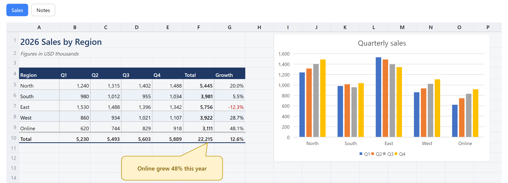
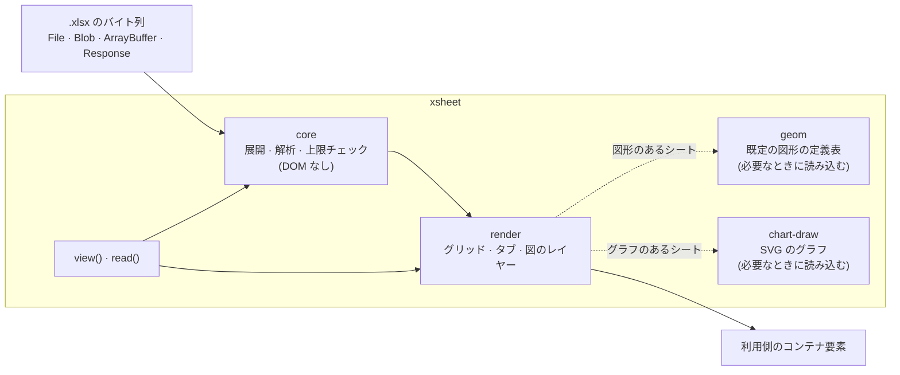

# XSheet

> `.xlsx` ファイルを、Excel で見たときと同じ見た目でブラウザに表示します。読み取り専用で、サーバーもネットワーク通信も要りません。

[](LICENSE)
[](https://nodejs.org/)
[](https://www.typescriptlang.org/)
[](https://github.com/TaekangKwon/XSheet/actions/workflows/ci.yml)

[English](README.md) · **日本語** · [한국어](README.ko.md)



_Excel で作ったブック（[`fixtures/excel/showcase.xlsx`](fixtures/excel/showcase.xlsx)）を、XSheet でブラウザに表示したところ。_

**[デモを試す](https://taekangkwon.github.io/XSheet/)** — 手元の `.xlsx` を開くか、サンプルを選べます。ファイルはブラウザの中で読み込むだけで、どこにも送信しません。

---

## なぜ作ったか

多くの Excel ビューアは、Excel で作った文書の文字やおおまかな形を、元のシートに近い形で表示してくれます。しかし、数万セルを超えるような大きな文書になると、表示が遅くなったり、表示できなかったりします。また、セルの罫線や塗りつぶし、列幅、セルの結合、シートに貼り付けたスクリーンショット、矢印やテキストボックスといった図形など、文字以外のものはうまく表現されません。そこで、自分に必要な機能を備えたビューアを作ることにしました。

私はこれまでに `.xlsx` のビューアを 2 回作りました。1 回目はプロジェクトの文書を 1 画面で読める Chrome 拡張 **InterHub**（[InterHub-MCP](https://github.com/TaekangKwon/InterHub-MCP) と一緒に配布しています）のため、2 回目は別の文書ビューアのためです。同じ表示の不具合を毎回 2 か所で直すことに疲れて、コードを 1 つのライブラリにまとめることにしました。そうして生まれたのが **XSheet** です。

XSheet はあえて 1 つのことしかしません。[SheetJS](https://sheetjs.com/) が多くの形式を読み書きできる汎用ライブラリなのに対し、XSheet は **`.xlsx` を読み込んで Excel と同じように描くこと**だけに絞っています。また、出どころの分からないファイルを開いても問題が起きないよう、最初から守りを固めて設計しています。

## 表示できるもの

| 対象 | 対応内容 |
| --- | --- |
| セル | 表示形式を適用した値、列幅と行の高さ、セルの結合、罫線、塗りつぶし、文字の装飾。Excel 16 の表示に合わせています（サイズと図の位置の誤差 1 px 以内が目標） |
| 図 | 画像、図形（176 種類すべての既定の図形と自由な形の図形）、線とコネクタ、グループ、図形内の文字。セルの上の別のレイヤーに描きます |
| グラフ | 縦棒・横棒（集合・積み上げ・100% 積み上げ）、マーカー付き折れ線、円、ドーナツ。タイトル、凡例、項目軸、値軸、目盛線を含みます。ファイルに保存された値から SVG で描きます |
| 大きなシート | 100 万セルのシートも開けます。画面に見えている範囲だけを描き、スクロールに合わせて描き足します |
| シート | シートごとにタブを表示します。非表示のシートのタブには印が付き、最初は先頭の表示シートが開きます |
| 画面の文言 | 日本語、英語、韓国語。キーごとに差し替えられます |
| テーマ | ライト、ダーク、OS の設定に合わせる。色は CSS 変数で指定します |

## クイックスタート

### `<script>` 1 つで（ビルドツールなし）

```html
<script src="xsheet.min.js"></script>
<input type="file" id="file" accept=".xlsx" />
<div id="viewer" style="height: 600px"></div>
<script>
  let viewer;
  document.querySelector('#file').onchange = async (e) => {
    viewer?.destroy();
    viewer = await XSheet.view('#viewer', e.target.files[0]);
  };
</script>
```

- `xsheet.min.js` は Releases のスタンドアロン版の zip に入っています。入手方法は「[スタンドアロン版の zip をダウンロードする](#スタンドアロン版の-zip-をダウンロードする)」を参照してください。
- `xsheet.min.js` は、依存ライブラリ（jszip、ssf）、図形の定義表、グラフの描画をすべて含んだ 1 つのファイルです。グローバル変数 `XSheet` を定義し、`file://` で開いたページでも動きます。
- CSS は自動で挿入されます。コンテナに高さがない場合は 480 px で表示し、`console.warn` を 1 回出します。
- そのまま使えるビューアのページ（ファイルを選択、またはドロップ）：[examples/standalone.html](examples/standalone.html)

### バンドラで（Vite、webpack など）

```ts
import { view } from 'xsheet';

const viewer = await view('#viewer', file, { theme: 'auto' }); // File・Blob・ArrayBuffer・Response など
viewer.destroy(); // 後片付け
```

React と Vue での使い方：[docs/guide/frameworks.md](docs/guide/frameworks.md)

### Node や Web Worker で（読み取りのみ、DOM なし）

```ts
import { openXlsx } from 'xsheet/core';

const book = await openXlsx(await readFile('book.xlsx'));
const sheet = await book.openSheet(book.sheets[0].index);
console.log(sheet.getRows(1, 10).map((row) => row.cells.map((c) => c?.text ?? '')));
book.close();
```

- `xsheet/core` は DOM も Node 固有の API も使いません。ブラウザ、Web Worker、Node 20 以上で動きます。
- `xsheet` の `read(source)` も同じことができ、`File`、`Blob`、`Response` も受け取れます。Worker で読み込む方法：[docs/guide/worker.md](docs/guide/worker.md)

## インストール

| 使い方 | 入手方法 |
| --- | --- |
| `<script>`、またはバンドラなしの `import` | [Releases](https://github.com/TaekangKwon/XSheet/releases) から `xsheet-<version>-standalone.zip` をダウンロードし、ページと同じ場所に展開します（[手順](#スタンドアロン版の-zip-をダウンロードする)）。中身：[docs/guide/standalone.md](docs/guide/standalone.md) |
| バンドラ、または Node | Git のタグからインストールします（下記） |

> [!NOTE]
> XSheet は**まだ npm に公開していません**。Git のタグごとにビルド済みの `dist/` が入っているため、タグからインストールしてもビルドスクリプトは実行されません（[ADR-0002](docs/adr/0002-build-and-distribution.md)）。

```bash
npm install github:TaekangKwon/XSheet#v0.4.1
```

- 依存パッケージは `jszip` と `ssf` の 2 つだけで、一緒にインストールされます。
- `view`、`read`、`xsheet/core`、`MESSAGES_KO`、スタンドアロン版は v0.2.0 から、グラフの表示、`readChart`、`xsheet-chart.mjs` は v0.3.0 から、`tabPosition` は v0.4.0 から使えます。

### スタンドアロン版の zip をダウンロードする

1. [最新のリリース](https://github.com/TaekangKwon/XSheet/releases/latest)を開きます（以前の版は [Releases](https://github.com/TaekangKwon/XSheet/releases) にあります）。
2. **Assets** から `xsheet-<version>-standalone.zip` をダウンロードします。「Source code」のアーカイブはリポジトリのソースで、ビルド済みのライブラリではありません。
3. 展開すると `xsheet-<version>/` フォルダができます。
   - すぐに試すなら、`viewer.html` をダブルクリックして（`file://` で動きます）、`.xlsx` ファイルを選ぶかドロップします。ファイルはブラウザの中で読み込むだけで、どこにも送信しません。
   - 自分のページで使うなら、`xsheet.min.js` をページと同じ場所にコピーし、[クイックスタート](#クイックスタート)の例のとおりに書きます。バンドラなしで `import` するなら、`xsheet.mjs`・`xsheet-geom.mjs`・`xsheet-chart.mjs` を同じフォルダにコピーします。
4. これらのファイルを再配布するときは、`xsheet.licenses.txt`・`LICENSE`・`NOTICE` を一緒に置いてください。

## 仕組み



- **core** は zip と XML をシートごとに必要になった時点で読み込み、すべてのサイズを上限と照らし合わせます。DOM にはまったく触れないので、Node や Worker でも動きます。
- **render** は画面に見えている行と列だけをスクロールするグリッドに描き、画像・図形・グラフをその上のレイヤーに重ねます。
- **geom**（図形の定義表。gzip 後で約 30 KB）と **chart-draw**（約 16 KB）は別のチャンクに分かれています。シートに図形やグラフが実際にあるときだけ読み込まれます。

## API

### `view(target, source, options?)`

ブック全体をシートのタブ付きで表示します。戻り値は `Promise<Viewer>` です。

| 引数 | 説明 |
| --- | --- |
| `target` | 要素、または CSS セレクタ。XSheet はその中に子要素 `div.xs-viewer` を追加するだけで、コンテナ自体は変更しません |
| `source` | `File`、`Blob`、`ArrayBuffer`、型付き配列（`Uint8Array` など）、`DataView`、`Response`、またはそれらを返す Promise |

- URL の文字列を渡すと `TypeError` になります。XSheet は自分からは何も取得しないためです。URL にあるファイルを表示するには `XSheet.view('#v', fetch(url))` のように書いてください。失敗した `Response`（`ok` が false）も `TypeError` です。
- 開けないファイル（暗号化されている、壊れている、大きすぎる、対応していない形式）でも例外は投げません。代わりにビューアの中にメッセージのバー（`div.xs-banner`）を表示し、`sheets` は空になります。
- 同じコンテナに `view` をもう一度呼ぶと、前の表示を自動で置き換えます。先に `destroy()` を呼ぶ必要はありません。1 回目の読み込み中に 2 回目の呼び出しが始まった場合、1 回目の呼び出しは空の `Viewer` を返します。

#### オプション（すべて省略可）

| オプション | 既定値 | 説明 |
| --- | --- | --- |
| `lang` | `'auto'` | `'ja'`・`'en'`・`'ko'`・`'auto'` のいずれか。`auto` は `<html lang>`、ブラウザの言語の順に確認し、合うものがなければ英語を使います |
| `messages` | — | `lang` で選んだ文言の一部だけを上書きします。キーの一覧：[docs/02_architecture.md](docs/02_architecture.md) §7 |
| `theme` | `'light'` | `'light'`・`'dark'`・`'auto'`（`prefers-color-scheme` に従う）。[docs/guide/theme.md](docs/guide/theme.md) を参照 |
| `css` | `'auto'` | CSS を `<style>` として 1 回だけ挿入します。`style.css` や `xsheet.css` を読み込み済みなら挿入しません。`'none'` なら常に挿入しません |
| `height` | `'auto'` | コンテナの高さが 0 のときだけ 480 px で表示します。数値は px、文字列は CSS の長さ（`'70vh'` など） |
| `drawings` | `true` | 図のレイヤー（画像、図形、線、グラフ）を表示するかどうか |
| `tabPosition` | `'top'` | シートタブを置く場所。`'top'`（表の上）か `'bottom'`（Excel と同じく表の下） |
| `nonce` | — | 自動で挿入する `<style>` と書式用の `<style>` に付ける nonce（CSP 用。[docs/guide/csp.md](docs/guide/csp.md) を参照） |
| `limits` | `DEFAULT_LIMITS` | 読み取りの上限の一部を変更します |

#### `Viewer`

| メンバー | 説明 |
| --- | --- |
| `sheets` | シートの一覧（`SheetInfo[]`：`index`（1 始まり）、`name`、`hidden`）。タブの順で、非表示のシートも含みます |
| `showSheet(index または name)` | タブをクリックしたのと同じようにシートを切り替えます。存在しない番号や名前なら `RangeError` |
| `destroy()` | 表示を消し、ブック、イベントリスナー、blob URL を解放します。何度呼んでも安全です |

### `read(source, options?)`

DOM を使わずにブックを開きます。`openXlsx` と同じですが、`view` と同じ形式の入力を受け取れます。戻り値は `Promise<XlsxBook>` で、使い終わったら呼び出し側で `close()` してください。

```ts
import { read, XlsxError } from 'xsheet';

try {
  const book = await read(fetch('/files/book.xlsx'), { limits: { maxSheetXmlBytes: 32 * 1024 * 1024 } });
  const sheet = await book.openSheet(book.sheets[0].index);
  const rows = sheet.getRows(1, 100); // 1〜100 行目：表示どおりの文字、書式、罫線の番号
  book.close();
} catch (e) {
  if (e instanceof XlsxError) console.log(e.kind); // 'not-zip' | 'encrypted' | 'broken' | 'too-large' | 'unsupported'
}
```

### 低レベル API（`renderWorkbook`・`renderSheet`・`openXlsx`）

`view` が内部で使っている API です。CSS の読み込み、サイズ、画面の文言を自分で制御したいときに使います。

#### ブック全体をタブ付きで表示する

```ts
import { renderWorkbook } from 'xsheet/render';
import 'xsheet/style.css';

const container = document.getElementById('viewer')!; // 高さが決まっている要素
const data = await file.arrayBuffer(); // .xlsx のバイト列（ArrayBuffer または Uint8Array）

const wb = await renderWorkbook(container, data);
wb.sheets; // SheetInfo[]（開けなかったときは空）
await wb.showSheet(2); // SheetInfo.index（1 始まり）
wb.destroy(); // リスナーと blob URL を解放し、ブックを閉じ、表示を消す
```

- コンテナは**必ず高さが決まっている必要があります**（`height: 100%` の親要素の中、flex の子要素など）。内側のスクロール領域 `.xs-body` が、どこまで見えているかを決めるためです。`view` と違い、既定の高さは付けません。
- CSS も自動では挿入しません。`xsheet/style.css` を import するか、`<link>` で読み込んでください。
- 開けないファイルでも例外は投げず、表示領域の中にメッセージを出します。

#### 1 つのシートだけを表示する

```ts
import { openXlsx } from 'xsheet';
import { renderSheet } from 'xsheet/render';
import 'xsheet/style.css';

const book = await openXlsx(data);
const first = book.sheets.find((s) => !s.hidden) ?? book.sheets[0];
const sheetView = await renderSheet(container, book, first.index);
// …
sheetView.destroy(); // ブックは閉じない
book.close();
```

#### オプション（`renderWorkbook`・`renderSheet`）

| オプション | 既定値 | 説明 |
| --- | --- | --- |
| `messages` | 日本語（`MESSAGES_JA`） | 画面の文言。一部のキーだけを渡しても構いません。英語なら `MESSAGES_EN`、韓国語なら `MESSAGES_KO` を渡します |
| `drawings` | `true` | 図のレイヤーを表示するかどうか。`false` なら図をそもそも読み込みません |
| `tabPosition` | `'top'` | シートタブを置く場所。`'top'` か `'bottom'`（`renderWorkbook` のみ） |
| `nonce` | — | 書式用の `<style>` 要素に付ける nonce（CSP の `style-src 'nonce-…'` 用） |
| `limits` | `DEFAULT_LIMITS` | 読み取りの上限（`renderWorkbook` のみ。`renderSheet` を使うときは `openXlsx` に渡します） |
| `zoom` | `1` | 最初の倍率（v0.5.0）。0.5〜2.0 の数か、使っている列を表示の幅に合わせる `{ fit: 'width' }`（`min`・`max` の既定は 0.5・2.0）。範囲の外の数は端の値にし、`NaN` やその他の値は `RangeError` |
| `headers` | `true` | `false` なら行番号と列見出しを出さず、セルを左上の角から描きます（v0.5.0） |

### 検索・ハイライト・拡大縮小（v0.5.0）

`renderWorkbook`・`renderSheet` が返す表示には、検索結果の表示・スクロール・位置の判定・拡大縮小のメンバーがあります（`WorkbookView` は `SheetView` を拡張したもの）。`view` とその `Viewer` には、まだありません。

```ts
import { findText, openXlsx } from 'xsheet';
import { renderWorkbook } from 'xsheet/render';

const bytes = await file.arrayBuffer();
const wb = await renderWorkbook(container, bytes, { zoom: { fit: 'width' } });
const book = await openXlsx(bytes); // renderWorkbook は開いたブックを外に出さないので、検索用にもう 1 つ開く（閉じるのは呼ぶ側）

const ac = new AbortController();
const shown = wb.sheets.find((s) => !s.hidden) ?? wb.sheets[0]; // 最初に表示されるシート
const sheet = await book.openSheet(shown.index);
const { matches, truncated } = await findText(sheet, '合計', { signal: ac.signal });
wb.setHighlights(matches);
wb.focusHighlight(0); // 最初のヒットまでスクロールし、今のヒットにする

container.addEventListener('click', (e) => {
  const hit = wb.highlightAt(e.clientX, e.clientY);
  if (hit >= 0) wb.focusHighlight(hit, { scroll: false });
});
```

| メンバー | 説明 |
| --- | --- |
| `findText(sheet, query, options?)` | `xsheet`・`xsheet/core` から。表示どおりの文字（表示形式を当てた後）を探します。結果は `{ matches, truncated }` で、一致は `{ r, c, start, end }`（セルは 1 始まり、位置は UTF-16 で `end` を含まない）。オプション：`match`（`'partial'` か `'cell'`）、`ignoreCase`（`true`）、`ignoreNewlines`（`true`）、`skipHidden`（`true`）、`signal`（中断すると `AbortError` の `DOMException` で reject）、`maxMatches`（10,000。最大 100,000）。約 10ms ごとにページへ処理を返します |
| `setHighlights(matches)` | 一致を光らせます。`null` か `[]` で消します。スクロールしても残り、シートを替えると消えます。色は `--xs-hit-bg`・`--xs-hit-current-bg` |
| `focusHighlight(index, options?)` | 一致の 1 つ（`setHighlights` に渡した配列の番号）を今のヒットにし、表示の上から約 1/3 の位置までスクロールします。`{ scroll: false }` なら印だけ、`{ smooth: true }` ならなめらかに、`-1` で印を外します |
| `scrollToCell(r, c, options?)` | セル（1 始まり）を同じ方法で見える位置までスクロールします |
| `cellAt(clientX, clientY)` | 画面上の位置にあるセル `{ r, c }`。見出し・スクロールバー・表の外では `null`。結合したセルは左上、はみ出した文字はその元のセルを返します |
| `highlightAt(clientX, clientY)` | その位置にある一致の番号。無ければ `-1` |
| `setZoom(zoom)`・`zoom` | 倍率を変える（値は `zoom` オプションと同じ）・読む。左上のセルは動きません。見出しの大きさは変わらず（100% 未満では行番号の文字だけ小さくなります）、線の太さも変わりません |
| `showSheet(index)` | 表示を作り直さずにシートを替えます。倍率は保ち、ハイライトは消します。`renderSheet` の戻り値にもあります |

- 表示に CSS の `transform` で倍率を掛けないでください。`cellAt`・`highlightAt` が違うセルを指します。`setZoom` を使います。

API の全体は [docs/02_architecture.md](docs/02_architecture.md) の §2（core）と §3（render と `view` の層）にまとめています。

### エントリポイント

| import | 内容 |
| --- | --- |
| `xsheet` | すべて：`view`、`read`、および `xsheet/core` と `xsheet/render` の公開 API 全部 |
| `xsheet/core` | 読み取り（`openXlsx`、`findText`（文字の検索・v0.5.0）、`XlsxError`、`DEFAULT_LIMITS`、単位の換算など）と型。DOM と Node 固有の API を使わないことを保証します（Worker・Node 向け） |
| `xsheet/render` | 表示（`renderWorkbook`、`renderSheet`、`MESSAGES_JA`、`MESSAGES_EN`、`MESSAGES_KO`） |
| `xsheet/style.css` | CSS（ライトの既定値と、`data-xs-theme` 用のダークの値） |
| `xsheet/geom` | 図形の定義表と、その数式の評価。`render` が動的に import するので、通常は直接使いません |
| `xsheet/internal` | `render` が使う半公開のモジュール。**バージョン間の互換性は保証しません** |

- ESM のみです。型定義を同梱しています（TypeScript の `moduleResolution: "bundler"` が前提です）。
- Node で `xsheet` を import しても、読み込んだ時点では DOM に触れません。ただし、DOM を使わないと保証しているのは `xsheet/core` だけです。
- 図形の定義表は図形のあるシートを、グラフの描画はグラフのあるシートを開いたときだけ読み込まれます。利用側のバンドラでも別のチャンクになります。サイズ：[docs/02_architecture.md](docs/02_architecture.md) §8

## テーマ

- ダークで表示するには、`view` に `theme: 'dark'` を渡します（`'auto'` なら OS の設定に合わせます）。`renderWorkbook` などを使う場合は、表示のルート要素か `<html>` などの祖先要素に `data-xs-theme="dark"`（または `"auto"`）を付けます。ダークの値は `style.css` に含まれているので、自分で書き写す必要はありません。
- 色は 16 個の CSS 変数（`--xs-*`）で変えられます。既定値の詳細度は 0（`:where(:root, :host)`）なので、Shadow DOM の中を含め、どこからでも上書きできます。

```css
/* ライトテーマのアクセントカラーだけを変える */
:root {
  --xs-accent: #0f766e;
}
```

ダークの値の変え方と Shadow DOM での注意点は [docs/guide/theme.md](docs/guide/theme.md)、各変数の役割は [docs/02_architecture.md](docs/02_architecture.md) §6 にあります。ファイルに含まれる色（塗りつぶし、文字の色、図形の色）は変数を通さず、そのままの色で描きます。

## 画面の文言

- 日本語（`MESSAGES_JA`）、英語（`MESSAGES_EN`）、韓国語（`MESSAGES_KO`）を同梱しています。キーは 23 個です（[docs/02_architecture.md](docs/02_architecture.md) §7）。
- `view` は `lang`（既定値 `auto`）で言語を選びます。`renderWorkbook` と `renderSheet` の既定は日本語です。
- 一部の文言だけを変えるには、`messages: { noData: '（空）' }` のように渡します。
- `view` と `read` が出す開発者向けのエラーと警告は英語で、`XSheet:` から始まります。

## セキュリティモデル

XSheet は、開く `.xlsx` がすべて悪意のあるファイルかもしれないという前提で作っています。

- **通信しません。** ライブラリが自分から何かを取得したり、送信したり、外部に知らせたりすることはありません。渡されたバイト列を読むだけです。
- **コードを生成しません。** `eval`、`new Function`、文字列を渡すタイマーは使いません。スタンドアロン版でもこれを検査しています。
- **ファイルの HTML を入れません。** ファイル内の文字は `textContent` を通してだけ DOM に入ります。画像は `blob:` URL で表示します。
- **あらゆる箇所に上限があります。** 展開後のサイズ、各パーツのサイズ、件数、図形の数式、画像のサイズ、グラフのデータ点の数に、合わせて 29 の上限があります。上限を超えると `XlsxError('too-large')` になるか（`view` と `renderWorkbook` ではメッセージを表示）、その図だけを簡略化して描き、お知らせを表示します。既定値は `DEFAULT_LIMITS` にあり（一覧：[docs/02_architecture.md](docs/02_architecture.md) §5）、`limits` で一部を変更できます。
- **エラーに中身を含めません。** 例外のメッセージには、セルの値もシート名も含めません。

### コンテンツセキュリティポリシー（CSP）

| ディレクティブ | 必要な理由 |
| --- | --- |
| `script-src 'self'` | ライブラリと図形の定義表を同じオリジンから読み込みます。スタンドアロン版も含め、`'unsafe-eval'` は不要です |
| `style-src 'nonce-<値>'`（または `'unsafe-inline'`） | 書式用の `<style>` と、`view` が挿入する `<style>` のため。どちらにも渡した `nonce` が付きます |
| `img-src blob:` | 画像を blob URL で表示するため |

`<style>` の自動挿入を避けたい場合は、`css: 'none'` にして `xsheet.css`（`style.css`）を `<link>` で読み込んでください。詳しくは [docs/guide/csp.md](docs/guide/csp.md) を参照してください。

脆弱性の報告方法は [SECURITY.md](SECURITY.md) をご覧ください。

## 制限事項

- **読み取り専用です。** 書き込みや編集はできません。
- **`.xlsx` のみに対応しています。** `.xls`（BIFF）、`.ods`、`.csv` は開けません。`.xls` は SheetJS など別のライブラリで扱ってください。
- **数式は計算しません。** Excel がファイルに保存した値を表示します。
- **対応していないグラフ**（面、散布図、組み合わせ、第 2 軸、3-D、Excel 2016 以降に追加された種類など）は、破線の枠の中にグラフの種類名だけを表示します。
- **まだ描画しないもの：** 条件付き書式、テーブルのスタイル、配置と折り返し、フォント名、セル内の一部の文字だけに付けた書式（[docs/04_roadmap.md](docs/04_roadmap.md) M7）
- **まだ確定していない規則があります。** 罫線と表示形式の一部のケースは、Excel との突き合わせがまだ済んでいません（分かっている差異：[docs/05_quality.md](docs/05_quality.md)）。

## 対応環境

- `xsheet/core`：ES2022 に対応したブラウザ、Web Worker、Node 20 以上
- `view`、`xsheet/render`、スタンドアロン版：Chrome、Edge、Firefox、Safari の最新 2 バージョン

## ディレクトリ構成

```text
XSheet/
├── src/
│   ├── core/          # 読み取り：zip、XML、セル、スタイル、図、グラフ、上限（DOM なし）
│   ├── geom/          # 既定の図形の定義表と数式の評価（必要なときに読み込む）
│   ├── render/        # グリッド、タブ、図のレイヤー、SVG のグラフ、画面の文言
│   ├── facade/        # view() と read()：1 行で使える入口の層
│   └── style.css      # CSS（ライト＋ダーク）
├── examples/          # サンプルページ（開発サーバー用とスタンドアロン版用）
├── fixtures/excel/    # Excel で作った基準の .xlsx と、Excel から取得した値
├── tests/             # Vitest + jsdom
├── tools/             # スタンドアロン版のビルド、サイズの検査、図形の定義表の生成
└── docs/              # 設計文書、ADR、ガイド（日本語）
```

## 開発

開発には Node 22.12 以上が必要です。

| コマンド | 用途 |
| --- | --- |
| `npm run test` | テスト（Vitest） |
| `npm run typecheck`・`npm run lint`・`npm run format:check` | 型検査、ESLint、Prettier |
| `npm run build` | `dist/` をビルド（Vite のライブラリモード → d.ts → スタンドアロン版） |
| `npm run check:consumer` | 一時的なプロジェクトから `dist/` を import し、型検査とビルドが通るか、パッケージの中身が正しいかを確認 |
| `npm run check:standalone` | スタンドアロン版が jsdom と素の Node で動くか、型がコンパイルできるかを確認 |
| `npm run size` | エントリポイントごと、スタンドアロン版のファイルごとのサイズを上限と比較 |
| `npm run examples` | サンプルページを起動（http://localhost:5173/examples/）。ファイルの選択、テーマと言語の切り替えができます |
| `npm run examples:static` | `npm run build` の後、スタンドアロン版のサンプルを http で配信（http://localhost:5174/examples/esm.html） |

決まりごと：`core` と `geom` では DOM と Node 固有の API を使いません。ADR なしに依存パッケージを増やしません。テストデータは、コードで合成したもの（`src/testing/make-xlsx.ts`）か、作者が Excel で作ったファイルだけを使います。そのほかの決まりは [CLAUDE.md](CLAUDE.md) にあります。

`npm run sync:status` と `npm run sync:patch` は、XSheet の元になった非公開のプロジェクト InterHub から変更を取り込むコマンドです。使えるのはメンテナーだけです（[ADR-0003](docs/adr/0003-universal-distribution.md) §4）。

## ドキュメント

設計文書とガイドは日本語で書いています。

| 文書 | 内容 |
| --- | --- |
| [docs/guide/](docs/guide/README.md) | 使い方のガイド：スタンドアロン版、React と Vue、Worker、CSP、テーマ |
| [docs/](docs/README.md) | 要件、設計、ロードマップ、品質の記録 |
| [docs/adr/](docs/adr/) | 設計判断の記録（ADR） |
| [CHANGELOG.md](CHANGELOG.md) | 変更履歴 |

## 謝辞

- 既定の図形の定義表は、ECMA-376（Ecma International）の `presetShapeDefinitions.xml` から生成しています。その著作権表示は [NOTICE](NOTICE) にあり、すべての配布物に含まれます。
- zip の読み込みには [JSZip](https://stuk.github.io/jszip/)、表示形式の処理には [SSF](https://github.com/SheetJS/ssf) を使っています。
- XSheet は、InterHub の `.xlsx` ビューアを切り出して作ったライブラリです。

## 開発元

このプロジェクトは、岡山県笠岡市の小さなソフトウェア会社 **株式会社システム・エムズ**（SYSTEM EMUZU CO.,LTD.、2000 年設立）の Kwon がメンテナンスしています。\
私たちは「create rich time」をモットーに、ミスや手間を減らして使う人の時間を豊かにするシステムを作っているチームです。イベントの受付、土木・建築の積算、生産管理など、業務で使う Web システムを設計から保守まで手がけています。

- 🌐 [公式ホームページ](https://msap2.jp/emuzu/)
- ✍️ [技術ブログ](https://msap2.jp/emuzu/blog/) — 自社で作ったアプリや AI の活用について

## ライセンス

[MIT](LICENSE)。図形の定義表には Ecma International の著作権表示が [NOTICE](NOTICE) として付いています。また、スタンドアロン版は依存ライブラリを含んでいるため、そのライセンスを `xsheet.licenses.txt` として一緒に配布しています。再配布するときは、`LICENSE`、`NOTICE`、`xsheet.licenses.txt` を一緒に置いてください。
