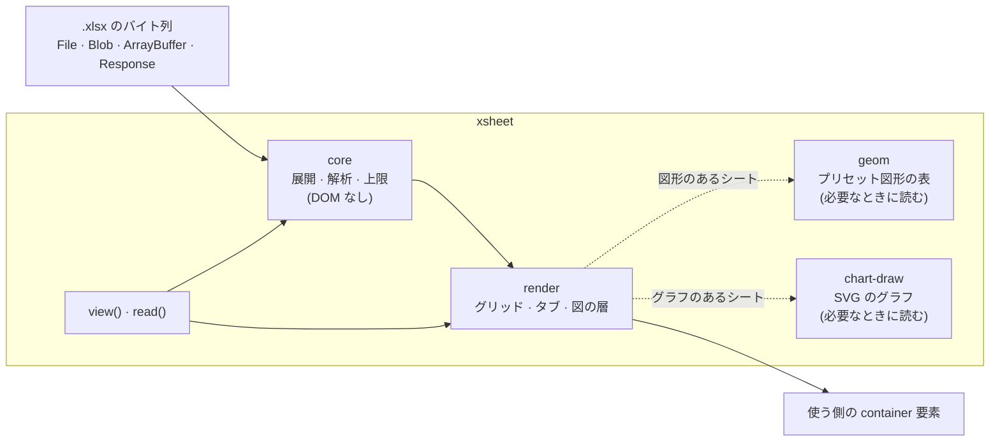

# XSheet

> `.xlsx` を Excel どおりにブラウザで表示する。読み取り専用で、サーバーも通信も要らない。

[](LICENSE)
[](https://nodejs.org/)
[](https://www.typescriptlang.org/)
[](https://github.com/TaekangKwon/XSheet/actions/workflows/ci.yml)

[English](README.md) · **日本語** · [한국어](README.ko.md)

---

## なぜ作ったか

仕様書や設計書を Excel で書くチームでは、情報はシートの*見た目*に入っている。罫線・塗り・列幅・結合セル・貼り付けたスクリーンショット、その上に引いた箱と矢印。値だけを並べた表にすると、その大半が消える。

私は `.xlsx` のビューアを 2 回書いた。1 つは **InterHub**（プロジェクトの文書を 1 画面で見せる Chrome 拡張。[InterHub-MCP](https://github.com/TaekangKwon/InterHub-MCP) と一緒に配る）、もう 1 つは別の文書ビューアだ。同じ描画の不具合を 2 か所で直すのに疲れて、コードを 1 つのライブラリにまとめた。それが **XSheet** だ。

やることは意図して 1 つに絞っている。[SheetJS](https://sheetjs.com/) は多くの形式を読み書きするが、XSheet は **`.xlsx` を読んで、Excel どおりに描く**ことだけをする。自分で作ったのではないファイルにも耐えるように作ってある。

## 何を描くか

| 領域 | 対応 |
| --- | --- |
| セル | 表示形式つきの値・列幅と行高・結合・罫線・塗り・文字の装飾。Excel 16 の表示に合わせる（寸法と図の位置は 1 px 以内が目標） |
| 図 | 画像・図形（プリセットの形 176 種すべてと自由な形）・線とコネクタ・グループ・図形の中の文字。セルの上の層に描く |
| グラフ | 縦棒・横棒（集合・積み上げ・100 % 積み上げ）、マーカー付きの折れ線、円、ドーナツ。タイトル・凡例・項目軸と値軸・目盛線つき。ファイルに保存された値から SVG で描く |
| 大きなシート | 100 万セルのシートが開く。見えている範囲だけを描き、スクロールで描き足す |
| シート | シートごとにタブを出す。非表示のシートには印の付いたタブが出て、最初に開くのは最初の表示シート |
| 画面の文言 | 日本語・英語・韓国語。キーごとに差し替えられる |
| テーマ | 明るい・暗い・OS に合わせる。色は CSS 変数 |

## 3 行で始める

### `<script>` 1 つ（ビルドの道具なし）

```html
<script src="xsheet.min.js"></script>
<input type="file" id="file" accept=".xlsx" />
<div id="viewer" style="height: 600px"></div>
<script>
  let viewer;
  document.querySelector('#file').onchange = async (e) => {
    viewer?.destroy();
    viewer = await XSheet.view('#viewer', e.target.files[0]);
  };
</script>
```

- `xsheet.min.js` は依存（jszip・ssf）と形の表とグラフの描画を中に持つ 1 ファイル。大域の `XSheet` を作る。`file://` で開いたページでも動く。
- CSS は自動で入る。container に高さが無いときは 480 px で出し、`console.warn` を 1 回出す。
- 出来上がりのビューア（ファイルを選ぶ・ドロップする）：[examples/standalone.html](examples/standalone.html)。

### バンドラ（Vite・webpack など）

```ts
import { view } from 'xsheet';

const viewer = await view('#viewer', file, { theme: 'auto' }); // File・Blob・ArrayBuffer・Response など
viewer.destroy(); // 片付け
```

React・Vue での置き方は [docs/guide/frameworks.md](docs/guide/frameworks.md)。

### Node・Worker（読み取りだけ・DOM なし）

```ts
import { openXlsx } from 'xsheet/core';

const book = await openXlsx(await readFile('book.xlsx'));
const sheet = await book.openSheet(book.sheets[0].index);
console.log(sheet.getRows(1, 10).map((row) => row.cells.map((c) => c?.text ?? '')));
book.close();
```

- `xsheet/core` は DOM も Node 固有の API も使わない。ブラウザ・Web Worker・Node 20 以上で動く。
- `xsheet` の `read(source)` も同じ（`File`・`Blob`・`Response` も受ける）。Worker で読む例は [docs/guide/worker.md](docs/guide/worker.md)。

## 入れ方

| 使い方 | 入れ方 |
| --- | --- |
| `<script>`・バンドラ無しの `import` | [Releases](https://github.com/TaekangKwon/XSheet/releases) から `xsheet-<version>-standalone.zip` を取り、ページの隣に展開して置く。中身は [docs/guide/standalone.md](docs/guide/standalone.md) |
| バンドラ・Node | Git のタグから入れる（下） |

> [!NOTE]
> XSheet は**まだ npm に公開していない**。Git のタグごとにビルド済みの `dist/` が入っているので、タグから入れてもビルドのスクリプトは走らない（[ADR-0002](docs/adr/0002-build-and-distribution.md)）。

```bash
npm install github:TaekangKwon/XSheet#v0.3.0
```

- 依存は `jszip` と `ssf` だけ（一緒に入る）。
- `view`・`read`・`xsheet/core`・`MESSAGES_KO`・単独版は v0.2.0 から。グラフの表示・`readChart`・`xsheet-chart.mjs` は v0.3.0 から。

## 仕組み



- **core** は zip と XML をシートごとに遅延して読み、大きさはすべて上限と照らす。DOM に触れないので、Node や Worker でも動く。
- **render** は見えている行と列をスクロールするグリッドに描き、画像・図形・グラフをその上の層に置く。
- **geom**（形の表。gzip 約 30 KB）と **chart-draw**（約 16 KB）は別のチャンク。図形やグラフのあるシートを開いたときだけ読まれる。

## API

### `view(target, source, options?)`

ブック全体をタブ付きで出す。戻り値は `Promise<Viewer>`。

| 引数 | 内容 |
| --- | --- |
| `target` | 表示を置く要素か CSS セレクタ。子として `div.xs-viewer` を足す（container 自身は変えない） |
| `source` | `File`・`Blob`・`ArrayBuffer`・型付き配列（`Uint8Array` など）・`DataView`・`Response`、またはそれらの Promise |

- URL の文字列は受けない（`TypeError`）。XSheet は自分では何も取りにいかない。URL から出すなら `XSheet.view('#v', fetch(url))` と書く。失敗した `Response`（`ok` が false）も `TypeError`。
- 開けないファイル（暗号化・壊れている・大きすぎる・対応しない形式）は例外にせず、表示の中に文言の帯（`div.xs-banner`）を出す。このとき `sheets` は空。
- 同じ container にもう一度 `view` すると、前の表示を外してから出す（`destroy()` は要らない）。読み込み中に次の `view` が来たら、前の呼び出しは表示の無い `Viewer`（`sheets` が空）を返す。

#### 指定（どれも省略できる）

| 指定 | 既定 | 内容 |
| --- | --- | --- |
| `lang` | `'auto'` | `'ja'`・`'en'`・`'ko'`・`'auto'`。`auto` は `<html lang>` → ブラウザの言語の順に見て、合うものが無ければ英語 |
| `messages` | なし | 文言を一部だけ替える（`lang` で選んだ表の上に重ねる）。キーは [docs/02_architecture.md](docs/02_architecture.md) §7 |
| `theme` | `'light'` | `'light'`・`'dark'`・`'auto'`（OS の `prefers-color-scheme` に従う）。[docs/guide/theme.md](docs/guide/theme.md) |
| `css` | `'auto'` | 表示の CSS を `<style>` で 1 回だけ入れる。`style.css`・`xsheet.css` を読み込み済みなら入れない。`'none'` なら入れない |
| `height` | `'auto'` | container の高さが 0 のときだけ 480 px にする。数値は px、文字列は CSS の長さ（`'70vh'` など） |
| `drawings` | `true` | 図の層（画像・図形・線・グラフ）を出すか |
| `nonce` | なし | 自動で入れる `<style>` と書式の `<style>` に付ける nonce（CSP 用。[docs/guide/csp.md](docs/guide/csp.md)） |
| `limits` | `DEFAULT_LIMITS` | 読み取りの上限を一部だけ替える |

#### `Viewer`

| メンバ | 内容 |
| --- | --- |
| `sheets` | シートの一覧（`SheetInfo[]`：`index`（1 始まり）・`name`・`hidden`）。タブの並びで、非表示のシートも入る |
| `showSheet(index か name)` | シートを替える（タブを押したのと同じ）。無い番号・名前は `RangeError` |
| `destroy()` | 表示を外し、ブック・リスナ・blob URL を放す。何度呼んでもよい |

### `read(source, options?)`

DOM なしでブックを開く。`openXlsx` と同じで、受け取れる形を `view` と揃えたもの。戻り値は `Promise<XlsxBook>`（閉じるのは呼び出し側の `close()`）。

```ts
import { read, XlsxError } from 'xsheet';

try {
  const book = await read(fetch('/files/book.xlsx'), { limits: { maxSheetXmlBytes: 32 * 1024 * 1024 } });
  const sheet = await book.openSheet(book.sheets[0].index);
  const rows = sheet.getRows(1, 100); // 1〜100 行目（表示どおりの文字・書式・罫線の番号）
  book.close();
} catch (e) {
  if (e instanceof XlsxError) console.log(e.kind); // 'not-zip' | 'encrypted' | 'broken' | 'too-large' | 'unsupported'
}
```

### 細かく作る（`renderWorkbook`・`renderSheet`・`openXlsx`）

`view` の下にある道具。CSS の読み込み・高さ・文言の表を自分で決めたいときに使う。

#### ブック全体をタブ付きで表示する

```ts
import { renderWorkbook } from 'xsheet/render';
import 'xsheet/style.css';

const container = document.getElementById('viewer')!; // 高さが決まっている要素
const data = await file.arrayBuffer(); // .xlsx のバイト列（ArrayBuffer か Uint8Array）

const wb = await renderWorkbook(container, data);
wb.sheets; // SheetInfo[]（開けなかったときは空）
await wb.showSheet(2); // SheetInfo.index（1 始まり）
wb.destroy(); // リスナ・blob URL を放し、ブックを閉じ、表示を外す
```

- `container` は**高さが決まっていること**（`height: 100%` の祖先・flex の子など）。中のスクロール枠 `.xs-body` が、見えている範囲を決める窓になる。`view` と違い、既定の高さは付けない。
- CSS は自動で入らない。`xsheet/style.css` を import するか `<link>` で読む。
- 開けないファイルでも例外にせず、表示の中に文言を出す。

#### 1 シートだけ表示する

```ts
import { openXlsx } from 'xsheet';
import { renderSheet } from 'xsheet/render';
import 'xsheet/style.css';

const book = await openXlsx(data);
const first = book.sheets.find((s) => !s.hidden) ?? book.sheets[0];
const sheetView = await renderSheet(container, book, first.index);
// …
sheetView.destroy(); // ブックは閉じない
book.close();
```

#### 指定（`renderWorkbook`・`renderSheet`）

| 指定 | 既定 | 内容 |
| --- | --- | --- |
| `messages` | 日本語（`MESSAGES_JA`） | 文言。一部のキーだけ渡してもよい。英語は `MESSAGES_EN`、韓国語は `MESSAGES_KO` を渡す |
| `drawings` | `true` | 図の層（画像・図形・線・グラフ）を出すか。`false` なら図を読まない |
| `nonce` | なし | 書式の `<style>` 要素に付ける nonce（CSP の `style-src 'nonce-…'` 用） |
| `limits` | `DEFAULT_LIMITS` | 読み取りの上限（`renderWorkbook` だけ。`renderSheet` では `openXlsx` に渡す） |

API の全体は [docs/02_architecture.md](docs/02_architecture.md) §2（core）・§3（render と入口の層）。

### 入口（サブパス）

| import | 中身 |
| --- | --- |
| `xsheet` | 全部：`view`・`read` と、`xsheet/core`・`xsheet/render` の公開物すべて |
| `xsheet/core` | 読み取りだけ（`openXlsx`・`XlsxError`・`DEFAULT_LIMITS`・寸法の換算など）と型。DOM・Node 固有の API を使わないことを約束する入口（Worker・Node 向け） |
| `xsheet/render` | 表示（`renderWorkbook`・`renderSheet`・`MESSAGES_JA`・`MESSAGES_EN`・`MESSAGES_KO`） |
| `xsheet/style.css` | 表示の CSS（明るい既定値と `data-xs-theme` のダーク） |
| `xsheet/geom` | 図形の形の表と式の評価。render が動的に import するので、ふつうは直接使わない |
| `xsheet/internal` | render が使う半公開の部品。**版の互換を約束しない** |

- ESM だけ。型は同梱（TypeScript は `moduleResolution: "bundler"` が前提）。
- `xsheet` を Node で import しても、読み込んだ時点では DOM に触れない。ただし DOM を使わないと約束するのは `xsheet/core` だけ。
- 形の表は図形のあるシートを、グラフの描画はグラフのあるシートを開いたときだけ読まれる（使う側のビルドでも別のチャンクになる）。大きさは [docs/02_architecture.md](docs/02_architecture.md) §8。

## 見た目（テーマと CSS 変数）

- ダーク表示は `view` の `theme: 'dark'`（OS に合わせるなら `'auto'`）。`renderWorkbook` などでは、表示の根か祖先（`<html>` など）に `data-xs-theme="dark"`（または `"auto"`）を付ける。ダークの値は `style.css` が持つので、使う側が写す必要はない。
- 色は CSS 変数 `--xs-*`（14 個）で替えられる。既定値は詳細度 0（`:where(:root, :host)`）なので、どこで上書きしてもよい（Shadow DOM の中でも効く）。

```css
/* 明るい表示の強調の色だけ替える */
:root {
  --xs-accent: #0f766e;
}
```

ダークの値の替え方・Shadow DOM の注意は [docs/guide/theme.md](docs/guide/theme.md)、変数の役割は [docs/02_architecture.md](docs/02_architecture.md) §6。ファイルから来る色（塗り・文字の色・図形の色）は変数を通さず、ファイルの色のまま描く。

## 文言

- 同梱は日本語（`MESSAGES_JA`）・英語（`MESSAGES_EN`）・韓国語（`MESSAGES_KO`）。23 キー（[docs/02_architecture.md](docs/02_architecture.md) §7）。
- `view` は `lang` で選ぶ（既定 `auto`）。`renderWorkbook`・`renderSheet` の既定は日本語のまま。
- 一部だけ替えるなら `messages: { noData: '（空）' }` のように渡す。
- 使う側（開発者）向けの `view`・`read` の例外と警告は英語で、`XSheet:` で始まる。

## セキュリティの考え方

XSheet は、開く `.xlsx` がすべて悪意のあるものかもしれないと考える。

- **通信しない。** ライブラリは取得も送信も外への連絡もしない。渡されたバイト列を読むだけ。
- **コードを生成しない。** `eval`・`new Function`・文字列のタイマーを使わない。単独版もこれを検査している。
- **ファイルから HTML を入れない。** ファイルの文字は `textContent` でだけ DOM に入る。画像は `blob:` URL で出す。
- **どこにも上限がある。** 展開後の大きさ・部品の大きさ・件数・図形の式・画像の大きさ・グラフの点の数に 29 の上限がある。超えたら `XlsxError('too-large')`（`view`・`renderWorkbook` は文言を出す）か、その図だけを簡略化して通知を出す。既定値は `DEFAULT_LIMITS`（一覧は [docs/02_architecture.md](docs/02_architecture.md) §5）。`limits` で一部だけ変えられる。
- **エラーに中身を入れない。** 例外のメッセージにはセル値・シート名を入れない。

### CSP

| 指定 | 理由 |
| --- | --- |
| `script-src 'self'` | ライブラリと形の表を同じ出所から読む。`'unsafe-eval'` は要らない（単独版も同じ） |
| `style-src 'nonce-<値>'`（または `'unsafe-inline'`） | 書式の `<style>` と、`view` が自動で入れる `<style>`。どちらも `nonce` 指定で付く |
| `img-src blob:` | 図の画像は blob URL で出す |

自動で入れる `<style>` を避けたいときは `css: 'none'` にして `xsheet.css`（`style.css`）を `<link>` で読む。詳しくは [docs/guide/csp.md](docs/guide/csp.md)。

脆弱性の報告は [SECURITY.md](SECURITY.md) を見る。

## できないこと

- **読み取り専用。** 書き込みも編集もしない。
- **`.xlsx` だけ。** `.xls`（BIFF）・`.ods`・`.csv` は開けない。`.xls` は SheetJS など別のライブラリに回す。
- **数式は計算しない。** Excel がファイルに保存した値を出す。
- **対応外のグラフ**（面・散布図・組み合わせ・第 2 軸・3-D・Excel 2016 以降の新しい種類など）は、破線の枠とグラフの種類の名前で示す。
- **まだ描かないもの：** 条件付き書式・テーブルスタイル・配置と折り返し・フォント名・文字の一部だけの書式（[docs/04_roadmap.md](docs/04_roadmap.md) M7）。
- **仮のままの規則がある。** 罫線と表示形式の一部は、Excel との突き合わせがまだ済んでいない（分かっている差は [docs/05_quality.md](docs/05_quality.md)）。

## 対応環境

- `xsheet/core`：ES2022 のブラウザ・Web Worker・Node 20 以上。
- `view`・`xsheet/render`・単独版での表示：Chrome・Edge・Firefox・Safari の最新 2 版。

## ディレクトリ構成

```text
XSheet/
├── src/
│   ├── core/          # 読み取り：zip・XML・セル・スタイル・図・グラフ・上限（DOM なし）
│   ├── geom/          # プリセット図形の表と式の評価（必要なときに読む）
│   ├── render/        # グリッド・タブ・図の層・SVG のグラフ・画面の文言
│   ├── facade/        # view() と read()：1 行で使える入口の層
│   └── style.css      # CSS（明るい・暗い）
├── examples/          # 例のページ（開発サーバー用と単独版）
├── fixtures/excel/    # Excel で作った基準の .xlsx と、Excel が示す値
├── tests/             # Vitest + jsdom
├── tools/             # 単独版のビルド・大きさの検査・図形の表の生成
└── docs/              # 設計メモ・ADR・ガイド（日本語）
```

## 開発

開発には Node 22.12 以上が要る。

| コマンド | 用途 |
| --- | --- |
| `npm run test` | テスト（Vitest） |
| `npm run typecheck`・`npm run lint`・`npm run format:check` | 型・ESLint・Prettier の確認 |
| `npm run build` | `dist/` を作る（Vite のライブラリモード → d.ts → 単独版） |
| `npm run check:consumer` | 別のプロジェクトから `dist/` を import して型検査とビルドが通るか、配る中身の確認 |
| `npm run check:standalone` | 単独版が jsdom・素の Node で動くか、型が通るかの確認 |
| `npm run size` | 入口ごと・単独版の大きさと上限 |
| `npm run examples` | 例のページ（http://localhost:5173/examples/）。ファイルの選択・明暗・文言の切り替え |
| `npm run examples:static` | `npm run build` の後、単独版の例を http で開く（http://localhost:5174/examples/esm.html） |

決まり：`core` と `geom` は DOM も Node 固有の API も使わない。ADR なしに依存を増やさない。テストデータは合成（`src/testing/make-xlsx.ts`）か、作者が Excel で作ったものだけ。残りは [CLAUDE.md](CLAUDE.md)。

`npm run sync:status` と `npm run sync:patch` は、XSheet の元になった非公開のプロジェクト InterHub の変更を取り込む。使えるのはメンテナーだけ（[ADR-0003](docs/adr/0003-universal-distribution.md) §4）。

## ドキュメント

| 文書 | 中身 |
| --- | --- |
| [docs/guide/](docs/guide/README.md) | 使い方の手引き：単独版・React と Vue・Worker・CSP・テーマ |
| [docs/](docs/README.md) | 要件・設計・ロードマップ・品質のメモ |
| [docs/adr/](docs/adr/) | 設計の決定の記録（ADR） |
| [CHANGELOG.md](CHANGELOG.md) | 変更の記録 |

## 謝辞

- プリセット図形の表は ECMA-376（Ecma International）の `presetShapeDefinitions.xml` から作っている。その著作権表示は [NOTICE](NOTICE) にあり、すべての配布物に入る。
- zip の読み取りは [JSZip](https://stuk.github.io/jszip/)、表示形式は [SSF](https://github.com/SheetJS/ssf) に頼っている。
- XSheet は InterHub の `.xlsx` ビューアから切り出して作った。

## ライセンス

[MIT](LICENSE)。図形の形の表は Ecma International の著作権表示を [NOTICE](NOTICE) に持ち、単独版は依存を中に持つため、そのライセンスを `xsheet.licenses.txt` として一緒に配る。再配布するときは `LICENSE`・`NOTICE`・`xsheet.licenses.txt` を一緒に置くこと。
