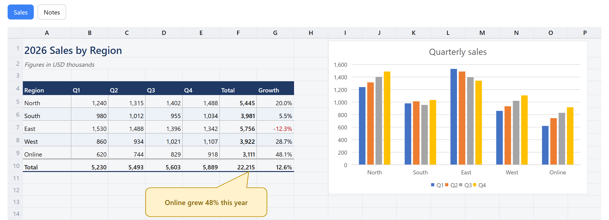
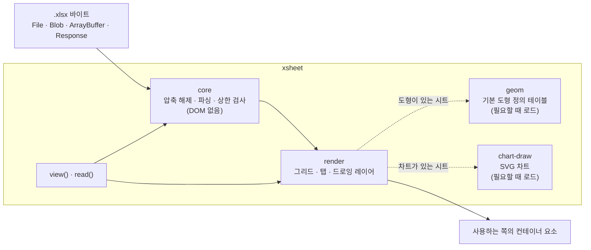

# XSheet

> `.xlsx` 파일을 Excel에서 보던 모습 그대로 브라우저에 표시합니다. 읽기 전용이며, 서버도 네트워크 연결도 필요 없습니다.

[](LICENSE)
[](https://nodejs.org/)
[](https://www.typescriptlang.org/)
[](https://github.com/TaekangKwon/XSheet/actions/workflows/ci.yml)

[English](README.md) · [日本語](README.ja.md) · **한국어**



_Excel로 만든 통합 문서([`fixtures/excel/showcase.xlsx`](fixtures/excel/showcase.xlsx))를 XSheet로 브라우저에 표시한 화면._

**[데모 사용해 보기](https://taekangkwon.github.io/XSheet/)** — 가지고 있는 `.xlsx`를 열거나 샘플을 고를 수 있습니다. 파일은 브라우저 안에서만 읽으며 어디에도 전송하지 않습니다.

---

## 만들게 된 계기

많은 Excel 뷰어는 Excel로 만든 문서의 글자 내용과 대략적인 형태를 원래 시트와 비슷하게 보여 줍니다. 하지만 셀이 수만 개를 넘는 큰 문서는 표시가 느리거나 아예 열리지 않는 경우가 많고, 셀의 테두리와 배경색, 열 너비, 병합한 셀, 시트 위에 붙여 넣은 스크린샷, 화살표나 텍스트 상자 같은 도형처럼 글자가 아닌 요소는 제대로 표현되지 않습니다. 그래서 제게 필요한 기능을 갖춘 뷰어를 직접 만들게 되었습니다.

저는 지금까지 `.xlsx` 뷰어를 두 번 만들었습니다. 한 번은 프로젝트 문서를 한 화면에서 볼 수 있게 해 주는 Chrome 확장 프로그램 **InterHub**([InterHub-MCP](https://github.com/TaekangKwon/InterHub-MCP)와 함께 배포)에 넣기 위해서였고, 또 한 번은 다른 문서 뷰어에 넣기 위해서였습니다. 그런데 같은 표시 버그를 매번 두 곳에서 고치는 일이 반복되다 보니, 아예 코드를 하나의 라이브러리로 묶기로 했습니다. 그렇게 나온 것이 **XSheet**입니다.

XSheet는 일부러 한 가지 일만 합니다. [SheetJS](https://sheetjs.com/)가 여러 형식을 읽고 쓰는 범용 라이브러리라면, XSheet는 **`.xlsx`를 읽어서 Excel과 똑같이 그려 주는 일**에만 집중합니다. 또 출처를 알 수 없는 파일을 열어도 문제가 생기지 않도록 처음부터 방어적으로 설계했습니다.

## 표시할 수 있는 것

| 영역 | 지원 내용 |
| --- | --- |
| 셀 | 표시 형식이 적용된 값, 열 너비와 행 높이, 셀 병합, 테두리, 배경색, 글꼴 스타일. Excel 16의 표시에 맞춤(크기와 그림 위치의 오차 1 px 이내가 목표) |
| 그림·도형 | 그림, 도형(기본 도형 176종 전부와 자유형 도형), 선과 연결선, 그룹, 도형 안의 텍스트. 셀 위의 별도 레이어에 그림 |
| 차트 | 세로 막대형·가로 막대형(묶은, 누적, 100% 기준 누적), 표식이 있는 꺾은선형, 원형, 도넛형. 제목, 범례, 항목 축, 값 축, 눈금선 포함. 파일에 저장된 값으로 SVG를 그림 |
| 큰 시트 | 셀이 100만 개인 시트도 열림. 화면에 보이는 부분만 그리고, 스크롤하면 이어서 그림 |
| 시트 | 시트마다 탭을 표시. 숨긴 시트의 탭에는 표시가 붙고, 처음에는 숨기지 않은 첫 번째 시트가 열림 |
| UI 문구 | 일본어, 영어, 한국어. 키 단위로 바꿀 수 있음 |
| 테마 | 라이트, 다크, OS 설정 따름. 색은 CSS 변수로 지정 |

## 빠른 시작

### `<script>` 하나로 (빌드 도구 없이)

```html
<script src="xsheet.min.js"></script>
<input type="file" id="file" accept=".xlsx" />
<div id="viewer" style="height: 600px"></div>
<script>
  let viewer;
  document.querySelector('#file').onchange = async (e) => {
    viewer?.destroy();
    viewer = await XSheet.view('#viewer', e.target.files[0]);
  };
</script>
```

- `xsheet.min.js`는 Releases의 스탠드얼론 zip에 들어 있습니다. 받는 방법은 「[스탠드얼론 zip 내려받기](#스탠드얼론-zip-내려받기)」를 참고하세요.
- `xsheet.min.js`는 의존 라이브러리(jszip, ssf)와 도형 정의 테이블, 차트 렌더러를 모두 담은 파일 하나입니다. 전역 변수 `XSheet`를 만들며, `file://`로 연 페이지에서도 동작합니다.
- CSS는 자동으로 삽입됩니다. 컨테이너에 높이가 없으면 480 px로 표시하고 `console.warn`을 한 번 출력합니다.
- 바로 쓸 수 있는 뷰어 페이지(파일 선택 또는 끌어다 놓기): [examples/standalone.html](examples/standalone.html)

### 번들러에서 (Vite, webpack 등)

```ts
import { view } from 'xsheet';

const viewer = await view('#viewer', file, { theme: 'auto' }); // File, Blob, ArrayBuffer, Response 등
viewer.destroy(); // 정리
```

React와 Vue에서 쓰는 예: [docs/guide/frameworks.md](docs/guide/frameworks.md)

### Node나 Web Worker에서 (읽기만, DOM 없음)

```ts
import { openXlsx } from 'xsheet/core';

const book = await openXlsx(await readFile('book.xlsx'));
const sheet = await book.openSheet(book.sheets[0].index);
console.log(sheet.getRows(1, 10).map((row) => row.cells.map((c) => c?.text ?? '')));
book.close();
```

- `xsheet/core`는 DOM도, Node 전용 API도 쓰지 않습니다. 브라우저, Web Worker, Node 20 이상에서 동작합니다.
- `xsheet`의 `read(source)`도 같은 일을 하며, `File`, `Blob`, `Response`도 받습니다. Worker에서 읽는 방법: [docs/guide/worker.md](docs/guide/worker.md)

## 설치

| 용도 | 설치 방법 |
| --- | --- |
| `<script>` 또는 번들러 없이 `import` | [Releases](https://github.com/TaekangKwon/XSheet/releases)에서 `xsheet-<version>-standalone.zip`을 내려받아 페이지와 같은 곳에 압축을 풉니다([순서](#스탠드얼론-zip-내려받기)). 들어 있는 파일: [docs/guide/standalone.md](docs/guide/standalone.md) |
| 번들러 또는 Node | Git 태그로 설치합니다(아래 참고) |

> [!NOTE]
> XSheet는 **아직 npm에 올리지 않았습니다.** Git 태그마다 빌드된 `dist/`가 들어 있어서, 태그로 설치해도 빌드 스크립트가 실행되지 않습니다([ADR-0002](docs/adr/0002-build-and-distribution.md)).

```bash
npm install github:TaekangKwon/XSheet#v0.4.1
```

- 의존 패키지는 `jszip`과 `ssf` 두 개뿐이며, 함께 설치됩니다.
- `view`, `read`, `xsheet/core`, `MESSAGES_KO`, 스탠드얼론 빌드는 v0.2.0부터, 차트 표시와 `readChart`, `xsheet-chart.mjs`는 v0.3.0부터, `tabPosition`은 v0.4.0부터 쓸 수 있습니다.

### 스탠드얼론 zip 내려받기

1. [최신 릴리스](https://github.com/TaekangKwon/XSheet/releases/latest)를 엽니다(이전 버전은 [Releases](https://github.com/TaekangKwon/XSheet/releases)에 있습니다).
2. **Assets**에서 `xsheet-<version>-standalone.zip`을 내려받습니다. "Source code" 압축 파일은 저장소의 소스이고, 빌드된 라이브러리가 아닙니다.
3. 압축을 풀면 `xsheet-<version>/` 폴더가 생깁니다.
   - 바로 써 보려면 `viewer.html`을 더블클릭하고(`file://`에서도 동작합니다) `.xlsx` 파일을 고르거나 끌어다 놓습니다. 파일은 브라우저 안에서만 읽으며 어디에도 전송하지 않습니다.
   - 내 페이지에서 쓰려면 `xsheet.min.js`를 페이지와 같은 곳에 복사하고 [빠른 시작](#빠른-시작)의 예대로 작성합니다. 번들러 없이 `import`하려면 `xsheet.mjs`, `xsheet-geom.mjs`, `xsheet-chart.mjs`를 같은 폴더에 복사합니다.
4. 이 파일들을 다시 배포할 때는 `xsheet.licenses.txt`, `LICENSE`, `NOTICE`를 함께 두세요.

## 동작 방식



- **core**는 zip과 XML을 시트 단위로 필요할 때만 읽고, 모든 크기를 상한값과 비교합니다. DOM을 전혀 건드리지 않으므로 Node와 Worker에서도 동작합니다.
- **render**는 화면에 보이는 행과 열만 스크롤 그리드에 그리고, 그림·도형·차트는 그 위의 레이어에 올립니다.
- **geom**(도형 정의 테이블, gzip 기준 약 30 KB)과 **chart-draw**(약 16 KB)는 별도 청크로 나뉘어 있습니다. 시트에 도형이나 차트가 실제로 있을 때만 로드됩니다.

## API

### `view(target, source, options?)`

통합 문서 전체를 시트 탭과 함께 표시합니다. `Promise<Viewer>`를 반환합니다.

| 인수 | 설명 |
| --- | --- |
| `target` | 요소 또는 CSS 선택자. XSheet는 그 안에 자식 요소 `div.xs-viewer`를 추가할 뿐, 컨테이너 자체는 바꾸지 않음 |
| `source` | `File`, `Blob`, `ArrayBuffer`, 형식화 배열(`Uint8Array` 등), `DataView`, `Response`, 또는 이들을 반환하는 Promise |

- URL 문자열을 넘기면 `TypeError`가 납니다. XSheet는 스스로 아무것도 내려받지 않기 때문입니다. URL에 있는 파일을 표시하려면 `XSheet.view('#v', fetch(url))`처럼 쓰세요. 실패한 `Response`(`ok`가 false)도 `TypeError`입니다.
- 열 수 없는 파일(암호화됨, 손상됨, 너무 큼, 지원하지 않는 형식)이라도 예외를 던지지 않습니다. 대신 뷰어 안에 메시지 배너(`div.xs-banner`)를 표시하고, `sheets`는 빈 배열이 됩니다.
- 같은 컨테이너에 `view`를 다시 호출하면 이전 표시를 자동으로 교체하므로, 미리 `destroy()`를 부를 필요가 없습니다. 첫 번째 호출이 아직 로딩 중일 때 두 번째 호출이 시작되면, 첫 번째 호출은 빈 `Viewer`를 반환합니다.

#### 옵션 (모두 생략 가능)

| 옵션 | 기본값 | 설명 |
| --- | --- | --- |
| `lang` | `'auto'` | `'ja'`, `'en'`, `'ko'`, `'auto'` 중 하나. `auto`는 `<html lang>`, 브라우저 언어 순으로 확인하고, 맞는 것이 없으면 영어를 씀 |
| `messages` | — | `lang`으로 고른 문구 위에 일부 문구만 덮어씀. 키 목록: [docs/02_architecture.md](docs/02_architecture.md) §7 |
| `theme` | `'light'` | `'light'`, `'dark'`, `'auto'`(`prefers-color-scheme`을 따름). [docs/guide/theme.md](docs/guide/theme.md) 참고 |
| `css` | `'auto'` | CSS를 `<style>`로 한 번만 삽입. `style.css`나 `xsheet.css`가 이미 로드되어 있으면 삽입하지 않음. `'none'`이면 항상 삽입하지 않음 |
| `height` | `'auto'` | 컨테이너 높이가 0일 때만 480 px로 표시. 숫자는 px, 문자열은 CSS 길이(`'70vh'` 등) |
| `drawings` | `true` | 드로잉 레이어(그림, 도형, 선, 차트)를 표시할지 여부 |
| `tabPosition` | `'top'` | 시트 탭을 놓을 위치. `'top'`(표 위) 또는 `'bottom'`(Excel처럼 표 아래) |
| `nonce` | — | 자동으로 삽입하는 `<style>`과 서식용 `<style>`에 붙일 nonce(CSP용. [docs/guide/csp.md](docs/guide/csp.md) 참고) |
| `limits` | `DEFAULT_LIMITS` | 읽기 상한값 중 일부를 바꿈 |

#### `Viewer`

| 멤버 | 설명 |
| --- | --- |
| `sheets` | 시트 목록(`SheetInfo[]`: `index`(1부터 시작), `name`, `hidden`). 탭 순서이며 숨긴 시트도 포함 |
| `showSheet(index 또는 name)` | 탭을 클릭한 것처럼 시트를 전환. 없는 번호나 이름이면 `RangeError` |
| `destroy()` | 표시를 지우고 통합 문서, 이벤트 리스너, blob URL을 해제. 여러 번 호출해도 안전함 |

### `read(source, options?)`

DOM 없이 통합 문서를 엽니다. `openXlsx`와 같지만, `view`와 같은 형식의 입력을 받습니다. `Promise<XlsxBook>`을 반환하며, 다 쓴 뒤에는 호출한 쪽에서 `close()`로 닫아야 합니다.

```ts
import { read, XlsxError } from 'xsheet';

try {
  const book = await read(fetch('/files/book.xlsx'), { limits: { maxSheetXmlBytes: 32 * 1024 * 1024 } });
  const sheet = await book.openSheet(book.sheets[0].index);
  const rows = sheet.getRows(1, 100); // 1~100행: 화면에 보이는 텍스트, 서식, 테두리 번호
  book.close();
} catch (e) {
  if (e instanceof XlsxError) console.log(e.kind); // 'not-zip' | 'encrypted' | 'broken' | 'too-large' | 'unsupported'
}
```

### 하위 수준 API (`renderWorkbook`, `renderSheet`, `openXlsx`)

`view`가 내부에서 쓰는 API입니다. CSS 로딩, 크기, UI 문구를 직접 다루고 싶을 때 씁니다.

#### 통합 문서 전체를 탭과 함께 표시

```ts
import { renderWorkbook } from 'xsheet/render';
import 'xsheet/style.css';

const container = document.getElementById('viewer')!; // 높이가 정해진 요소
const data = await file.arrayBuffer(); // .xlsx 바이트(ArrayBuffer 또는 Uint8Array)

const wb = await renderWorkbook(container, data);
wb.sheets; // SheetInfo[] (파일을 열 수 없으면 빈 배열)
await wb.showSheet(2); // SheetInfo.index (1부터 시작)
wb.destroy(); // 리스너와 blob URL을 해제하고, 통합 문서를 닫고, 표시를 지움
```

- 컨테이너는 **반드시 높이가 정해져 있어야 합니다**(`height: 100%`인 상위 요소 안, flex 자식 등). 안쪽의 스크롤 영역 `.xs-body`가 어디까지 보이는지를 결정하기 때문입니다. `view`와 달리 기본 높이를 넣어 주지 않습니다.
- CSS도 자동으로 삽입하지 않습니다. `xsheet/style.css`를 import하거나 `<link>`로 불러오세요.
- 열 수 없는 파일이라도 예외를 던지지 않고, 표시 영역 안에 메시지를 보여 줍니다.

#### 시트 하나만 표시

```ts
import { openXlsx } from 'xsheet';
import { renderSheet } from 'xsheet/render';
import 'xsheet/style.css';

const book = await openXlsx(data);
const first = book.sheets.find((s) => !s.hidden) ?? book.sheets[0];
const sheetView = await renderSheet(container, book, first.index);
// …
sheetView.destroy(); // book은 닫지 않음
book.close();
```

#### 옵션 (`renderWorkbook`, `renderSheet`)

| 옵션 | 기본값 | 설명 |
| --- | --- | --- |
| `messages` | 일본어(`MESSAGES_JA`) | UI 문구. 일부 키만 넘겨도 됨. 영어는 `MESSAGES_EN`, 한국어는 `MESSAGES_KO`를 넘김 |
| `drawings` | `true` | 드로잉 레이어를 표시할지 여부. `false`이면 그림·도형을 아예 읽지 않음 |
| `tabPosition` | `'top'` | 시트 탭을 놓을 위치. `'top'` 또는 `'bottom'`(`renderWorkbook`에만 해당) |
| `nonce` | — | 서식용 `<style>` 요소에 붙일 nonce(CSP의 `style-src 'nonce-…'`용) |
| `limits` | `DEFAULT_LIMITS` | 읽기 상한값(`renderWorkbook`에만 해당. `renderSheet`를 쓸 때는 `openXlsx`에 넘김) |
| `zoom` | `1` | 처음 배율(v0.5.0). 0.5~2.0의 숫자, 또는 사용 중인 열을 표시 영역의 너비에 맞추는 `{ fit: 'width' }`(`min`·`max` 기본값은 0.5·2.0). 범위 밖의 숫자는 끝값으로 맞추고, `NaN`이나 그 밖의 값은 `RangeError` |
| `headers` | `true` | `false`이면 행 번호와 열 머리글을 표시하지 않고, 셀을 왼쪽 위 모서리부터 그림(v0.5.0) |

### 검색, 하이라이트, 확대·축소 (v0.5.0)

`renderWorkbook`과 `renderSheet`가 반환하는 표시 객체에는 검색 결과 표시, 스크롤, 위치 판정, 확대·축소 멤버가 있습니다(`WorkbookView`는 `SheetView`를 확장한 것). `view`와 그 `Viewer`에는 아직 없습니다.

```ts
import { findText, openXlsx } from 'xsheet';
import { renderWorkbook } from 'xsheet/render';

const bytes = await file.arrayBuffer();
const wb = await renderWorkbook(container, bytes, { zoom: { fit: 'width' } });
const book = await openXlsx(bytes); // renderWorkbook은 연 통합 문서를 밖에 내주지 않으므로 검색용으로 하나 더 엶(닫는 것은 호출하는 쪽)

const ac = new AbortController();
const shown = wb.sheets.find((s) => !s.hidden) ?? wb.sheets[0]; // 처음에 표시되는 시트
const sheet = await book.openSheet(shown.index);
const { matches, truncated } = await findText(sheet, '합계', { signal: ac.signal });
wb.setHighlights(matches);
wb.focusHighlight(0); // 첫 번째 일치 위치로 스크롤하고 현재 일치로 표시

container.addEventListener('click', (e) => {
  const hit = wb.highlightAt(e.clientX, e.clientY);
  if (hit >= 0) wb.focusHighlight(hit, { scroll: false });
});
```

| 멤버 | 설명 |
| --- | --- |
| `findText(sheet, query, options?)` | `xsheet`, `xsheet/core`에서 가져옴. 표시된 그대로의 문자(표시 형식을 적용한 뒤)를 검색. 결과는 `{ matches, truncated }`이고, 일치 하나는 `{ r, c, start, end }`(셀은 1부터, 위치는 UTF-16이며 `end`는 포함하지 않음). 옵션: `match`(`'partial'` 또는 `'cell'`), `ignoreCase`(`true`), `ignoreNewlines`(`true`), `skipHidden`(`true`), `signal`(중단하면 `AbortError` `DOMException`으로 reject), `maxMatches`(10,000, 최대 100,000). 약 10ms마다 페이지에 처리를 양보함 |
| `setHighlights(matches)` | 일치를 강조 표시. `null`이나 `[]`로 지움. 스크롤해도 남고, 시트를 바꾸면 지워짐. 색은 `--xs-hit-bg`, `--xs-hit-current-bg` |
| `focusHighlight(index, options?)` | 일치 하나(`setHighlights`에 넘긴 배열의 번호)를 현재 일치로 정하고, 표시 영역의 위에서 약 1/3 위치까지 스크롤. `{ scroll: false }`는 표시만, `{ smooth: true }`는 부드럽게, `-1`은 표시를 해제 |
| `scrollToCell(r, c, options?)` | 셀(1부터)이 보이도록 같은 방식으로 스크롤 |
| `cellAt(clientX, clientY)` | 화면 위 위치에 있는 셀 `{ r, c }`. 머리글, 스크롤바, 표 바깥이면 `null`. 병합 셀은 왼쪽 위 셀을, 넘친 문자는 그 원래 셀을 반환 |
| `highlightAt(clientX, clientY)` | 그 위치에 있는 일치의 번호. 없으면 `-1` |
| `setZoom(zoom)`, `zoom` | 배율을 바꾸거나(값은 `zoom` 옵션과 같음) 읽음. 왼쪽 위 셀은 움직이지 않음. 머리글 크기는 그대로이고(100% 미만에서는 행 번호 글자만 작아짐), 선 굵기도 바뀌지 않음 |
| `showSheet(index)` | 표시를 다시 만들지 않고 시트를 바꿈. 배율은 유지하고 하이라이트는 지움. `renderSheet`의 반환값에도 있음 |

- 표시 영역에 CSS `transform`으로 배율을 걸지 마세요. `cellAt`과 `highlightAt`이 엉뚱한 셀을 가리킵니다. `setZoom`을 쓰세요.

전체 API는 [docs/02_architecture.md](docs/02_architecture.md)의 §2(core)와 §3(render와 `view` 계층)에 정리되어 있습니다.

### 진입점

| import | 내용 |
| --- | --- |
| `xsheet` | 전부: `view`, `read`, 그리고 `xsheet/core`와 `xsheet/render`의 공개 API 전체 |
| `xsheet/core` | 읽기 기능(`openXlsx`, `findText`(문자 검색, v0.5.0), `XlsxError`, `DEFAULT_LIMITS`, 단위 변환 등)과 타입. DOM과 Node 전용 API를 쓰지 않음을 보장(Worker와 Node용) |
| `xsheet/render` | 표시 기능(`renderWorkbook`, `renderSheet`, `MESSAGES_JA`, `MESSAGES_EN`, `MESSAGES_KO`) |
| `xsheet/style.css` | CSS(라이트 기본값과 `data-xs-theme`용 다크 값) |
| `xsheet/geom` | 도형 정의 테이블과 수식 계산기. `render`가 동적으로 import하므로 보통은 직접 쓸 일이 없음 |
| `xsheet/internal` | `render`가 쓰는 반공개 모듈. **버전 간 호환성을 보장하지 않음** |

- ESM 전용입니다. 타입 정의가 포함되어 있습니다(TypeScript의 `moduleResolution: "bundler"`를 전제로 함).
- Node에서 `xsheet`를 import해도 로드 시점에는 DOM을 건드리지 않습니다. 다만 DOM을 쓰지 않는다고 보장하는 것은 `xsheet/core`뿐입니다.
- 도형 정의 테이블은 도형이 있는 시트를, 차트 렌더러는 차트가 있는 시트를 열 때만 로드됩니다. 여러분의 번들러에서도 별도 청크로 나뉩니다. 크기: [docs/02_architecture.md](docs/02_architecture.md) §8

## 테마

- 다크 모드로 표시하려면 `view`에 `theme: 'dark'`를 넘기세요(`'auto'`는 OS 설정을 따름). `renderWorkbook` 등을 쓸 때는 표시 영역의 루트나 `<html>` 같은 상위 요소에 `data-xs-theme="dark"`(또는 `"auto"`)를 붙입니다. 다크 값은 `style.css`에 들어 있으므로 따로 복사할 필요가 없습니다.
- 색은 16개의 CSS 변수(`--xs-*`)로 바꿀 수 있습니다. 기본값의 명시도(specificity)가 0(`:where(:root, :host)`)이라서, Shadow DOM 안을 포함해 어디서든 덮어쓸 수 있습니다.

```css
/* 라이트 테마의 강조색만 바꾸기 */
:root {
  --xs-accent: #0f766e;
}
```

다크 값을 바꾸는 방법과 Shadow DOM 관련 주의 사항은 [docs/guide/theme.md](docs/guide/theme.md), 각 변수의 역할은 [docs/02_architecture.md](docs/02_architecture.md) §6에 있습니다. 파일에 들어 있는 색(배경색, 글꼴 색, 도형 색)은 변수를 거치지 않고 그대로 그립니다.

## UI 문구

- 일본어(`MESSAGES_JA`), 영어(`MESSAGES_EN`), 한국어(`MESSAGES_KO`)가 들어 있으며, 키는 23개입니다([docs/02_architecture.md](docs/02_architecture.md) §7).
- `view`는 `lang`(기본값 `auto`)으로 언어를 고릅니다. `renderWorkbook`과 `renderSheet`의 기본 언어는 일본어입니다.
- 일부 문구만 바꾸려면 `messages: { noData: '(비어 있음)' }`처럼 넘기면 됩니다.
- `view`와 `read`가 내는 개발자용 오류와 경고는 영어이며, `XSheet:`로 시작합니다.

## 보안 모델

XSheet는 열려는 `.xlsx`가 모두 악의적인 파일일 수 있다고 가정합니다.

- **네트워크를 쓰지 않습니다.** 라이브러리가 스스로 무언가를 내려받거나, 올리거나, 외부로 알리는 일은 없습니다. 넘겨받은 바이트만 읽습니다.
- **코드를 생성하지 않습니다.** `eval`, `new Function`, 문자열 타이머를 쓰지 않으며, 스탠드얼론 빌드에서도 이를 검사합니다.
- **파일의 HTML을 넣지 않습니다.** 파일 속 텍스트는 `textContent`로만 DOM에 들어갑니다. 그림은 `blob:` URL로 표시합니다.
- **모든 곳에 상한이 있습니다.** 압축을 푼 크기, 각 파트의 크기, 개수, 도형 수식, 이미지 크기, 차트 데이터 점 수에 모두 29개의 상한이 있습니다. 상한을 넘으면 `XlsxError('too-large')`가 발생하거나(`view`와 `renderWorkbook`에서는 메시지로 표시), 해당 그림·도형만 단순하게 그리고 안내를 표시합니다. 기본값은 `DEFAULT_LIMITS`에 있으며(목록: [docs/02_architecture.md](docs/02_architecture.md) §5), `limits`로 일부를 바꿀 수 있습니다.
- **오류 메시지에 내용을 넣지 않습니다.** 예외 메시지에는 셀 값도, 시트 이름도 들어가지 않습니다.

### 콘텐츠 보안 정책 (CSP)

| 지시어 | 필요한 이유 |
| --- | --- |
| `script-src 'self'` | 라이브러리와 도형 정의 테이블을 같은 출처에서 로드함. 스탠드얼론 빌드를 포함해 `'unsafe-eval'`은 필요 없음 |
| `style-src 'nonce-<값>'`(또는 `'unsafe-inline'`) | 서식용 `<style>`과 `view`가 삽입하는 `<style>`용. 두 요소 모두 넘겨받은 `nonce`가 붙음 |
| `img-src blob:` | 그림을 blob URL로 표시함 |

`<style>` 자동 삽입을 피하고 싶다면 `css: 'none'`으로 두고 `xsheet.css`(`style.css`)를 `<link>`로 불러오세요. 자세한 내용: [docs/guide/csp.md](docs/guide/csp.md)

취약점 신고 방법은 [SECURITY.md](SECURITY.md)를 참고하세요.

## 제한 사항

- **읽기 전용입니다.** 쓰기나 편집은 할 수 없습니다.
- **`.xlsx`만 지원합니다.** `.xls`(BIFF), `.ods`, `.csv`는 열 수 없습니다. `.xls`는 SheetJS 같은 다른 라이브러리로 처리하세요.
- **수식을 계산하지 않습니다.** Excel이 파일에 저장해 둔 값을 표시합니다.
- **지원하지 않는 차트**(영역형, 분산형, 콤보, 보조 축, 3차원, Excel 2016 이후에 추가된 차트 종류 등)는 점선 테두리 안에 차트 종류 이름만 표시합니다.
- **아직 그리지 않는 것:** 조건부 서식, 표 스타일, 맞춤과 텍스트 줄 바꿈, 글꼴 이름, 셀 안 일부 문자에만 적용한 서식([docs/04_roadmap.md](docs/04_roadmap.md) M7)
- **아직 확정되지 않은 규칙이 있습니다.** 테두리와 표시 형식의 일부 경우는 아직 Excel과 비교해 확인하지 못했습니다(알려진 차이: [docs/05_quality.md](docs/05_quality.md)).

## 지원 환경

- `xsheet/core`: ES2022를 지원하는 브라우저, Web Worker, Node 20 이상
- `view`, `xsheet/render`, 스탠드얼론 빌드: Chrome, Edge, Firefox, Safari의 최신 두 버전

## 프로젝트 구조

```text
XSheet/
├── src/
│   ├── core/          # 읽기: zip, XML, 셀, 스타일, 그림·도형, 차트, 상한 (DOM 없음)
│   ├── geom/          # 기본 도형 정의 테이블과 수식 계산기 (필요할 때 로드)
│   ├── render/        # 그리드, 탭, 드로잉 레이어, SVG 차트, UI 문구
│   ├── facade/        # view()와 read(): 한 줄로 쓰는 진입 계층
│   └── style.css      # CSS (라이트 + 다크)
├── examples/          # 예제 페이지 (개발 서버용과 스탠드얼론용)
├── fixtures/excel/    # Excel로 만든 기준 .xlsx 파일과 Excel에서 얻은 값
├── tests/             # Vitest + jsdom
├── tools/             # 스탠드얼론 빌드, 크기 검사, 도형 정의 테이블 생성기
└── docs/              # 설계 문서, ADR, 가이드 (일본어)
```

## 개발

개발하려면 Node 22.12 이상이 필요합니다.

| 명령 | 용도 |
| --- | --- |
| `npm run test` | 테스트(Vitest) |
| `npm run typecheck` · `npm run lint` · `npm run format:check` | 타입 검사, ESLint, Prettier |
| `npm run build` | `dist/` 빌드(Vite 라이브러리 모드 → d.ts → 스탠드얼론 파일) |
| `npm run check:consumer` | 임시 프로젝트에서 `dist/`를 import해 타입 검사와 빌드가 통과하는지, 패키지에 들어갈 파일이 맞는지 확인 |
| `npm run check:standalone` | 스탠드얼론 파일이 jsdom과 순수 Node에서 동작하는지, 타입이 컴파일되는지 확인 |
| `npm run size` | 진입점과 스탠드얼론 파일별 크기를 상한과 비교 |
| `npm run examples` | 예제 페이지 실행(http://localhost:5173/examples/). 파일 선택, 테마·언어 전환 가능 |
| `npm run examples:static` | `npm run build` 후 스탠드얼론 예제를 http로 제공(http://localhost:5174/examples/esm.html) |

규칙: `core`와 `geom`에서는 DOM과 Node 전용 API를 쓰지 않습니다. ADR 없이 의존 패키지를 늘리지 않습니다. 테스트 데이터는 코드로 합성한 것(`src/testing/make-xlsx.ts`)이나 작성자가 Excel로 직접 만든 파일만 씁니다. 그 밖의 규칙은 [CLAUDE.md](CLAUDE.md)에 있습니다.

`npm run sync:status`와 `npm run sync:patch`는 XSheet의 원본인 비공개 프로젝트 InterHub의 변경 사항을 가져오는 명령입니다. 메인테이너만 쓸 수 있습니다([ADR-0003](docs/adr/0003-universal-distribution.md) §4).

## 문서

설계 문서와 가이드는 일본어로 작성되어 있습니다.

| 문서 | 내용 |
| --- | --- |
| [docs/guide/](docs/guide/README.md) | 사용 가이드: 스탠드얼론 빌드, React와 Vue, Worker, CSP, 테마 |
| [docs/](docs/README.md) | 요구 사항, 아키텍처, 로드맵, 품질 기록 |
| [docs/adr/](docs/adr/) | 아키텍처 결정 기록(ADR) |
| [CHANGELOG.md](CHANGELOG.md) | 변경 이력 |

## 감사의 말

- 기본 도형 정의 테이블은 ECMA-376(Ecma International)의 `presetShapeDefinitions.xml`로 만듭니다. 그 저작권 표시는 [NOTICE](NOTICE)에 있으며, 모든 배포물에 함께 들어갑니다.
- zip 읽기는 [JSZip](https://stuk.github.io/jszip/), 표시 형식 처리는 [SSF](https://github.com/SheetJS/ssf)를 사용합니다.
- XSheet는 InterHub의 `.xlsx` 뷰어를 떼어 내어 만든 라이브러리입니다.

## 만든 곳

이 프로젝트는 일본 오카야마현 가사오카시의 작은 소프트웨어 회사 **주식회사 시스템 엠즈**(SYSTEM EMUZU CO.,LTD., 2000년 설립)의 Kwon이 관리하고 있습니다.\
저희는 "create rich time"을 모토로, 실수와 수고를 줄여 쓰는 사람의 시간을 풍요롭게 하는 시스템을 만들어 가는 팀입니다. 이벤트 접수, 토목·건축 적산, 생산 관리 같은 업무용 웹 시스템을 설계부터 유지보수까지 맡고 있습니다.

- 🌐 [공식 홈페이지](https://msap2.jp/emuzu/)
- ✍️ [기술 블로그](https://msap2.jp/emuzu/blog/)(일본어) — 직접 만든 앱과 AI 활용 이야기

## 라이선스

[MIT](LICENSE). 도형 정의 테이블에는 Ecma International의 저작권 표시가 [NOTICE](NOTICE)로 붙어 있고, 스탠드얼론 파일은 의존 라이브러리를 포함하고 있어 그 라이선스를 `xsheet.licenses.txt`로 함께 배포합니다. 재배포할 때는 `LICENSE`, `NOTICE`, `xsheet.licenses.txt`를 함께 두세요.
