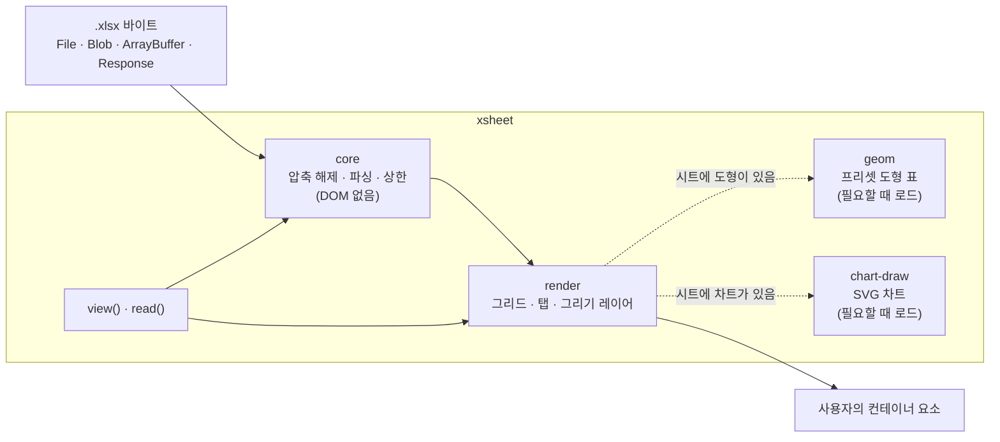

# XSheet

> `.xlsx` 파일을 Excel에서 보이는 모습 그대로 브라우저에 표시한다. 읽기 전용이며 서버도, 네트워크 접속도 필요 없다.

[](LICENSE)
[](https://nodejs.org/)
[](https://www.typescriptlang.org/)
[](https://github.com/TaekangKwon/XSheet/actions/workflows/ci.yml)

[English](README.md) · [日本語](README.ja.md) · **한국어**

---

## 만들게 된 계기

사양서와 설계서를 Excel로 쓰는 팀에서는 정보가 시트의 *겉모습*에 담긴다. 테두리, 채우기, 열 너비, 병합된 셀, 위에 붙여 넣은 스크린샷, 그 사이에 그린 상자와 화살표가 그렇다. 값만 늘어놓은 표로는 이 대부분이 사라진다.

나는 `.xlsx` 뷰어를 두 번 만들었다. 한 번은 프로젝트의 문서를 한 화면에 보여 주는 Chrome 확장 프로그램 **InterHub**(함께 배포되는 [InterHub-MCP](https://github.com/TaekangKwon/InterHub-MCP)에 들어 있다)용이고, 한 번은 다른 문서 뷰어용이다. 같은 렌더링 버그를 두 곳에서 고치는 일에 지쳐서 코드를 하나의 라이브러리로 합쳤다. 그것이 **XSheet**다.

이 라이브러리는 일부러 한 가지만 한다. [SheetJS](https://sheetjs.com/)는 여러 형식을 읽고 쓰지만, XSheet는 **`.xlsx`를 읽어서 Excel처럼 그리는 일**만 한다. 그리고 직접 만들지 않은 파일에도 견디도록 만들었다.

## 표시할 수 있는 것

| 영역 | 지원 내용 |
| --- | --- |
| 셀 | 표시 형식이 적용된 값, 열 너비와 행 높이, 병합된 셀, 테두리, 채우기, 글꼴 스타일. Excel 16에 맞춘다(목표: 크기와 그림 위치의 오차 1 px 이내) |
| 그리기 | 그림, 도형(프리셋 도형 176종 전부와 사용자 지정 도형), 선과 커넥터, 그룹, 도형 안의 텍스트. 셀 위의 레이어에 그린다 |
| 차트 | 세로 막대와 가로 막대(묶음, 누적, 100 % 누적), 마커가 있는 꺾은선, 원, 도넛. 제목, 범례, 항목 축과 값 축, 눈금선을 갖추며, 파일에 저장된 값으로 SVG를 그린다 |
| 큰 시트 | 셀이 100만 개인 시트도 열린다. 보이는 부분만 그리고, 스크롤하면 더 그린다 |
| 시트 | 시트마다 탭이 있다. 숨겨진 시트의 탭에는 표시가 붙고, 처음에는 보이는 첫 시트가 열린다 |
| UI 텍스트 | 일본어, 영어, 한국어. 키 단위로 바꿀 수 있다 |
| 테마 | 라이트, 다크, 또는 OS를 따름. 색은 CSS 변수다 |

## 빠른 시작

### `<script>` 하나로 (빌드 도구 불필요)

```html
<script src="xsheet.min.js"></script>
<input type="file" id="file" accept=".xlsx" />
<div id="viewer" style="height: 600px"></div>
<script>
  let viewer;
  document.querySelector('#file').onchange = async (e) => {
    viewer?.destroy();
    viewer = await XSheet.view('#viewer', e.target.files[0]);
  };
</script>
```

- `xsheet.min.js`는 의존 라이브러리(jszip, ssf), 도형 표, 차트 렌더러를 하나로 묶은 단일 파일이다. 전역 `XSheet`를 정의하며, `file://`로 연 페이지에서도 동작한다.
- CSS는 자동으로 삽입된다. 컨테이너에 높이가 없으면 뷰어는 480 px을 쓰고 `console.warn`을 한 번 출력한다.
- 완성된 뷰어 페이지(파일을 선택하거나 드롭한다): [examples/standalone.html](examples/standalone.html).

### 번들러와 함께 (Vite, webpack, …)

```ts
import { view } from 'xsheet';

const viewer = await view('#viewer', file, { theme: 'auto' }); // File, Blob, ArrayBuffer, Response, …
viewer.destroy(); // 정리
```

React와 Vue 예제: [docs/guide/frameworks.md](docs/guide/frameworks.md).

### Node 또는 Web Worker (읽기 전용, DOM 없음)

```ts
import { openXlsx } from 'xsheet/core';

const book = await openXlsx(await readFile('book.xlsx'));
const sheet = await book.openSheet(book.sheets[0].index);
console.log(sheet.getRows(1, 10).map((row) => row.cells.map((c) => c?.text ?? '')));
book.close();
```

- `xsheet/core`는 DOM도 Node 고유 API도 쓰지 않는다. 브라우저, Web Worker, Node 20 이상에서 동작한다.
- `xsheet`의 `read(source)`도 같은 일을 하며 `File`, `Blob`, `Response`도 받는다. Worker에서 읽는 방법: [docs/guide/worker.md](docs/guide/worker.md).

## 설치

| 용도 | 설치 방법 |
| --- | --- |
| `<script>`, 또는 번들러 없이 `import` | [Releases](https://github.com/TaekangKwon/XSheet/releases)에서 `xsheet-<version>-standalone.zip`을 받아 페이지 옆에 압축을 푼다. 내용물: [docs/guide/standalone.md](docs/guide/standalone.md) |
| 번들러 또는 Node | Git 태그로 설치한다(아래) |

> [!NOTE]
> XSheet는 **아직 npm에 공개되지 않았다.** 각 Git 태그에는 빌드된 `dist/`가 들어 있으므로 태그로 설치하면 빌드 스크립트가 실행되지 않는다([ADR-0002](docs/adr/0002-build-and-distribution.md)).

```bash
npm install github:TaekangKwon/XSheet#v0.3.0
```

- 의존 패키지는 `jszip`과 `ssf`뿐이며 함께 설치된다.
- `view`, `read`, `xsheet/core`, `MESSAGES_KO`, 단독 실행 빌드는 v0.2.0에서 추가되었다. 차트, `readChart`, `xsheet-chart.mjs`는 v0.3.0에서 추가되었다.

## 동작 구조



- **core**는 zip과 XML을 시트 단위로 지연해서 읽고, 모든 크기를 상한과 비교해 확인한다. DOM에 전혀 접근하지 않으므로 Node와 Worker에서도 동작한다.
- **render**는 보이는 행과 열만 스크롤 그리드에 그리고, 그 위의 레이어에 그림, 도형, 차트를 올린다.
- **geom**(도형 표, gzip 후 약 30 KB)과 **chart-draw**(약 16 KB)는 별도 청크다. 시트에 도형이나 차트가 실제로 있을 때만 로드된다.

## API

### `view(target, source, options?)`

시트 탭이 있는 형태로 워크북 전체를 표시한다. `Promise<Viewer>`를 반환한다.

| 인수 | 의미 |
| --- | --- |
| `target` | 요소 또는 CSS 선택자. XSheet는 자식으로 `div.xs-viewer`를 추가하며 컨테이너 자체는 건드리지 않는다 |
| `source` | `File`, `Blob`, `ArrayBuffer`, 타입 배열(`Uint8Array` 등), `DataView`, `Response`, 또는 이들의 Promise |

- URL 문자열은 `TypeError`로 거부된다. XSheet는 스스로 아무것도 가져오지 않는다. URL의 파일을 표시하려면 `XSheet.view('#v', fetch(url))`처럼 쓴다. 실패한 `Response`(`ok`가 false)도 `TypeError`다.
- 열 수 없는 파일(암호화됨, 손상됨, 너무 큼, 미지원)은 예외를 던지지 않는다. 대신 뷰어가 메시지 바(`div.xs-banner`)를 표시하고 `sheets`는 비어 있다.
- 같은 컨테이너에서 `view`를 다시 호출하면 이전 뷰가 교체되므로 먼저 `destroy()`를 호출할 필요가 없다. 첫 호출이 로딩 중일 때 두 번째 호출이 시작되면 첫 호출은 빈 `Viewer`로 resolve된다.

#### 옵션 (모두 생략 가능)

| 옵션 | 기본값 | 의미 |
| --- | --- | --- |
| `lang` | `'auto'` | `'ja'`, `'en'`, `'ko'` 또는 `'auto'`. `auto`는 `<html lang>`, 브라우저 언어 순으로 보고, 없으면 영어로 한다 |
| `messages` | — | `lang`으로 고른 표 위에 UI 텍스트 일부를 덮어쓴다. 키: [docs/02_architecture.md](docs/02_architecture.md) §7 |
| `theme` | `'light'` | `'light'`, `'dark'` 또는 `'auto'`(`prefers-color-scheme`을 따름). [docs/guide/theme.md](docs/guide/theme.md) 참조 |
| `css` | `'auto'` | CSS를 `<style>`로 한 번 삽입한다. `style.css` / `xsheet.css`가 이미 로드되어 있으면 건너뛴다. `'none'`이면 삽입하지 않는다 |
| `height` | `'auto'` | 컨테이너의 높이가 0일 때만 480 px을 쓴다. 숫자는 px, 문자열은 CSS 길이(`'70vh'`)다 |
| `drawings` | `true` | 그리기 레이어(그림, 도형, 선, 차트)를 표시한다 |
| `nonce` | — | 삽입되는 `<style>`과 서식용 `<style>`의 nonce(CSP용. [docs/guide/csp.md](docs/guide/csp.md) 참조) |
| `limits` | `DEFAULT_LIMITS` | 읽기 상한의 일부를 덮어쓴다 |

#### `Viewer`

| 멤버 | 의미 |
| --- | --- |
| `sheets` | 시트 목록(`SheetInfo[]`: `index`(1부터 시작), `name`, `hidden`). 탭 순서이며 숨겨진 시트도 포함한다 |
| `showSheet(index or name)` | 탭을 클릭한 것처럼 시트를 전환한다. 없는 인덱스나 이름이면 `RangeError`를 던진다 |
| `destroy()` | 뷰를 제거하고 워크북, 리스너, blob URL을 해제한다. 여러 번 호출해도 안전하다 |

### `read(source, options?)`

DOM 없이 워크북을 연다. `openXlsx`와 같지만 `view`와 같은 입력을 받는다. `Promise<XlsxBook>`을 반환하며, 호출한 쪽이 `close()`로 닫아야 한다.

```ts
import { read, XlsxError } from 'xsheet';

try {
  const book = await read(fetch('/files/book.xlsx'), { limits: { maxSheetXmlBytes: 32 * 1024 * 1024 } });
  const sheet = await book.openSheet(book.sheets[0].index);
  const rows = sheet.getRows(1, 100); // 1~100행: 표시 텍스트, 서식, 테두리 ID
  book.close();
} catch (e) {
  if (e instanceof XlsxError) console.log(e.kind); // 'not-zip' | 'encrypted' | 'broken' | 'too-large' | 'unsupported'
}
```

### 저수준 부품 (`renderWorkbook`, `renderSheet`, `openXlsx`)

`view`의 아래에 있는 부품이다. CSS 로딩, 크기, UI 텍스트를 직접 제어하고 싶을 때 쓴다.

#### 탭이 있는 워크북 전체

```ts
import { renderWorkbook } from 'xsheet/render';
import 'xsheet/style.css';

const container = document.getElementById('viewer')!; // 높이가 정해진 요소
const data = await file.arrayBuffer(); // .xlsx 바이트(ArrayBuffer 또는 Uint8Array)

const wb = await renderWorkbook(container, data);
wb.sheets; // SheetInfo[] (파일을 열 수 없으면 비어 있음)
await wb.showSheet(2); // SheetInfo.index (1부터 시작)
wb.destroy(); // 리스너와 blob URL을 해제하고, 워크북을 닫고, 뷰를 제거
```

- 컨테이너에는 **높이가 반드시 정해져 있어야 한다**(`height: 100%`인 상위 요소, flex 자식 등). 안쪽 스크롤러 `.xs-body`가 무엇이 보일지를 정하는 창이다. `view`와 달리 기본 높이는 적용되지 않는다.
- CSS는 삽입되지 않는다. `xsheet/style.css`를 import하거나 `<link>`로 로드한다.
- 열 수 없는 파일은 예외를 던지지 않고 뷰 안에 메시지를 표시한다.

#### 시트 하나

```ts
import { openXlsx } from 'xsheet';
import { renderSheet } from 'xsheet/render';
import 'xsheet/style.css';

const book = await openXlsx(data);
const first = book.sheets.find((s) => !s.hidden) ?? book.sheets[0];
const sheetView = await renderSheet(container, book, first.index);
// …
sheetView.destroy(); // book은 닫지 않는다
book.close();
```

#### 옵션 (`renderWorkbook`, `renderSheet`)

| 옵션 | 기본값 | 의미 |
| --- | --- | --- |
| `messages` | 일본어(`MESSAGES_JA`) | UI 텍스트. 일부만 담은 객체도 된다. 영어는 `MESSAGES_EN`, 한국어는 `MESSAGES_KO`를 전달한다 |
| `drawings` | `true` | 그리기 레이어를 표시한다. `false`이면 그리기 데이터를 읽지도 않는다 |
| `nonce` | — | 서식용 `<style>` 요소의 nonce(CSP `style-src 'nonce-…'`용) |
| `limits` | `DEFAULT_LIMITS` | 읽기 상한(`renderWorkbook`만 해당. `renderSheet`는 `openXlsx`에 전달한다) |

전체 API는 [docs/02_architecture.md](docs/02_architecture.md) §2(core)와 §3(render와 `view` 계층)에 설명되어 있다.

### 진입점

| import | 내용 |
| --- | --- |
| `xsheet` | 전부: `view`, `read`, 그리고 `xsheet/core`와 `xsheet/render`의 모든 공개 export |
| `xsheet/core` | 읽기 전용(`openXlsx`, `XlsxError`, `DEFAULT_LIMITS`, 단위 변환 등)과 타입. DOM도 Node 고유 API도 쓰지 않음을 보장한다(Worker와 Node용) |
| `xsheet/render` | 렌더링(`renderWorkbook`, `renderSheet`, `MESSAGES_JA`, `MESSAGES_EN`, `MESSAGES_KO`) |
| `xsheet/style.css` | CSS(라이트 기본값과 `data-xs-theme` 아래의 다크 값) |
| `xsheet/geom` | 도형 표와 그 수식 평가기. `render`가 동적으로 import하므로 보통은 직접 쓰지 않는다 |
| `xsheet/internal` | `render`가 쓰는 준공개 부품. **버전 간 호환성을 약속하지 않는다** |

- ESM만 지원한다. 타입이 포함되어 있다(TypeScript의 `moduleResolution: "bundler"`를 전제로 한다).
- Node에서 `xsheet`를 import해도 로드 시점에 DOM을 건드리지 않지만, DOM을 쓰지 않는다고 약속하는 것은 `xsheet/core`뿐이다.
- 도형 표는 도형이 있는 시트에서만, 차트 렌더러는 차트가 있는 시트에서만 로드된다. 번들러도 이들을 별도 청크로 유지한다. 크기: [docs/02_architecture.md](docs/02_architecture.md) §8.

## 테마

- 다크 뷰로 하려면 `view`에 `theme: 'dark'`를 전달한다(`'auto'`는 OS를 따른다). `renderWorkbook` 등에서는 뷰 루트나 `<html>` 같은 상위 요소에 `data-xs-theme="dark"`(또는 `"auto"`)를 붙인다. 다크 값은 `style.css`에 들어 있으므로 복사할 필요가 없다.
- 색은 14개의 CSS 변수(`--xs-*`)다. 기본값의 명시도(specificity)는 0(`:where(:root, :host)`)이므로 Shadow DOM 안을 포함해 어디서든 덮어쓸 수 있다.

```css
/* 라이트 테마의 강조색만 바꾼다 */
:root {
  --xs-accent: #0f766e;
}
```

다크 값을 덮어쓰는 방법과 Shadow DOM에 관한 메모: [docs/guide/theme.md](docs/guide/theme.md). 각 변수의 역할: [docs/02_architecture.md](docs/02_architecture.md) §6. 파일에서 가져오는 색(채우기, 글꼴 색, 도형 색)은 변수를 거치지 않고 그대로 그려진다.

## UI 텍스트

- 일본어(`MESSAGES_JA`), 영어(`MESSAGES_EN`), 한국어(`MESSAGES_KO`)가 포함되어 있다. 키는 23개다([docs/02_architecture.md](docs/02_architecture.md) §7).
- `view`는 `lang`(기본값 `auto`)으로 하나를 고른다. `renderWorkbook`과 `renderSheet`의 기본값은 일본어다.
- 문자열 몇 개만 바꾸려면 `messages: { noData: '(empty)' }`처럼 전달한다.
- `view`와 `read`가 내는 개발자용 오류와 경고는 영어이며 `XSheet:`로 시작한다.

## 보안 모델

XSheet는 열리는 모든 `.xlsx`가 악의적일 수 있다고 가정한다.

- **네트워크를 쓰지 않는다.** 라이브러리는 아무것도 가져오지도, 업로드하지도, 외부에 알리지도 않는다. 넘겨받은 바이트만 읽는다.
- **코드를 생성하지 않는다.** `eval`도, `new Function`도, 문자열 타이머도 없다. 단독 실행 빌드는 이 점을 검사한다.
- **파일의 HTML을 쓰지 않는다.** 파일의 텍스트는 `textContent`를 통해서만 DOM에 도달한다. 그림은 `blob:` URL로 표시한다.
- **모든 곳에 상한이 있다.** 압축 해제 크기, 파트 크기, 개수, 도형 수식, 이미지 크기, 차트 점 수에 29개의 상한이 있다. 상한을 넘으면 `XlsxError('too-large')`가 발생하거나(`view`와 `renderWorkbook`은 메시지를 표시한다), 해당 그리기 하나가 단순화되고 안내가 표시된다. 기본값은 `DEFAULT_LIMITS`에 있다(목록: [docs/02_architecture.md](docs/02_architecture.md) §5). `limits`로 일부를 덮어쓸 수 있다.
- **오류에 내용을 담지 않는다.** 예외 메시지에는 셀 값도 시트 이름도 들어가지 않는다.

### 콘텐츠 보안 정책 (CSP)

| 디렉티브 | 이유 |
| --- | --- |
| `script-src 'self'` | 라이브러리와 도형 표가 사용자의 오리진에서 로드된다. `'unsafe-eval'`은 필요 없다. 단독 실행 빌드도 마찬가지다 |
| `style-src 'nonce-<value>'`(또는 `'unsafe-inline'`) | 서식용 `<style>`과 `view`가 삽입하는 `<style>`. 둘 다 전달한 `nonce`가 붙는다 |
| `img-src blob:` | 그림을 blob URL로 표시한다 |

삽입되는 `<style>`을 피하려면 `css: 'none'`을 쓰고 `xsheet.css`(`style.css`)를 `<link>`로 로드한다. 자세한 내용: [docs/guide/csp.md](docs/guide/csp.md).

취약점을 신고하려면 [SECURITY.md](SECURITY.md)를 참조한다.

## 제한 사항

- **읽기 전용.** 쓰기도 편집도 없다.
- **`.xlsx`만 지원한다.** `.xls`(BIFF), `.ods`, `.csv`는 지원하지 않는다. `.xls`는 SheetJS 같은 다른 라이브러리로 처리한다.
- **수식을 계산하지 않는다.** Excel이 파일에 저장한 값을 표시한다.
- **지원 범위 밖의 차트**(영역, 분산형, 콤보, 보조 축, 3-D, Excel 2016 이후의 차트 종류 등)는 차트 종류의 이름이 붙은 점선 틀로 표시된다.
- **아직 그리지 않는 것:** 조건부 서식, 표 스타일, 정렬과 줄 바꿈, 글꼴 이름, 부분적인 서식 있는 텍스트([docs/04_roadmap.md](docs/04_roadmap.md) M7).
- **일부 규칙은 아직 잠정적이다.** 테두리와 표시 형식의 일부 경우는 Excel과의 대조를 기다리고 있다(알려진 차이: [docs/05_quality.md](docs/05_quality.md)).

## 지원 브라우저와 런타임

- `xsheet/core`: ES2022 브라우저, Web Worker, Node 20 이상.
- `view`, `xsheet/render`, 단독 실행 빌드: Chrome, Edge, Firefox, Safari의 최신 2개 버전.

## 프로젝트 구성

```text
XSheet/
├── src/
│   ├── core/          # 읽기: zip, XML, 셀, 스타일, 그리기, 차트, 상한 (DOM 없음)
│   ├── geom/          # 프리셋 도형 표와 수식 평가기 (필요할 때 로드)
│   ├── render/        # 그리드, 탭, 그리기 레이어, SVG 차트, UI 텍스트
│   ├── facade/        # view()와 read(): 한 줄로 쓰는 진입 계층
│   └── style.css      # CSS (라이트 + 다크)
├── examples/          # 예제 페이지 (개발 서버용과 단독 실행용)
├── fixtures/excel/    # Excel에서 만든 기준 .xlsx 파일과 Excel이 보고하는 값
├── tests/             # Vitest + jsdom
├── tools/             # 단독 실행 파일 빌드, 크기 검사, 도형 표 생성기
└── docs/              # 설계 문서, ADR, 가이드 (일본어)
```

## 개발

개발에는 Node 22.12 이상이 필요하다.

| 명령 | 용도 |
| --- | --- |
| `npm run test` | 테스트(Vitest) |
| `npm run typecheck` · `npm run lint` · `npm run format:check` | 타입, ESLint, Prettier |
| `npm run build` | `dist/` 빌드(Vite 라이브러리 모드 → d.ts → 단독 실행 파일) |
| `npm run check:consumer` | 임시 프로젝트에서 `dist/`를 import해 타입 검사와 빌드가 통과하는지, 패키지 내용물이 맞는지 확인한다 |
| `npm run check:standalone` | 단독 실행 파일이 jsdom과 순수 Node에서 동작하는지, 그 타입이 컴파일되는지 확인한다 |
| `npm run size` | 각 진입점과 단독 실행 파일의 크기를 상한과 비교한다 |
| `npm run examples` | http://localhost:5173/examples/ 의 예제 페이지(파일 선택, 테마와 언어 전환) |
| `npm run examples:static` | `npm run build` 후, 단독 실행 예제를 http로 제공한다(http://localhost:5174/examples/esm.html) |

규칙: `core`와 `geom`은 DOM도 Node 고유 API도 쓰지 않는다. ADR 없이 의존성을 추가하지 않는다. 테스트 데이터는 합성한 것(`src/testing/make-xlsx.ts`)이거나 작성자가 Excel에서 만든 것이다. 나머지는 [CLAUDE.md](CLAUDE.md)에 있다.

`npm run sync:status`와 `npm run sync:patch`는 XSheet를 추출해 낸 비공개 프로젝트인 InterHub의 변경을 가져온다. 메인테이너만 쓸 수 있다([ADR-0003](docs/adr/0003-universal-distribution.md) §4).

## 문서

설계 문서와 가이드는 일본어로 쓰여 있다.

| 문서 | 내용 |
| --- | --- |
| [docs/guide/](docs/guide/README.md) | 사용 가이드: 단독 실행 빌드, React와 Vue, Worker, CSP, 테마 |
| [docs/](docs/README.md) | 요구 사항, 아키텍처, 로드맵, 품질 메모 |
| [docs/adr/](docs/adr/) | 아키텍처 결정 기록 |
| [CHANGELOG.md](CHANGELOG.md) | 릴리스 노트 |

## 감사의 말

- 프리셋 도형 표는 ECMA-376(Ecma International)의 `presetShapeDefinitions.xml`에서 생성한다. 저작권 표시는 [NOTICE](NOTICE)에 있으며 모든 빌드에 포함된다.
- zip 읽기는 [JSZip](https://stuk.github.io/jszip/)에, 표시 형식은 [SSF](https://github.com/SheetJS/ssf)에 의존한다.
- XSheet는 InterHub의 `.xlsx` 뷰어에서 추출되었다.

## 라이선스

[MIT](LICENSE). 도형 표에는 [NOTICE](NOTICE)에 Ecma International의 저작권 표시가 붙으며, 단독 실행 파일은 의존 라이브러리를 번들에 포함하므로 그 라이선스가 `xsheet.licenses.txt`로 함께 배포된다. 재배포할 때는 `LICENSE`, `NOTICE`, `xsheet.licenses.txt`를 함께 두어야 한다.
