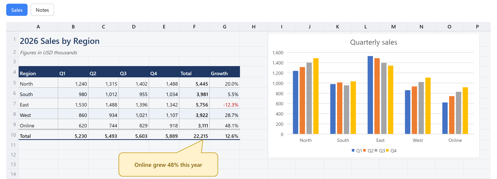
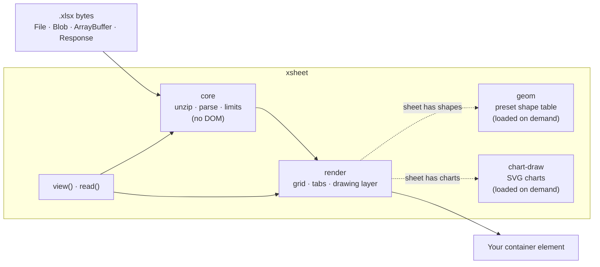

# XSheet

> Show `.xlsx` files in the browser the way Excel shows them — read-only, with no server and no network access.

[](LICENSE)
[](https://nodejs.org/)
[](https://www.typescriptlang.org/)
[](https://github.com/TaekangKwon/XSheet/actions/workflows/ci.yml)

**English** · [日本語](README.ja.md) · [한국어](README.ko.md)



_A workbook made in Excel ([`fixtures/excel/showcase.xlsx`](fixtures/excel/showcase.xlsx)), drawn by XSheet in the browser._

**[Try the live demo](https://taekangkwon.github.io/XSheet/)** — open your own `.xlsx` or pick a sample. Files are read in your browser and never uploaded.

---

## Why this exists

Many Excel viewers show the text of a workbook and roughly the shape of its sheets. But large workbooks (tens of thousands of cells or more) open slowly or not at all, and everything that is not text is lost or drawn wrong: cell borders and fills, column widths, merged cells, screenshots pasted onto the sheet, and shapes such as arrows and text boxes. So I built a viewer that does what I needed.

I had written an `.xlsx` viewer twice — once for **InterHub**, a Chrome extension that shows a project's documents in one screen (it ships with [InterHub-MCP](https://github.com/TaekangKwon/InterHub-MCP)), and once for another document viewer. Fixing the same rendering bug in two places got old, so the code became one library: **XSheet**.

It deliberately does one thing. [SheetJS](https://sheetjs.com/) reads and writes many formats; XSheet only **reads `.xlsx` and draws it as Excel would**, and it is built to survive the files you did not make yourself.

## What it draws

| Area | Supported |
| --- | --- |
| Cells | Values with their number formats, column widths and row heights, merged cells, borders, fills, font styling — matched to Excel 16 (target: within 1 px for sizes and drawing positions) |
| Drawings | Pictures, shapes (all 176 preset shapes and custom geometry), lines and connectors, groups, text in shapes — on a layer above the cells |
| Charts | Column and bar (clustered, stacked, 100 % stacked), line with markers, pie, doughnut — with title, legend, category and value axes and gridlines, drawn as SVG from the values saved in the file |
| Big sheets | A sheet with a million cells opens; only the visible part is drawn, and more is drawn as you scroll |
| Sheets | A tab for every sheet; hidden sheets get a marked tab, and the first visible sheet opens first |
| UI text | Japanese, English and Korean, replaceable key by key |
| Themes | Light, dark, or follow the OS; colors are CSS variables |

## Quick start

### One `<script>` (no build tools)

```html
<script src="xsheet.min.js"></script>
<input type="file" id="file" accept=".xlsx" />
<div id="viewer" style="height: 600px"></div>
<script>
  let viewer;
  document.querySelector('#file').onchange = async (e) => {
    viewer?.destroy();
    viewer = await XSheet.view('#viewer', e.target.files[0]);
  };
</script>
```

- Get `xsheet.min.js` from the standalone zip on Releases: see [Download the standalone zip](#download-the-standalone-zip).
- `xsheet.min.js` is a single file that bundles its dependencies (jszip, ssf), the shape table and the chart renderer. It defines the global `XSheet` and also works on a page opened from `file://`.
- The CSS is inserted for you. If the container has no height, the viewer uses 480 px and logs one `console.warn`.
- A finished viewer page (pick a file or drop it): [examples/standalone.html](examples/standalone.html).

### With a bundler (Vite, webpack, …)

```ts
import { view } from 'xsheet';

const viewer = await view('#viewer', file, { theme: 'auto' }); // File, Blob, ArrayBuffer, Response, …
viewer.destroy(); // clean up
```

React and Vue examples: [docs/guide/frameworks.md](docs/guide/frameworks.md).

### Node or a Web Worker (read only, no DOM)

```ts
import { openXlsx } from 'xsheet/core';

const book = await openXlsx(await readFile('book.xlsx'));
const sheet = await book.openSheet(book.sheets[0].index);
console.log(sheet.getRows(1, 10).map((row) => row.cells.map((c) => c?.text ?? '')));
book.close();
```

- `xsheet/core` uses no DOM and no Node-specific API. It runs in browsers, Web Workers and Node 20+.
- `read(source)` from `xsheet` does the same and also accepts `File`, `Blob` and `Response`. Reading in a Worker: [docs/guide/worker.md](docs/guide/worker.md).

## Installation

| Use | How to get it |
| --- | --- |
| `<script>`, or `import` without a bundler | Download `xsheet-<version>-standalone.zip` from [Releases](https://github.com/TaekangKwon/XSheet/releases) and unzip it next to your page ([steps](#download-the-standalone-zip)). Contents: [docs/guide/standalone.md](docs/guide/standalone.md) |
| Bundler or Node | Install from a Git tag (below) |

> [!NOTE]
> XSheet is **not published to npm yet**. Each Git tag contains a built `dist/`, so installing from a tag runs no build scripts ([ADR-0002](docs/adr/0002-build-and-distribution.md)).

```bash
npm install github:TaekangKwon/XSheet#v0.4.1
```

- The only dependencies are `jszip` and `ssf`; they are installed with it.
- `view`, `read`, `xsheet/core`, `MESSAGES_KO` and the standalone build arrived in v0.2.0. Charts, `readChart` and `xsheet-chart.mjs` arrived in v0.3.0, and `tabPosition` in v0.4.0.

### Download the standalone zip

1. Open the [latest release](https://github.com/TaekangKwon/XSheet/releases/latest) (older versions: [Releases](https://github.com/TaekangKwon/XSheet/releases)).
2. Under **Assets**, download `xsheet-<version>-standalone.zip`. The "Source code" archives are the repository's source, not the built library.
3. Unzip it. You get a folder `xsheet-<version>/`.
   - To try it right away, double-click `viewer.html` (it works from `file://`) and pick or drop an `.xlsx` file. The file is read in the browser and never uploaded.
   - To use it on your own page, copy `xsheet.min.js` next to the page and follow [One `<script>`](#one-script-no-build-tools). To `import` without a bundler, copy `xsheet.mjs`, `xsheet-geom.mjs` and `xsheet-chart.mjs` into the same folder.
4. When you redistribute these files, keep `xsheet.licenses.txt`, `LICENSE` and `NOTICE` with them.

## How it works



- **core** reads the zip and the XML lazily, sheet by sheet, and checks every size against a limit. It never touches the DOM, so it also runs in Node and in Workers.
- **render** draws the visible rows and columns into a scrolling grid and puts pictures, shapes and charts on a layer above it.
- **geom** (the shape table, about 30 KB gzipped) and **chart-draw** (about 16 KB) are separate chunks. They load only when a sheet actually has shapes or charts.

## API

### `view(target, source, options?)`

Shows the whole workbook with sheet tabs. Returns `Promise<Viewer>`.

| Argument | Meaning |
| --- | --- |
| `target` | An element or a CSS selector. XSheet appends a `div.xs-viewer` child and leaves the container itself alone |
| `source` | `File`, `Blob`, `ArrayBuffer`, a typed array (`Uint8Array`, …), `DataView`, `Response`, or a Promise of one of these |

- A URL string is rejected with `TypeError` — XSheet never fetches anything itself. To show a file from a URL, write `XSheet.view('#v', fetch(url))`. A failed `Response` (`ok` is false) is also a `TypeError`.
- Files that cannot be opened (encrypted, broken, too large, unsupported) do not throw. The viewer shows a message bar (`div.xs-banner`) instead, and `sheets` is empty.
- Calling `view` again on the same container replaces the previous view; you do not need `destroy()` first. If a second call starts while the first is still loading, the first call resolves to an empty `Viewer`.

#### Options (all optional)

| Option | Default | Meaning |
| --- | --- | --- |
| `lang` | `'auto'` | `'ja'`, `'en'`, `'ko'` or `'auto'`. `auto` looks at `<html lang>`, then the browser language, and falls back to English |
| `messages` | — | Replace some of the UI text, on top of the table chosen by `lang`. Keys: [docs/02_architecture.md](docs/02_architecture.md) §7 |
| `theme` | `'light'` | `'light'`, `'dark'` or `'auto'` (follows `prefers-color-scheme`). See [docs/guide/theme.md](docs/guide/theme.md) |
| `css` | `'auto'` | Insert the CSS once as a `<style>`. Skipped if `style.css` / `xsheet.css` is already loaded. `'none'` never inserts it |
| `height` | `'auto'` | Use 480 px only when the container's height is 0. A number means px; a string is a CSS length (`'70vh'`) |
| `drawings` | `true` | Show the drawing layer (pictures, shapes, lines, charts) |
| `tabPosition` | `'top'` | Where to put the sheet tabs: `'top'` (above the grid) or `'bottom'` (below it, as in Excel) |
| `nonce` | — | Nonce for the inserted `<style>` and the format `<style>` (for CSP; see [docs/guide/csp.md](docs/guide/csp.md)) |
| `limits` | `DEFAULT_LIMITS` | Override some of the read limits |

#### `Viewer`

| Member | Meaning |
| --- | --- |
| `sheets` | The sheet list (`SheetInfo[]`: `index` (1-based), `name`, `hidden`), in tab order, hidden sheets included |
| `showSheet(index or name)` | Switch sheets, like clicking a tab. Unknown index or name throws `RangeError` |
| `destroy()` | Remove the view and release the workbook, listeners and blob URLs. Safe to call more than once |

### `read(source, options?)`

Opens a workbook without any DOM. Same as `openXlsx`, but it accepts the same inputs as `view`. Returns `Promise<XlsxBook>`; the caller closes it with `close()`.

```ts
import { read, XlsxError } from 'xsheet';

try {
  const book = await read(fetch('/files/book.xlsx'), { limits: { maxSheetXmlBytes: 32 * 1024 * 1024 } });
  const sheet = await book.openSheet(book.sheets[0].index);
  const rows = sheet.getRows(1, 100); // rows 1–100: display text, formats, border ids
  book.close();
} catch (e) {
  if (e instanceof XlsxError) console.log(e.kind); // 'not-zip' | 'encrypted' | 'broken' | 'too-large' | 'unsupported'
}
```

### Lower-level building blocks (`renderWorkbook`, `renderSheet`, `openXlsx`)

These sit underneath `view`. Use them when you want to control CSS loading, sizing and the UI text yourself.

#### The whole workbook with tabs

```ts
import { renderWorkbook } from 'xsheet/render';
import 'xsheet/style.css';

const container = document.getElementById('viewer')!; // an element with a definite height
const data = await file.arrayBuffer(); // the .xlsx bytes (ArrayBuffer or Uint8Array)

const wb = await renderWorkbook(container, data);
wb.sheets; // SheetInfo[] (empty if the file could not be opened)
await wb.showSheet(2); // SheetInfo.index (1-based)
wb.destroy(); // release listeners and blob URLs, close the workbook, remove the view
```

- The container **must have a definite height** (an ancestor with `height: 100%`, a flex child, …). The inner scroller `.xs-body` is the window that decides what is visible. Unlike `view`, no default height is applied.
- The CSS is not inserted. Import `xsheet/style.css` or load it with `<link>`.
- A file that cannot be opened does not throw; a message is shown inside the view.

#### A single sheet

```ts
import { openXlsx } from 'xsheet';
import { renderSheet } from 'xsheet/render';
import 'xsheet/style.css';

const book = await openXlsx(data);
const first = book.sheets.find((s) => !s.hidden) ?? book.sheets[0];
const sheetView = await renderSheet(container, book, first.index);
// …
sheetView.destroy(); // does not close the book
book.close();
```

#### Options (`renderWorkbook`, `renderSheet`)

| Option | Default | Meaning |
| --- | --- | --- |
| `messages` | Japanese (`MESSAGES_JA`) | UI text; partial objects are fine. Pass `MESSAGES_EN` for English or `MESSAGES_KO` for Korean |
| `drawings` | `true` | Show the drawing layer. With `false`, drawings are not even read |
| `tabPosition` | `'top'` | `'top'` or `'bottom'`: where to put the sheet tabs (`renderWorkbook` only) |
| `nonce` | — | Nonce for the format `<style>` element (for CSP `style-src 'nonce-…'`) |
| `limits` | `DEFAULT_LIMITS` | Read limits (`renderWorkbook` only; for `renderSheet`, pass them to `openXlsx`) |
| `zoom` | `1` | Initial zoom (v0.5.0): a number from 0.5 to 2.0, or `{ fit: 'width' }` to fit the used columns to the view's width (`min` / `max` default to 0.5 / 2.0). Numbers outside the range are clamped; `NaN` or any other value throws `RangeError` |
| `headers` | `true` | With `false`, no row numbers and no column letters; the cells start at the top-left corner (v0.5.0) |

### Search, highlights and zoom (v0.5.0)

The views returned by `renderWorkbook` and `renderSheet` have members for search results, scrolling, hit testing and zoom (`WorkbookView` extends `SheetView`). `view` and its `Viewer` do not have them yet.

```ts
import { findText, openXlsx } from 'xsheet';
import { renderWorkbook } from 'xsheet/render';

const bytes = await file.arrayBuffer();
const wb = await renderWorkbook(container, bytes, { zoom: { fit: 'width' } });
const book = await openXlsx(bytes); // renderWorkbook keeps its book to itself; open one more to search (close it yourself)

const ac = new AbortController();
const shown = wb.sheets.find((s) => !s.hidden) ?? wb.sheets[0]; // the sheet shown first
const sheet = await book.openSheet(shown.index);
const { matches, truncated } = await findText(sheet, 'total', { signal: ac.signal });
wb.setHighlights(matches);
wb.focusHighlight(0); // scroll to the first hit and mark it as the current one

container.addEventListener('click', (e) => {
  const hit = wb.highlightAt(e.clientX, e.clientY);
  if (hit >= 0) wb.focusHighlight(hit, { scroll: false });
});
```

| Member | Meaning |
| --- | --- |
| `findText(sheet, query, options?)` | From `xsheet` / `xsheet/core`. Searches the text as displayed (after number formats). Resolves to `{ matches, truncated }`; a match is `{ r, c, start, end }` (1-based cell, UTF-16 offsets, `end` exclusive). Options: `match` (`'partial'` or `'cell'`), `ignoreCase` (`true`), `ignoreNewlines` (`true`), `skipHidden` (`true`), `signal` (rejects with an `AbortError` `DOMException`), `maxMatches` (10,000, at most 100,000). It yields to the page about every 10 ms |
| `setHighlights(matches)` | Highlight the matches; `null` or `[]` clears them. They survive scrolling and are cleared when the sheet changes. Colors: `--xs-hit-bg`, `--xs-hit-current-bg` |
| `focusHighlight(index, options?)` | Make one match (its index in the `setHighlights` array) the current one and scroll it about a third of the way down the view. `{ scroll: false }` only marks it, `{ smooth: true }` animates, `-1` clears the mark |
| `scrollToCell(r, c, options?)` | Scroll a cell (1-based) into view the same way |
| `cellAt(clientX, clientY)` | The cell `{ r, c }` under a point on the screen, or `null` on the headers, a scrollbar or outside the grid. A merged range gives its top-left cell; overflowing text gives the cell it comes from |
| `highlightAt(clientX, clientY)` | The index of the match under the point, or `-1` |
| `setZoom(zoom)`, `zoom` | Change the zoom (same values as the `zoom` option) or read it. The top-left cell stays in place. The headers keep their size (row numbers get a smaller font below 100%), and line widths do not change |
| `showSheet(index)` | Switch sheets without rebuilding the view: the zoom is kept and the highlights are cleared. `renderSheet` has it too |

- Do not scale the view with a CSS `transform`; `cellAt` and `highlightAt` would point at the wrong cells. Use `setZoom`.

The full API is described in [docs/02_architecture.md](docs/02_architecture.md) §2 (core) and §3 (render and the `view` layer).

### Entry points

| Import | Contents |
| --- | --- |
| `xsheet` | Everything: `view`, `read`, plus all public exports of `xsheet/core` and `xsheet/render` |
| `xsheet/core` | Reading only (`openXlsx`, `findText` (text search, v0.5.0), `XlsxError`, `DEFAULT_LIMITS`, unit conversions, …) and the types. Guaranteed to use no DOM and no Node-specific API (for Workers and Node) |
| `xsheet/render` | Rendering (`renderWorkbook`, `renderSheet`, `MESSAGES_JA`, `MESSAGES_EN`, `MESSAGES_KO`) |
| `xsheet/style.css` | The CSS (light defaults plus dark values under `data-xs-theme`) |
| `xsheet/geom` | The shape table and its formula evaluator. `render` imports it dynamically; you normally do not use it directly |
| `xsheet/internal` | Semi-public parts used by `render`. **No compatibility promise between versions** |

- ESM only. Types are included (TypeScript with `moduleResolution: "bundler"` is assumed).
- Importing `xsheet` in Node does not touch the DOM at load time, but only `xsheet/core` promises never to use it.
- The shape table loads only for sheets with shapes, and the chart renderer only for sheets with charts; your bundler keeps them as separate chunks too. Sizes: [docs/02_architecture.md](docs/02_architecture.md) §8.

## Theming

- For a dark view, pass `theme: 'dark'` to `view` (`'auto'` follows the OS). With `renderWorkbook` and friends, put `data-xs-theme="dark"` (or `"auto"`) on the view root or an ancestor such as `<html>`. The dark values ship in `style.css`; you do not need to copy them.
- Colors are 16 CSS variables (`--xs-*`). Their defaults have zero specificity (`:where(:root, :host)`), so you can override them anywhere, including inside Shadow DOM.

```css
/* change only the accent color of the light theme */
:root {
  --xs-accent: #0f766e;
}
```

Overriding the dark values and Shadow DOM notes: [docs/guide/theme.md](docs/guide/theme.md). What each variable does: [docs/02_architecture.md](docs/02_architecture.md) §6. Colors that come from the file (fills, font colors, shape colors) are drawn as-is, not through variables.

## UI text

- Japanese (`MESSAGES_JA`), English (`MESSAGES_EN`) and Korean (`MESSAGES_KO`) are included — 23 keys ([docs/02_architecture.md](docs/02_architecture.md) §7).
- `view` picks one with `lang` (default `auto`). `renderWorkbook` and `renderSheet` default to Japanese.
- To change only a few strings, pass e.g. `messages: { noData: '(empty)' }`.
- Developer-facing errors and warnings from `view` and `read` are in English and start with `XSheet:`.

## Security model

XSheet assumes every `.xlsx` it opens may be hostile.

- **No network.** The library never fetches, uploads or phones home. It only reads the bytes you hand it.
- **No code generation.** No `eval`, no `new Function`, no string timers — the standalone build is checked for this.
- **No HTML from the file.** Text from the file reaches the DOM only through `textContent`. Pictures are shown through `blob:` URLs.
- **Limits everywhere.** Unzipped size, part sizes, counts, shape formulas, image sizes and chart points have 29 limits. Going over one gives `XlsxError('too-large')` (`view` and `renderWorkbook` show a message), or that one drawing is simplified and a notice is shown. Defaults are in `DEFAULT_LIMITS` (list: [docs/02_architecture.md](docs/02_architecture.md) §5); `limits` overrides some of them.
- **No content in errors.** Exception messages never contain cell values or sheet names.

### Content Security Policy

| Directive | Why |
| --- | --- |
| `script-src 'self'` | The library and the shape table load from your origin. `'unsafe-eval'` is not needed, not even for the standalone build |
| `style-src 'nonce-<value>'` (or `'unsafe-inline'`) | The format `<style>` and the `<style>` that `view` inserts. Both get the `nonce` you pass |
| `img-src blob:` | Pictures are shown through blob URLs |

To avoid the inserted `<style>`, use `css: 'none'` and load `xsheet.css` (`style.css`) with `<link>`. Details: [docs/guide/csp.md](docs/guide/csp.md).

To report a vulnerability, see [SECURITY.md](SECURITY.md).

## Limitations

- **Read-only.** No writing or editing.
- **`.xlsx` only.** No `.xls` (BIFF), `.ods` or `.csv`. Route `.xls` to another library such as SheetJS.
- **No formula evaluation.** The values Excel saved in the file are shown.
- **Charts outside the supported set** (area, scatter, combo, secondary axis, 3-D, the Excel 2016+ chart types, …) show as a dashed frame with the chart type's name.
- **Not yet drawn:** conditional formatting, table styles, alignment and wrapping, font names, partial rich-text formatting ([docs/04_roadmap.md](docs/04_roadmap.md) M7).
- **Some rules are still provisional.** A few border and number-format cases are pending a check against Excel (known differences: [docs/05_quality.md](docs/05_quality.md)).

## Browser and runtime support

- `xsheet/core`: ES2022 browsers, Web Workers, Node 20+.
- `view`, `xsheet/render` and the standalone build: the latest two versions of Chrome, Edge, Firefox and Safari.

## Project layout

```text
XSheet/
├── src/
│   ├── core/          # Reading: zip, XML, cells, styles, drawings, charts, limits (no DOM)
│   ├── geom/          # Preset shape table and formula evaluator (loaded on demand)
│   ├── render/        # Grid, tabs, drawing layer, charts as SVG, UI text
│   ├── facade/        # view() and read(): the one-line entry layer
│   └── style.css      # The CSS (light + dark)
├── examples/          # Example pages (dev server and standalone)
├── fixtures/excel/    # Reference .xlsx files made in Excel, with the values Excel reports
├── tests/             # Vitest + jsdom
├── tools/             # Build of the standalone files, size check, shape-table generator
└── docs/              # Design notes, ADRs and guides (Japanese)
```

## Development

Node 22.12 or later is required for development.

| Command | Purpose |
| --- | --- |
| `npm run test` | Tests (Vitest) |
| `npm run typecheck` · `npm run lint` · `npm run format:check` | Types, ESLint, Prettier |
| `npm run build` | Build `dist/` (Vite library mode → d.ts → standalone files) |
| `npm run check:consumer` | Import `dist/` from a scratch project and check that type-checking and a build pass; check the package contents |
| `npm run check:standalone` | Check that the standalone files work in jsdom and in plain Node, and that their types compile |
| `npm run size` | Size of each entry point and standalone file against its limit |
| `npm run examples` | Example page at http://localhost:5173/examples/ (pick a file, switch theme and language) |
| `npm run examples:static` | After `npm run build`, serve the standalone example over http (http://localhost:5174/examples/esm.html) |

Conventions: `core` and `geom` use no DOM and no Node-specific API; no new dependencies without an ADR; test data is either synthesized (`src/testing/make-xlsx.ts`) or made in Excel by the authors. The rest is in [CLAUDE.md](CLAUDE.md).

`npm run sync:status` and `npm run sync:patch` pull changes from InterHub, the private project XSheet was extracted from. Only the maintainer can use them ([ADR-0003](docs/adr/0003-universal-distribution.md) §4).

## Documentation

The design documents and guides are written in Japanese.

| Document | Contents |
| --- | --- |
| [docs/guide/](docs/guide/README.md) | How-to guides: standalone build, React and Vue, Workers, CSP, theming |
| [docs/](docs/README.md) | Requirements, architecture, roadmap and quality notes |
| [docs/adr/](docs/adr/) | Architecture decision records |
| [CHANGELOG.md](CHANGELOG.md) | Release notes |

## Acknowledgements

- The preset shape table is generated from `presetShapeDefinitions.xml` in ECMA-376 (Ecma International). Its copyright notice is in [NOTICE](NOTICE) and ships with every build.
- Reading the zip relies on [JSZip](https://stuk.github.io/jszip/); number formats rely on [SSF](https://github.com/SheetJS/ssf).
- XSheet was extracted from the `.xlsx` viewer in InterHub.

## About us

This project is maintained by Kwon at **SYSTEM EMUZU CO.,LTD.** (株式会社システム・エムズ), a small software company in Kasaoka, Okayama, Japan, founded in 2000.\
We are a team that designs, builds and maintains web systems for businesses — event registration, cost estimation for construction, production management — under the motto _create rich time_: software that cuts mistakes and busywork so people get their time back.

- 🌐 [Website](https://msap2.jp/emuzu/)
- ✍️ [Tech blog](https://msap2.jp/emuzu/blog/) — the apps we make and how we use AI (Japanese)

## License

[MIT](LICENSE). The shape table carries Ecma International's copyright notice in [NOTICE](NOTICE), and the standalone files bundle their dependencies, whose licenses ship alongside as `xsheet.licenses.txt`. Keep `LICENSE`, `NOTICE` and `xsheet.licenses.txt` together when you redistribute.
