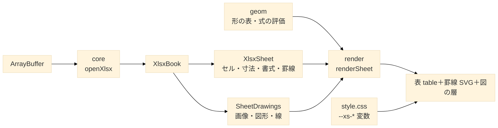

# 02. 設計 — 構成・公開 API・データモデル

| 項目 | 値 |
| --- | --- |
| 文書 | XSheet 立ち上げ資料 02 |
| 更新日 | 2026-10-28 |
| 関連 | [01_requirements.md](01_requirements.md)・[03_source-map.md](03_source-map.md) |

## TL;DR
- 3 層：**core**（.xlsx → データモデル・DOM 非依存）／**geom**（図形の形の表と式の評価・遅延読み込み）／**render**（DOM の表と重ねる層・CSS 1 枚）。
- 公開の入口は `openXlsx`（core）と `renderSheet`・`renderWorkbook`（render）。表示は 1 回の呼び出しごとのインスタンスで、`destroy()` で全部放す。
- 見た目は CSS 変数 `--xs-*` で、文言は `messages` で、使う側が差し替える。

---

## 1. 構成



| 層 | 入口（サブパス） | 依存 | 動く場所 |
| --- | --- | --- | --- |
| core | `xsheet`・`xsheet/internal`（半公開） | jszip・ssf | ブラウザ・Worker・Node |
| geom | `xsheet/geom`（render が動的 import） | なし | どこでも |
| render | `xsheet/render`・`xsheet/style.css` | core・geom・DOM | ブラウザ |

- InterHub では形の評価器が描画側（`viewers/xlsx-geom.ts`）にあり、core（`drawing-geom.ts`・`types.ts`）がそれを import している。ライブラリでは geom を独立させてこの逆転をなくす。

### ディレクトリ

```text
XSheet/
├─ src/core/        # 読み取り（InterHub lib/xlsx）
├─ src/geom/        # 形の表と評価器（InterHub viewers/xlsx-geom.ts・xlsx-preset-geom.json）
├─ src/render/      # 描画（InterHub viewers/xlsx-*.ts・spreadsheet.ts の .xlsx 部分）
├─ src/style.css    # InterHub global.css の .xlsx の部分
├─ src/testing/     # 合成 xlsx・画像を作る make-xlsx.ts・make-image.ts（テスト専用・公開しない）
├─ tools/geom/      # presetShapeDefinitions.xml・変換器・NOTICE
├─ tests/  fixtures/excel/  examples/  docs/
└─ NOTICE
```

## 2. 公開 API — core

```ts
export function openXlsx(data: ArrayBuffer | Uint8Array, options?: OpenXlsxOptions): Promise<XlsxBook>;
export interface OpenXlsxOptions { limits?: Partial<XlsxLimits> }

export interface XlsxBook {
  readonly sheets: readonly SheetInfo[];                 // index は 1 始まり・hidden は veryHidden を含む
  openSheet(index: number): Promise<XlsxSheet>;
  openDrawings(index: number): Promise<SheetDrawings>;   // 画像・図形・線・グループ＋通知
  readImage(index: number, path: string): Promise<ImageResult>; // シートごとに合計 128 MiB の予算
  close(): void;
}

export interface XlsxSheet {
  readonly rowCount: number; readonly colCount: number;
  readonly layout: SheetLayout;                 // 列幅・行高・既定値・非表示・MDW
  readonly borders: readonly CellBorder[];      // 罫線の表（SheetRow.borders の番号で引く）
  readonly formats: readonly CellFormat[];      // 見える書式の表（SheetRow.formats の番号で引く）
  rowFormat(r: number): number | undefined;     // 行の書式（customFormat）
  colFormat(c: number): number;                 // 列の書式
  getRows(first: number, last: number): SheetRow[]; // 見えている範囲だけ展開
}

export class XlsxError extends Error { kind: 'not-zip' | 'encrypted' | 'broken' | 'too-large' | 'unsupported' }
export { DEFAULT_LIMITS, colName, createGeometry, colWidthToPx, defaultColWidthToPx, ptToPx, fontDefaultRowPx, lookupMdw, isPaperFill };
```

- 今の InterHub の `lib/xlsx/index.ts` と同じ形。公開の範囲は M1-3 で次のように決めた（テストは `tests/core/public-api.test.ts`）：
  - 値：上の 11 個（`openXlsx`・`XlsxError`・`DEFAULT_LIMITS`・`colName`・`createGeometry`・`colWidthToPx`・`defaultColWidthToPx`・`ptToPx`・`fontDefaultRowPx`・`lookupMdw`・`isPaperFill`）。
  - 型：`types.ts` の公開の型を全部（図の型 `DrawingText`・`DrawingLine`・`ShapeGeom`・`DrawingGroup` なども `openDrawings` の戻り値から辿れるため）と、`Rgba`・`Geometry`・`XlsxLimits`・`OpenXlsxOptions`。`types.ts` に型を足したら入口にも足す（テストが落ちる）。
  - 出さない：`Theme`・`FormatTable`・`BorderTable` と読み取りの内部の関数（ブックの中で閉じていて、使う側が触る場面が無い）。
  - `xsheet/internal`（`src/core/internal.ts`・半公開で版の互換を約束しない）：render が使う `applyFillMode` と、描画の部品の試験で使う `emptyLayout`・`DEFAULT_MDW`。
  - `src/render/**` は core を `../core/index` と `../core/internal` からだけ引く（ESLint の `no-restricted-imports`）。M4 で core と render を別のチャンクにしたときに部品が重ならないようにするため。
  - DOM 非依存は、core の入口を Vite で束ねて素の Node（`--disallow-code-generation-from-strings`）で import し、Excel で作ったファイルを開いて元のソースと同じ結果になることで確かめる（`tests/core/node-import.test.ts`）。形の表（`preset-geom.json`）が core に入らないことも同じテストで見る。
- M6 の候補：`cellValue(r, c)`（生の値と型）、`sheetToJson`・`sheetToCsv`（SheetJS の `sheet_to_json` に当たる）。

## 3. 公開 API — render

```ts
export interface RenderOptions {
  messages?: Partial<XSheetMessages>;   // 既定は ja（MESSAGES_JA）。en（MESSAGES_EN）も同梱
  drawings?: boolean;                   // 図の層（既定 true）
  nonce?: string;                       // 書式の <style> に付ける（CSP 用・M3）
}
export interface SheetView {
  destroy(): void;                      // blob URL・リスナ・シートを放す（book は閉じない）
  scrollToCell?(r: number, c: number): void; // M6 の候補
}
export function renderSheet(container: HTMLElement, book: XlsxBook, sheetIndex: number, options?: RenderOptions): Promise<SheetView>;

export interface WorkbookView extends SheetView { showSheet(index: number): Promise<void> }
export function renderWorkbook(container: HTMLElement, data: ArrayBuffer, options?: RenderOptions): Promise<WorkbookView>; // タブ付き・book も閉じる
```

- `container` は高さが決まっていて、中でスクロールする前提（スクロール枠 `.xs-body` の `overflow` などは `style.css`（M3-1）が付ける）。render は `container` の子に自前の根 `div.xs-sheet` を足すだけで、`container` 自身には属性もクラスも付けない。
- DOM（M2-3）：`div.xs-sheet[data-xs-fmt]` ＞ [`div.xs-notice`（図の通知。無ければ hidden）・`div.xs-body`（スクロール枠＝仮想化の窓）・`<style>`（書式。`nonce` を付けられる）]。`div.xs-body` ＞ `div.xs-wrap` ＞ [`table.xs-grid`・`svg.xs-borders`・`div.xs-layer`]。空のシートは `div.xs-empty`、シートを開けないときは `div.xs-banner` を `div.xs-body` の中に出す。
- `sheetIndex` は `SheetInfo.index`（1 始まり・非表示のシートも数える）。ブックに無い番号は `RangeError`（DOM に何も足さない）。シートを開けない（`openSheet` の例外）ときは例外にせず、枠の中にメッセージを出して解決する。
- InterHub の `spreadsheet.ts` はモジュール変数（`disposeXlsxView`・`renderGeneration`・`formatSeq`）で表示を 1 つだけ持つ。render では状態を表示のインスタンス（`src/render/sheet-view.ts` の `createSheetView`）に持たせ、同じページに複数の表示を置けるようにする。書式の CSS の連番（`data-xs-fmt`）はモジュールで 1 つの連番のままでよい。
- 大きさの変化は `window` の `resize` ではなく、スクロール枠の `ResizeObserver`（無い環境では使わない）で知る。スクロール・大きさの変化は rAF 1 回にまとめて描く。`window`・`document` にはリスナを付けない。
- 描画の順（InterHub の `renderXlsxView` と同じ）：
  1. `openSheet` → `openDrawings`（`drawings: false` なら読まない）→ 形のある図形があれば形の表を読む（`loadGeom`。読めなければ代替で描き、通知 `libLoadFailed`）。
  2. 書式の CSS をブックで 1 回作る（`buildFormatCss`。シートを替えても作り直さない）。
  3. 図の配置（`layoutDrawings`）と図の層（`createImageLayer`）。
  4. 範囲と座標（`gridExtent`・`createGeometry`）。
  5. スクロールごとに `getRows` → 表（`buildGridTable`）→ 罫線（`buildBorderPaths`）。
  6. `destroy` で層（blob URL を revoke）・罫線・シートを放し、根を `container` から外す。ブックは閉じない。
- `renderWorkbook`（M2-4）は同じインスタンスの `showSheet(index)` でシートを替える（書式の `<style>` はブックで 1 つのまま）。

## 4. データモデル（要点）

| 型 | 主なフィールド |
| --- | --- |
| `CellView` | `text`（表示形式を適用した文字列）・`kind?`（`n`/`s`/`b`/`e`/`d`）・`colSpan`・`rowSpan` |
| `SheetRow` | `r`・`cells`（`undefined`＝空、`null`＝結合で隠れる）・`borders?`・`formats?`（表の番号） |
| `SheetLayout` | `cols: ColLayout[]`（`min`・`max`・`width`（文字数）・`hidden`・`xf?`）・`rows: RowLayout[]`（`ht`（pt）・`hidden`・`custom`）・`defaultColWidth`・`baseColWidth`・`defaultRowHeight`・`zeroHeight`・`mdw`・`fontRowPx` |
| `CellFormat` | `fill?`・`color?`（`Rgba`）・`bold?`・`italic?`・`strike?`・`underline?`（`single`/`double`）・`sizeRatio?`（0.5〜4） |
| `CellBorder` | `left?`・`right?`・`top?`・`bottom?`・`diagonal?`（`BorderEdge`＝13 線種＋色）・`diagonalUp`・`diagonalDown` |
| `SheetDrawing` | `anchor`（twoCell/oneCell/absolute）・`kind`（image/chart/smartart/shape/textbox/group/line）・`text?`・`geom?`（preset か custom）・`outline?`・`fillColor?`・`outlineColor?`・`line?`・`group?`・回転と反転 |
| `DrawingText` | 段落（揃え・箇条書き）→ ラン（文字・サイズ・太字など・色）・縦の揃え・余白・縦書き |
| `ImageResult` | `ok:true` で `format`・`mime`・`width`・`height`・`bytes`／`ok:false` で `reason` |
| `SheetDrawings.notices` | `part-too-large`・`broken`・`too-many`・`text-truncated`・`shape-simplified` |

- 全体は InterHub `src_V1/src/lib/xlsx/types.ts`（599 行）。行の番号・列の番号・アンカーの数え始め（0 か 1 か）は型の doc コメントに従う。

## 5. 上限（`XlsxLimits`・既定値）

| 区分 | 項目と既定値 |
| --- | --- |
| zip・部品 | `maxSheetXmlBytes` 160 MiB／`maxSharedStringsBytes` 64 MiB／`maxSmallPartBytes` 16 MiB／`maxEntries` 10,000／`maxSheets` 1,000／`maxMerges` 500,000 |
| 図 | `maxDrawings` 1,000／`maxLines` 1,000／`maxGroupDepth` 8 |
| 図形の文字 | `maxShapeTextChars` 10,000／`maxShapeParagraphs` 500／`maxShapeRuns` 2,000／`maxSheetTextChars` 1,000,000 |
| 画像 | `maxImageBytes` 20 MiB／`maxSheetImageBytes` 128 MiB／`maxImageSidePx` 16,384／`maxImagePixels` 64 Mi 画素 |
| 形の式 | `maxGeomGuides` 512／`maxGeomCommands` 4,096／`maxSheetGeomUnits` 200,000／`maxShapeAdjustments` 16 |
| 書式 | `maxBorders` 65,536／`maxFonts` 65,536／`maxFills` 65,536／`maxCellFormats` 4,096 |

- 変えられない定数：Excel の仕様上限（行 1,048,576・列 16,384・セル文字 32,767・列幅 255・行高 409.5pt）、`MAX_COLOR_TRANSFORMS` 16、`MAX_GRADIENT_STOPS` 16、`MAX_FORMAT_CODE_LENGTH` 255、描画側の `MAX_BORDER_SEGMENTS` 50,000。

## 6. CSS 変数

| ライブラリの変数 | 役割 | 明るい既定値 | ダークの例 | InterHub の元 |
| --- | --- | --- | --- | --- |
| `--xs-fg` | 文字の色（塗りの無いセル・自動の文字） | `#1a1a1a` | `#e6e6e6` | `--ih-fg` |
| `--xs-bg` | 見出し・面の地 | `#ffffff` | `#1e1e1e` | `--ih-bg` |
| `--xs-cell-bg` | セルの地（白の塗り＝「紙」もこれ） | `#f5f6f8` | `#0f1115` | `--ih-xlsx-cell-bg`（＝`--ih-canvas`） |
| `--xs-head-bg` | 列記号・行番号の地 | `#eef0f4` | `#1f232c` | `--ih-bg-elev2` |
| `--xs-grid` | グリッド線 | `#d0d0d0` | `#3a3a3a` | `--ih-border` |
| `--xs-muted`・`--xs-faint` | 行番号・破線枠の文字 | `#6b7280`・`#8a92a2` | `#9ca3af`・`#6b7386` | `--ih-muted`・`--ih-faint` |
| `--xs-border-ink` | 自動・黒の罫線（墨色） | `#000000` | `#d4d4d4` | `--ih-xlsx-border-ink` |
| `--xs-backdrop`・`--xs-backdrop-display` | ダーク時の図の白い下地 | `transparent`・`none` | `#ffffff`・`block` | `--ih-xlsx-backdrop*` |

- `style.css` は明るい既定値だけを持つ。ダーク表示は使う側が変数を上書きする（`prefers-color-scheme` か自前のテーマ属性）。例を `examples/` に置く。
- Excel の色（塗り・文字の色・図形の色）は変数ではなく、書式の CSS とインラインの値で入る。ダーク表示の描き分けの規則（塗りのあるセルは Excel の色のまま、白の塗りは「紙」など）は InterHub ADR-0030 のとおり。
- クラス名は InterHub の `ih-xlsx-*`・`ih-xf-N`・`data-ih-xlsx-fmt` を `xs-*`・`xs-xf-N`・`data-xs-fmt` にする（D6）。表の根の `.ih-spreadsheet` は `.xs-sheet`。InterHub 共用のクラス（`ih-data-view`・`ih-data-banner`・`ih-dv-rownum`・`ih-sheet-tabs` など）は、render が要るものだけ `xs-` で作り直す。

## 7. 文言（`XSheetMessages`・23 キー）

| 区分 | キー（InterHub の `spreadsheet.`・`spreadsheet.drawing.` を除いた名前） |
| --- | --- |
| エラー | `parseFailed`（`{detail}`）・`noSheets`・`noData`（InterHub の `data.noData`）・`encrypted`・`tooLarge`・`unsupported` |
| タブ | `hiddenSheet`・`tabsPrev`・`tabsNext`（`renderWorkbook` だけが使う） |
| 図の枠 | `chart`・`smartart`・`shape`・`textbox`・`group`・`imageFormat`（`{format}`）・`imageBroken` |
| 通知 | `noticeTooLarge`・`noticeBroken`・`noticeTooMany`・`noticeTextTruncated`・`noticeShapeSimplified`・`noticeOverBudget`・`libLoadFailed`（形の表を読めない） |

- 文言の元は InterHub `src_V1/src/locales/ja.ts`（275〜302 行・248 行の `data.noData`）と `en.ts`。
- 実装は `src/render/messages.ts`（M2-2）：
  - `MESSAGES_JA`（既定）・`MESSAGES_EN` は凍結した平たいオブジェクト。`xsheet/render` から出す。
  - `resolveMessages(partial, base)` が既定に渡された分だけを重ねる。文字列でない値・表に無いキーは無視する。
  - 差し込み（`{detail}`・`{format}`）は `formatMessage` が行う。値の無い `{name}` は残す（InterHub の `t()` と同じ）。
  - 型の名前は、旧仮称由来の `XlsxViewMessages` をやめて `XSheetMessages` にした（D6 と同じ理由）。
  - `libLoadFailed` は、InterHub では xlsx の読み込み（動的 import）の失敗だったが、render は core を静的に引くため起きない。M2-3 で「形の表（geom の動的 import）を読めない」通知の文言に替えた。
  - 23 キー目の `noData` は、`spreadsheet.ts` が空のシートで使う InterHub 共用のキー（`data.noData`）。立ち上げ資料の 22 キーには入っていなかった。
