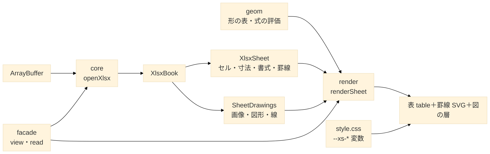

# 02. 設計 — 構成・公開 API・データモデル

| 項目 | 値 |
| --- | --- |
| 文書 | XSheet 立ち上げ資料 02 |
| 更新日 | 2026-11-12 |
| 関連 | [01_requirements.md](01_requirements.md)・[03_source-map.md](03_source-map.md)・[ADR-0003](adr/0003-universal-distribution.md)（M6）・[guide/](guide/README.md) |

## TL;DR
- 3 層：**core**（.xlsx → データモデル・DOM 非依存）／**geom**（図形の形の表と式の評価・遅延読み込み）／**render**（DOM の表と重ねる層・CSS 1 枚）。その上に薄い**入口の層**（`src/facade/`・M6）を置く。
- 公開の入口は `view`・`read`（入口の層）、`openXlsx`（core）、`renderSheet`・`renderWorkbook`（render）。表示は 1 回の呼び出しごとのインスタンスで、`destroy()` で全部放す。
- import は `xsheet`（全部）が基本。DOM を使わない約束は `xsheet/core`。依存を束ねた単独版（`xsheet.min.js`・`xsheet.mjs`）も配る（§8）。
- 見た目は CSS 変数 `--xs-*` と `data-xs-theme` で、文言は `lang`・`messages` で、使う側が差し替える。

---

## 1. 構成



| 層 | 入口（サブパス） | 依存 | 動く場所 |
| --- | --- | --- | --- |
| facade（入口の層） | `xsheet`（`view`・`read`。core・render の公開物も出す） | core・render | ブラウザ（`read` はどこでも） |
| core | `xsheet/core`・`xsheet`・`xsheet/internal`（半公開） | jszip・ssf | ブラウザ・Worker・Node |
| geom | `xsheet/geom`（render が動的 import） | なし | どこでも |
| render | `xsheet/render`・`xsheet`・`xsheet/style.css` | core・geom・DOM | ブラウザ |

- InterHub では形の評価器が描画側（`viewers/xlsx-geom.ts`）にあり、core（`drawing-geom.ts`・`types.ts`）がそれを import している。ライブラリでは geom を独立させてこの逆転をなくす。
- 入口の層（M6-2・[ADR-0003](adr/0003-universal-distribution.md) §2）は XSheet 固有のファイルで、InterHub から写したファイル（`src/core/`・`src/render/`）とは別に置く（写しの規約・ADR-0003 §4-1）。

### ディレクトリ

```text
XSheet/
├─ src/index.ts     # xsheet の入口（core・render・facade を全部出す。M6-2）
├─ src/core/        # 読み取り（InterHub lib/xlsx）
├─ src/geom/        # 形の表と評価器（InterHub viewers/xlsx-geom.ts・xlsx-preset-geom.json）
├─ src/render/      # 描画（InterHub viewers/xlsx-*.ts・spreadsheet.ts の .xlsx 部分）
├─ src/facade/      # 入口の層 view・read（XSheet 固有。M6-2）
├─ src/style.css    # InterHub global.css の .xlsx の部分＋data-xs-theme のダーク
├─ src/testing/     # 合成 xlsx・画像を作る make-xlsx.ts・make-image.ts（テスト専用・公開しない）
├─ tools/geom/      # presetShapeDefinitions.xml・変換器・NOTICE
├─ tools/standalone/  # 単独版のビルド・検査・遅れて読む部品の一覧（M6-3）
├─ tools/sync/      # InterHub の変更の取り込みの道具（M6-1）
├─ tests/  fixtures/excel/  examples/  docs/
├─ LICENSE         # MIT（ADR-0004）
└─ NOTICE
```

## 2. 公開 API — core

```ts
export function openXlsx(data: ArrayBuffer | Uint8Array, options?: OpenXlsxOptions): Promise<XlsxBook>;
export interface OpenXlsxOptions { limits?: Partial<XlsxLimits> }

export interface XlsxBook {
  readonly sheets: readonly SheetInfo[];                 // index は 1 始まり・hidden は veryHidden を含む
  openSheet(index: number): Promise<XlsxSheet>;
  openDrawings(index: number): Promise<SheetDrawings>;   // 画像・図形・線・グループ＋通知
  readImage(index: number, path: string): Promise<ImageResult>; // シートごとに合計 128 MiB の予算
  close(): void;
}

export interface XlsxSheet {
  readonly rowCount: number; readonly colCount: number;
  readonly layout: SheetLayout;                 // 列幅・行高・既定値・非表示・MDW
  readonly borders: readonly CellBorder[];      // 罫線の表（SheetRow.borders の番号で引く）
  readonly formats: readonly CellFormat[];      // 見える書式の表（SheetRow.formats の番号で引く）
  rowFormat(r: number): number | undefined;     // 行の書式（customFormat）
  colFormat(c: number): number;                 // 列の書式
  getRows(first: number, last: number): SheetRow[]; // 見えている範囲だけ展開
}

// 文字の検索（M7-4・ADR-0007 §1）。非同期・中断・件数の上限。CellView.text で照らす
export function findText(sheet: XlsxSheet, query: string, options?: FindTextOptions): Promise<FindTextResult>;

export class XlsxError extends Error { kind: 'not-zip' | 'encrypted' | 'broken' | 'too-large' | 'unsupported' }
export { findText, DEFAULT_LIMITS, colName, createGeometry, colWidthToPx, defaultColWidthToPx, ptToPx, fontDefaultRowPx, lookupMdw, isPaperFill };
```

- 入口は `xsheet/core`（M6-2 で足した。DOM・Node 固有の API を使わないことを約束する入口）。`xsheet` も core の公開物をすべて出す（v0.1.0 では `xsheet` が core の入口だった。§3「入口の層」）。
- 今の InterHub の `lib/xlsx/index.ts` と同じ形。公開の範囲は M1-3 で次のように決めた（テストは `tests/core/public-api.test.ts`）：
  - 値：上の 12 個（`openXlsx`・`findText`・`XlsxError`・`DEFAULT_LIMITS`・`colName`・`createGeometry`・`colWidthToPx`・`defaultColWidthToPx`・`ptToPx`・`fontDefaultRowPx`・`lookupMdw`・`isPaperFill`）。
  - 型：`types.ts` の公開の型を全部（図の型 `DrawingText`・`DrawingLine`・`ShapeGeom`・`DrawingGroup` なども `openDrawings` の戻り値から辿れるため）と、`Rgba`・`Geometry`・`XlsxLimits`・`OpenXlsxOptions`・`FindTextOptions`・`FindTextResult`・`TextMatch`。`types.ts` に型を足したら入口にも足す（テストが落ちる）。
  - 出さない：`Theme`・`FormatTable`・`BorderTable` と読み取りの内部の関数（ブックの中で閉じていて、使う側が触る場面が無い）。
  - `xsheet/internal`（`src/core/internal.ts`・半公開で版の互換を約束しない）：render が使う `applyFillMode` と、描画の部品の試験で使う `emptyLayout`・`DEFAULT_MDW`。
  - `src/render/**` は core を `../core/index` と `../core/internal` からだけ引く（ESLint の `no-restricted-imports`）。M4 で core と render を別のチャンクにしたときに部品が重ならないようにするため。
  - DOM 非依存は、core の入口を Vite で束ねて素の Node（`--disallow-code-generation-from-strings`）で import し、Excel で作ったファイルを開いて元のソースと同じ結果になることで確かめる（`tests/core/node-import.test.ts`）。形の表（`preset-geom.json`）が core に入らないことも同じテストで見る。
- M7 の候補：`cellValue(r, c)`（生の値と型）、`sheetToJson`・`sheetToCsv`（SheetJS の `sheet_to_json` に当たる）。

## 3. 公開 API — render と入口の層

```ts
export interface RenderOptions {
  messages?: Partial<XSheetMessages>;   // 既定は ja（MESSAGES_JA）。en（MESSAGES_EN）も同梱
  drawings?: boolean;                   // 図の層（既定 true）
  nonce?: string;                       // 書式の <style> に付ける（CSP 用。§3「CSP」）
  zoom?: Zoom;                          // 最初の倍率（M7-7・ADR-0007 §5。0.5〜2.0 か { fit: 'width' }）
  headers?: boolean;                    // 行番号の列と列見出し（既定 true。M7-9・ADR-0007 §7）
}
export interface SheetView {
  setHighlights(matches: readonly TextMatch[] | null): void; // 検索の一致を光らせる（M7-5・ADR-0007 §2。null・空で消す）
  focusHighlight(index: number, options?: FocusHighlightOptions): void; // 今のヒット（M7-6・ADR-0007 §3。-1 で外す）
  scrollToCell(r: number, c: number, options?: ScrollToCellOptions): void; // 縦は上から約 1/3・横は見えていないときだけ
  cellAt(clientX: number, clientY: number): CellPosition | null; // 画面の位置のセル（M7-6・ADR-0007 §4。結合は左上）
  highlightAt(clientX: number, clientY: number): number; // 画面の位置のハイライトの番号（無ければ -1）
  setZoom(zoom: Zoom): void;           // 倍率を替える（M7-7・ADR-0007 §5。寸法に倍率を掛けて描き直す・見出しには掛けない）
  readonly zoom: number;                // 今の倍率（fit は計算した値）
  showSheet(index: number): Promise<void>; // シートを替える（M7-9・ADR-0007 §7。倍率は保ち、ハイライトは消す）
  destroy(): void;                      // blob URL・リスナ・シートを放す（book は閉じない）
}
export function renderSheet(container: HTMLElement, book: XlsxBook, sheetIndex: number, options?: RenderOptions): Promise<SheetView>;

export interface WorkbookOptions extends RenderOptions {
  limits?: Partial<XlsxLimits>;         // openXlsx に渡す上限
  tabPosition?: 'top' | 'bottom';       // タブ列の場所（既定 top。Issue #17）
}
export interface WorkbookView extends SheetView {
  readonly sheets: readonly SheetInfo[];   // タブの並び。開けなかったブック・シート 0 枚では空（M6-2）
  showSheet(index: number): Promise<void>; // SheetInfo.index。無い番号は RangeError。表示中なら何もしない
}
export function renderWorkbook(container: HTMLElement, data: ArrayBuffer | Uint8Array, options?: WorkbookOptions): Promise<WorkbookView>; // タブ付き・destroy で book も閉じる
```

- `container` は高さが決まっていて、中でスクロールする前提（スクロール枠 `.xs-body` の `overflow` などは `style.css`（M3-1）が付ける）。render は `container` の子に自前の根 `div.xs-sheet` を足すだけで、`container` 自身には属性もクラスも付けない。
- DOM（M2-3）：`div.xs-sheet[data-xs-fmt]` ＞ [`div.xs-notice`（図の通知。無ければ hidden）・`div.xs-body`（スクロール枠＝仮想化の窓）・`<style>`（書式。`nonce` を付けられる）]。`div.xs-body` ＞ `div.xs-wrap` ＞ [`table.xs-grid`・`svg.xs-borders`・`div.xs-layer`]。空のシートは `div.xs-empty`、シートを開けないときは `div.xs-banner` を `div.xs-body` の中に出す。
- `sheetIndex` は `SheetInfo.index`（1 始まり・非表示のシートも数える）。ブックに無い番号は `RangeError`（DOM に何も足さない）。シートを開けない（`openSheet` の例外）ときは例外にせず、枠の中にメッセージを出して解決する。
- InterHub の `spreadsheet.ts` はモジュール変数（`disposeXlsxView`・`renderGeneration`・`formatSeq`）で表示を 1 つだけ持つ。render では状態を表示のインスタンス（`src/render/sheet-view.ts` の `createSheetView`）に持たせ、同じページに複数の表示を置けるようにする。書式の CSS の連番（`data-xs-fmt`）はモジュールで 1 つの連番のままでよい。
- 大きさの変化は `window` の `resize` ではなく、スクロール枠の `ResizeObserver`（無い環境では使わない）で知る。スクロール・大きさの変化は rAF 1 回にまとめて描く。`window`・`document` にはリスナを付けない。
- 描画の順（InterHub の `renderXlsxView` と同じ）：
  1. `openSheet` → `openDrawings`（`drawings: false` なら読まない）→ 形のある図形があれば形の表を読む（`loadGeom`。読めなければ代替で描き、通知 `libLoadFailed`）。
  2. 書式の CSS をブックで 1 回作る（`buildFormatCss`。シートを替えても作り直さない）。
  3. 図の配置（`layoutDrawings`）と図の層（`createImageLayer`）。
  4. 範囲と座標（`gridExtent`・`createGeometry`）。
  5. スクロールごとに `getRows` → 表（`buildGridTable`）→ 罫線（`buildBorderPaths`）。
  6. `destroy` で層（blob URL を revoke）・罫線・シートを放し、根を `container` から外す。ブックは閉じない。
- `renderWorkbook`（M2-4）：
  - DOM：`container` の子に `div.xs-workbook` ＞ [`div.xs-sheet-strip`（タブ列）・`div.xs-sheet`（上のシートの表示）]。タブ列は `button.xs-sheet-nav`（◀）・`div.xs-sheet-tabs`（横スクロール）＞ `button.xs-sheet-tab`…・`button.xs-sheet-nav`（▶）。タブは `is-active`・`is-hidden-sheet`（名前に ` ⌀`、title に名前と `hiddenSheet`）。`tabPosition: 'bottom'` では子の順が [`div.xs-sheet`・`div.xs-sheet-strip`] になり、根に `xs-tabs-bottom` を付ける（知らない値は `top`。Issue #17）。
  - 見た目（Issue #23・CSS だけ）：タブ列は表に付け、境に線を引く。タブは角の無い枠を縦線で区切り、選んだタブは表と同じ地・`--xs-accent` の太字で、表と反対側の端に棒を出す（上なら上端、下なら下端）。◀ ▶ は CSS の `order` で左にまとめる（DOM の並びは ◀・タブ・▶ のまま）。非表示のシートは斜体・破線ではなく薄い文字（`--xs-faint`）。見出し（列記号・行番号）は太字にせず、行番号は中央に置く。
  - シートの表示は 1 冊に 1 つ（`createSheetView`）で、タブは同じインスタンスの `showSheet` でシートを替える（書式の `<style>` はブックで 1 つのまま）。最初に出すのは最初の表示（非表示でない）シート、全部非表示なら先頭。
  - 開けない（`openXlsx` の例外）ときは例外にせず `div.xs-workbook` ＞ `div.xs-banner`（種類ごとの文言）、シートが 0 枚なら `div.xs-empty`（`noSheets`。ブックは閉じる）で解決する。どちらも `showSheet` は `RangeError`。
  - `destroy`：タブ列（リスナ・ResizeObserver・rAF）→ シートの表示 → `book.close()` → 根を外す。何度呼んでもよい。
  - `sheets`（M6-2）：入口の層の `Viewer.sheets` と、名前でのシートの切り替えのために足した。写したファイルの中の XSheet 固有の変更なので `// XSheet:` の印を付けている（ADR-0003 §4-1 の 3）。

### 入口の層（`src/facade/`・M6-2・[ADR-0003](adr/0003-universal-distribution.md) §2）

```ts
export type XSheetSource = Blob | ArrayBuffer | ArrayBufferView | Response
  | PromiseLike<Blob | ArrayBuffer | ArrayBufferView | Response>;  // File は Blob。URL の文字列は受けない

export interface ReadOptions { limits?: Partial<XlsxLimits> }
export interface ViewOptions extends ReadOptions {
  lang?: 'ja' | 'en' | 'ko' | 'auto';   // 既定 auto
  messages?: Partial<XSheetMessages>;   // lang で選んだ表の上に重ねる
  theme?: 'light' | 'dark' | 'auto';    // 既定 light
  css?: 'auto' | 'none';                // 既定 auto
  height?: number | string;             // 既定 'auto'。数値は px、文字列は CSS の長さ
  drawings?: boolean;                   // 既定 true
  tabPosition?: 'top' | 'bottom';       // 既定 top。renderWorkbook にそのまま渡す
  nonce?: string;                       // 自動の <style> と書式の <style> に付ける
}
export interface Viewer {
  readonly sheets: readonly SheetInfo[];
  showSheet(sheet: number | string): Promise<void>; // 番号（SheetInfo.index）か名前。無ければ RangeError
  destroy(): void;                                    // 何度呼んでもよい
}
export function view(target: HTMLElement | string, source: XSheetSource, options?: ViewOptions): Promise<Viewer>;
export function read(source: XSheetSource, options?: ReadOptions): Promise<XlsxBook>; // openXlsx と同じ
```

- `view` は `renderWorkbook` の上に作る。DOM：`container` ＞ `div.xs-viewer[data-xs-theme]` ＞ `renderWorkbook` の `div.xs-workbook`。`container` 自身には何も付けない。`destroy` は `WorkbookView.destroy` の後に `div.xs-viewer` を外す。
- `source`（`src/facade/source.ts`）：型付き配列・`DataView`・`ArrayBuffer`・`arrayBuffer()` を持つもの（`Blob`・`File`・`Response`）を `Uint8Array` にする。別の realm（iframe・jsdom）の物でも動くよう、`instanceof` ではなく形で見分ける。URL の文字列・失敗した `Response`（`ok` が false）は `TypeError`（ライブラリは通信しない。`fetch(url)` を渡せば中身を読むだけ）。
- 開けないファイルは `renderWorkbook` と同じく例外にせず帯（`div.xs-banner`）を出し、`sheets` は空。例外になるのは `target`・`source` の誤りだけ。
- `lang`：`auto` は `<html lang>` → `navigator.languages[0]` → `navigator.language` の順に、先頭の言語（`ko-KR` の `ko`）が `ja`・`en`・`ko` に合うものを選ぶ。どれも合わなければ英語。`renderWorkbook` の既定（日本語）は変えない（ADR-0003 Q3）。
- `theme`（`src/facade/style.ts`）：`dark`・`auto` は表示の根に `data-xs-theme` を付ける。`light` は何も付けない（使う側の `--xs-*` の上書きと、祖先の `data-xs-theme` がそのまま効く）。値は `style.css`（§6）。
- `css`：`auto` は `style.css` の文面（ビルドで `?inline` の文字列として入口に入る）を `<style data-xsheet-style>` で 1 回だけ入れる。入れる先は文書の head か、container が Shadow DOM の中ならその ShadowRoot。既に入れてある・`style.css` を読み込み済み（試しの要素に `.xs-workbook` の規則 `display: flex` が効く）なら入れない（変数は継承され、使う側が `:root` に書くこともあるので、変数では見ない）。ShadowRoot の中は入れ済みの印だけを見る。`nonce` を付ける。
- `height`：`auto` は container の `clientHeight` が 0 のときだけ表示の根に 480px を付け、`console.warn` を 1 回（ページで 1 回）出す。高さは CSSOM（`el.style.height`）で付ける（CSP）。
- 使う側（開発者）に向けた入口の層の例外と警告は英語で、`XSheet:` で始める（誰でも使う入口のため）。写したファイル（core・render）の例外は今までどおり日本語。どちらもセル値・シート名を入れない（N3）。
- 入口（`src/index.ts`・`xsheet`）は core・render・facade の公開物を全部出す。読み込んだ時点（モジュールの最上位）では DOM に触れない（Node で import するテスト）。使わない部分はバンドラが落とす（`sideEffects` は CSS だけ）。
- テスト：`tests/facade/`（jsdom）。

### CSP（N7・M3-3）

render が要る CSP の指定は次の 3 つ（`examples/index.html` の meta がこの形で動く）。

| 指定 | 理由 |
| --- | --- |
| `script-src 'self'` | ライブラリと形の表（`geom` のチャンク・単独版では `xsheet-geom.mjs`。図形を描くときに動的 import）・グラフの描画（`chart-draw` のチャンク・単独版では `xsheet-chart.mjs`。グラフを描くときに動的 import）を同じ出所から読む。`eval`・`new Function` は使わない（N1）ので `'unsafe-eval'` は要らない |
| `style-src 'nonce-<値>'`（または `'unsafe-inline'`） | 書式の `<style>` 要素（表示の根に 1 枚）と、`view` が自動で入れる表示の CSS の `<style>`（M6-2）。`nonce` を渡すとどちらにも付く。`style.css` を `<link>` で読むなら（`view` では `css: 'none'`）、その `<link>` にも同じ nonce を付けるか、`style-src` に出所（`'self'` など）を足す |
| `img-src blob:` | 図の画像は blob URL で出す（`data:` の URL は作らない） |

- render は `style` 属性を文字列で付けない（`setAttribute('style')` を使わない）。位置・大きさ・色は CSSOM（`el.style.left = …`）で入れ、これは CSP の `style-src` に止められない。HTML の文字列（`innerHTML` など）も使わない。`tests/render/csp.test.ts` が render のソースを見て確かめる。
- nonce は応答ごとにサーバーが作る推測できない値にする（例のページは固定の値）。ページの nonce は `<link>`・`<script>` の `nonce` プロパティで読める（属性はブラウザが隠すことがあるため `getAttribute` では読まない）。
- フォント・外への通信は使わないので、`font-src`・`connect-src` は要らない（例のページの `connect-src 'self'` はサンプルの読み込みと開発サーバーのため）。
- M3-3 で、`style-src 'nonce-…'` だけの CSP で examples が動くこと（書式の塗りが効く・nonce を渡さないと書式の `<style>` が止まる）を内蔵ブラウザで確かめた。

## 4. データモデル（要点）

| 型 | 主なフィールド |
| --- | --- |
| `CellView` | `text`（表示形式を適用した文字列）・`kind?`（`n`/`s`/`b`/`e`/`d`）・`colSpan`・`rowSpan` |
| `SheetRow` | `r`・`cells`（`undefined`＝空、`null`＝結合で隠れる）・`borders?`・`formats?`（表の番号） |
| `SheetLayout` | `cols: ColLayout[]`（`min`・`max`・`width`（文字数）・`hidden`・`xf?`）・`rows: RowLayout[]`（`ht`（pt）・`hidden`・`custom`）・`defaultColWidth`・`baseColWidth`・`defaultRowHeight`・`zeroHeight`・`mdw`・`fontRowPx` |
| `CellFormat` | `fill?`・`color?`（`Rgba`）・`bold?`・`italic?`・`strike?`・`underline?`（`single`/`double`）・`sizeRatio?`（0.5〜4） |
| `CellBorder` | `left?`・`right?`・`top?`・`bottom?`・`diagonal?`（`BorderEdge`＝13 線種＋色）・`diagonalUp`・`diagonalDown` |
| `SheetDrawing` | `anchor`（twoCell/oneCell/absolute）・`kind`（image/chart/smartart/shape/textbox/group/line）・`text?`・`geom?`（preset か custom）・`outline?`・`fillColor?`・`outlineColor?`・`line?`・`group?`・回転と反転 |
| `DrawingText` | 段落（揃え・箇条書き）→ ラン（文字・サイズ・太字など・色）・縦の揃え・余白・縦書き |
| `ImageResult` | `ok:true` で `format`・`mime`・`width`・`height`・`bytes`／`ok:false` で `reason` |
| `SheetDrawings.notices` | `part-too-large`・`broken`・`too-many`・`text-truncated`・`shape-simplified` |

- 全体は InterHub `src_V1/src/lib/xlsx/types.ts`（599 行）。行の番号・列の番号・アンカーの数え始め（0 か 1 か）は型の doc コメントに従う。
- `CellView.text` の表示形式は ssf が当てる。ssf が知らない曜日（`aaa`＝「月」・`aaaa` 以上＝「月曜日」。大文字の `AAA` も同じ）は、`src/core/format-ja.ts` が ssf の手前で書式を字句に分け、日付の通し番号から計算した曜日を引用符で包んだ形に置き換える（`format.ts` は ssf を包む `// XSheet:` の口 1 つ。[ADR-0007](adr/0007-moobius-viewer-api.md) §6・#25）。
  - 引用符・`\`・`_`・`*` の後・`[...]` の中と `AM/PM`・`A/P` の a は曜日にしない。a が 1・2 個なら文字のまま。
  - 日付の範囲の外（1900 年基準の負の値・9999/12/31 の先。Excel は ####）は、使う区画に曜日があればセルを空にする。
  - Excel 16（ja-JP）で作った `fixtures/excel/ref-weekday.xlsx`・`ref-weekday-1904.xlsx` と照合する（`tests/core/ref-weekday.test.ts`）。合わないのは ssf の受け持ちの所だけ：列幅いっぱいの埋め `*x`、文字だけの書式・1904 年基準の負の値の「-」、小文字の `am/pm` を大文字にすること、1904 年基準の 9999/12/31 の先。

## 5. 上限（`XlsxLimits`・既定値）

| 区分 | 項目と既定値 |
| --- | --- |
| zip・部品 | `maxSheetXmlBytes` 160 MiB／`maxSharedStringsBytes` 64 MiB／`maxSmallPartBytes` 16 MiB／`maxEntries` 10,000／`maxSheets` 1,000／`maxMerges` 500,000 |
| 図 | `maxDrawings` 1,000／`maxLines` 1,000／`maxGroupDepth` 8 |
| 図形の文字 | `maxShapeTextChars` 10,000／`maxShapeParagraphs` 500／`maxShapeRuns` 2,000／`maxSheetTextChars` 1,000,000 |
| 画像 | `maxImageBytes` 20 MiB／`maxSheetImageBytes` 128 MiB／`maxImageSidePx` 16,384／`maxImagePixels` 64 Mi 画素 |
| グラフ（M7） | `maxChartSeries` 255／`maxChartPoints` 100,000／`maxChartTextChars` 200,000／`maxSheetChartPoints` 1,000,000（超えたグラフは破線枠） |
| 形の式 | `maxGeomGuides` 512／`maxGeomCommands` 4,096／`maxSheetGeomUnits` 200,000／`maxShapeAdjustments` 16 |
| 書式 | `maxBorders` 65,536／`maxFonts` 65,536／`maxFills` 65,536／`maxCellFormats` 4,096 |

- 変えられない定数：Excel の仕様上限（行 1,048,576・列 16,384・セル文字 32,767・列幅 255・行高 409.5pt）、`MAX_COLOR_TRANSFORMS` 16、`MAX_GRADIENT_STOPS` 16、`MAX_FORMAT_CODE_LENGTH` 255、描画側の `MAX_BORDER_SEGMENTS` 50,000。

## 6. CSS 変数

| ライブラリの変数 | 役割 | 明るい既定値 | ダークの例 | InterHub の元 |
| --- | --- | --- | --- | --- |
| `--xs-fg` | 文字の色（塗りの無いセル・自動の文字・図形の色の省略） | `#1a1a1a` | `#e6e6e6` | `--ih-fg` |
| `--xs-bg` | 面の地（タブ・ボタン。図形の「明るく」の膜） | `#ffffff` | `#1e1e1e` | `--ih-bg` |
| `--xs-cell-bg` | セルの地（白の塗り＝「紙」・はみ出す文字の下・二重線の隙間もこれ） | `#ffffff` | `#0f1115` | `--ih-xlsx-cell-bg`（＝`--ih-canvas`。元は `#f5f6f8`。Issue #23） |
| `--xs-head-bg` | 列記号・行番号の地（破線枠・図形の塗りの省略の色の元） | `#eef0f4` | `#1f232c` | `--ih-bg-elev2` |
| `--xs-grid` | グリッド線（セルの右と下） | `#dcdfe4` | `#232733` | `--ih-border-soft`（`.ih-data-view td`。元は `#e5e8ee`。Issue #23） |
| `--xs-border` | 見出しの区切り・タブ列と表の境・タブの区切り | `#c4c8cf` | `#3a3a3a` | `--ih-border`（元は `#d0d0d0`。Issue #23） |
| `--xs-muted`・`--xs-faint` | 破線枠の線・見出し（列記号・行番号）と ◀ ▶ の文字 ／ 空の表示・非表示のシートのタブの文字 | `#6b7280`・`#8a92a2` | `#9ca3af`・`#6b7386` | `--ih-muted`・`--ih-faint` |
| `--xs-accent` | 選んだタブの文字と棒・フォーカスの枠 | `#3b82f6` | `#60a5fa` | `--ih-accent` |
| `--xs-warn`・`--xs-warn-bg` | 通知・エラーの帯（`xs-notice`・`xs-banner`）の文字と地 | `#b45309`・`#fef3c7` | `#fbbf24`・`rgba(251, 191, 36, 0.14)` | `--ih-warn`・`--ih-warn-bg` |
| `--xs-border-ink` | 自動・黒の罫線（墨色） | `#000000` | `#d4d4d4` | `--ih-xlsx-border-ink` |
| `--xs-backdrop`・`--xs-backdrop-display` | ダーク時の図の白い下地 | `transparent`・`none` | `#ffffff`・`block` | `--ih-xlsx-backdrop*` |
| `--xs-hit-bg`・`--xs-hit-current-bg` | 検索の一致のハイライト（`xs-hit`）と今のヒット（`is-current`）の地（M7-5・ADR-0007 §2） | `rgba(255, 255, 0, 0.4)`・`#ffa500` | `rgba(255, 255, 0, 0.3)`・`#b45309` | なし（XSheet で足した） |

- `style.css`（`src/style.css`・M3-1）の明るい既定値は詳細度 0 の `:where(:root, :host)` に置くため、使う側が `:root`・テーマの属性・`container` のどこで上書きしても勝つ（Shadow DOM の中に置いても効く）。
- ダークの値（この表の「ダークの例」の列）は、M6-2 から `style.css` が持つ（ADR-0003 §2。それまでは使う側が 14 個を写して上書きしていた）：
  - `[data-xs-theme='dark']`：表示の根か、その祖先（`<html>` など）に付ける。`view` の `theme: 'dark'` は表示の根 `div.xs-viewer` に付ける。`renderWorkbook`・`renderSheet` の使う側も同じ属性を使える。
  - `@media (prefers-color-scheme: dark) { [data-xs-theme='auto'] }`：OS・ブラウザの設定に従う（`theme: 'auto'`）。
  - どちらも 16 個すべてと `color-scheme: dark` を持つ。値を替えるときは、属性の付いた要素より内側で `--xs-*` を上書きする（[guide/theme.md](guide/theme.md)）。
  - 2 つのブロックとこの表の「ダークの例」の列が同じことを `tests/render/style-css.test.ts` が突き合わせる。
- 自前のテーマの属性で 16 個を上書きする形も使える。例は `examples/example.css`（M3-2。`npm run examples` で http://localhost:5173/examples/ を開く）。この表の「ダークの例」の列と同じ値で、`tests/render/examples.test.ts` が突き合わせる。
- `--xs-zoom`（倍率。M7-7）はテーマの変数ではなく、表示の根（`.xs-sheet`）に JS が入れる値で、16 個に数えない。使う側は上書きしない（倍率は `setZoom` で替える）。
- Excel の色（塗り・文字の色・図形の色）は変数ではなく、書式の CSS とインラインの値で入る。ダーク表示の描き分けの規則（塗りのあるセルは Excel の色のまま、白の塗りは「紙」など）は InterHub ADR-0030 のとおり。
- 変数の表は M3-1 で、InterHub の実際の規則に合わせて直した：グリッド線は `--ih-border` ではなく `--ih-border-soft`（`.ih-data-view th, td` の線）だったため `--xs-grid` の値を替え、見出し行の下の線・タブの枠の `--ih-border` を `--xs-border` に分けた。タブ（`--ih-accent`）と通知の帯（`--ih-warn*`）の変数を足した。この表と `style.css` の既定値は `tests/render/style-css.test.ts` が突き合わせる。
- Excel に寄せた見た目（Issue #23）：明るい既定値のうち `--xs-cell-bg`（白）・`--xs-grid`・`--xs-border`（少し濃く）を InterHub の値から変えた。ダークの値は変えていない。
  - 置き場所：変数の既定値は詳細度 0 のブロックに 1 つだけ置く決まりなので、その 3 行を直して `XSheet:` の印を付けた。規則の上書き（見出し・タブ列）は `style.css` の末尾の `XSheet:` のブロック 1 つにまとめ、写した規則は InterHub の形のまま残す（ADR-0003 §4-1 の 3）。
  - 表の色は `renderSheet` だけを使う側の画面も変える。昔の色に戻したい側は、3 つの変数を元の値（表の「InterHub の元」の列）で上書きすればよい。
- クラス名は InterHub の `ih-xlsx-*`・`ih-xf-N`・`data-ih-xlsx-fmt` を `xs-*`・`xs-xf-N`・`data-xs-fmt` にする（D6）。表の根の `.ih-spreadsheet` は `.xs-sheet`。InterHub 共用のクラス（`ih-data-view`・`ih-data-banner`・`ih-dv-rownum`・`ih-sheet-tabs` など）は、render が要るものだけ `xs-` で作り直す。

## 7. 文言（`XSheetMessages`・23 キー）

| 区分 | キー（InterHub の `spreadsheet.`・`spreadsheet.drawing.` を除いた名前） |
| --- | --- |
| エラー | `parseFailed`（`{detail}`）・`noSheets`・`noData`（InterHub の `data.noData`）・`encrypted`・`tooLarge`・`unsupported` |
| タブ | `hiddenSheet`・`tabsPrev`・`tabsNext`（`renderWorkbook` だけが使う） |
| 図の枠 | `chart`・`smartart`・`shape`・`textbox`・`group`・`imageFormat`（`{format}`）・`imageBroken` |
| 通知 | `noticeTooLarge`・`noticeBroken`・`noticeTooMany`・`noticeTextTruncated`・`noticeShapeSimplified`・`noticeOverBudget`・`libLoadFailed`（形の表を読めない） |

- 文言の元は InterHub `src_V1/src/locales/ja.ts`（275〜302 行・248 行の `data.noData`）と `en.ts`。
- 実装は `src/render/messages.ts`（M2-2）：
  - `MESSAGES_JA`（既定）・`MESSAGES_EN`・`MESSAGES_KO`（M6-2・ADR-0003 Q4）は凍結した平たいオブジェクト。`xsheet/render`（と `xsheet`）から出す。韓国語の表は XSheet で足したもので、InterHub に元は無い。
  - `resolveMessages(partial, base)` が既定に渡された分だけを重ねる。文字列でない値・表に無いキーは無視する。
  - 差し込み（`{detail}`・`{format}`）は `formatMessage` が行う。値の無い `{name}` は残す（InterHub の `t()` と同じ）。
  - 型の名前は、旧仮称由来の `XlsxViewMessages` をやめて `XSheetMessages` にした（D6 と同じ理由）。
  - `libLoadFailed` は、InterHub では xlsx の読み込み（動的 import）の失敗だったが、render は core を静的に引くため起きない。M2-3 で「形の表（geom の動的 import）を読めない」通知の文言に替えた。
  - 23 キー目の `noData` は、`spreadsheet.ts` が空のシートで使う InterHub 共用のキー（`data.noData`）。立ち上げ資料の 22 キーには入っていなかった。
- 入口の層の `view`（§3）は `lang` で表を選び、その上に `messages` を重ねて `renderWorkbook` に渡す。既定の `auto` は `<html lang>`・ブラウザの言語から選び、合わなければ英語。`renderWorkbook`・`renderSheet` の既定は日本語のまま。
- この表の文言は使う人（画面を見る人）向け。使う側の開発者に向けた入口の層の例外・警告（`TypeError`・`RangeError`・高さの `console.warn`）は `messages` に入れず、英語で `XSheet:` から始める。

## 8. ビルドと配布物（M4・M6・[ADR-0002](adr/0002-build-and-distribution.md)・[ADR-0003](adr/0003-universal-distribution.md)）

`npm run build` は 3 段（`vite build` → `tsc -p tsconfig.build.json` → `node tools/standalone/build.mjs`）。`dist/` に出すもの：

```text
dist/
├─ index.js                             # xsheet（全部。M6-2。view の CSS の自動挿入のため style.css の文面を文字列で持つ）
├─ core/index.js・core/internal.js     # xsheet/core・xsheet/internal（中身は chunks/ の共有の部品を引くだけ）
├─ render/index.js                      # xsheet/render（core の部品は chunks/ から引く）
├─ geom/index.js                        # xsheet/geom（形の表を含む。render は動的 import で読む）
├─ chunks/*.js                          # 入口どうしが共有する部品（名前にハッシュが付く）
├─ index.d.ts・core/*.d.ts・render/*.d.ts・geom/*.d.ts・facade/*.d.ts  # 型（src と同じ並び。src/testing は出さない）
├─ style.css                            # xsheet/style.css（src/style.css の写し）
├─ xsheet.min.js                        # 単独版（A）：IIFE・大域 XSheet・依存と形の表を中に持つ・圧縮済み
├─ xsheet.mjs・xsheet-geom.mjs・xsheet-chart.mjs  # 単独版（A）：ESM・依存を中に持つ・圧縮済み。形の表・グラフの描画は描くときだけ同じフォルダから読む
├─ xsheet.css                           # 単独版（A）：style.css と同じ
├─ xsheet.d.ts・xsheet.d.mts            # 単独版の型（大域 XSheet と declare module 'xsheet'／xsheet.mjs の型）
├─ xsheet.licenses.txt                  # 単独版が中に持つ依存のライセンスの全文
└─ NOTICE                               # Ecma の著作権表示
```

- 2 系統（ADR-0003 §1）：
  - B（バンドラ向け・`exports` が指すもの）：ESM だけ・圧縮しない・jszip と ssf は束ねない。使う側の TypeScript は `moduleResolution: "bundler"` が前提（ADR-0002）。M6 でも形は変えず、入口 `index`（`xsheet`）を足し、v0.1.0 の `xsheet`（core）を `xsheet/core` に移した（`xsheet` は core の公開物をすべて含むので、v0.1.0 の import は壊れない）。
  - A（単独版・`dist/` の根の `xsheet*`）：依存を束ね、圧縮する。使い方は [guide/standalone.md](guide/standalone.md)。`exports` からは指さない（タグの `dist/` と Release の zip で配る）。
- 単独版のビルド（`tools/standalone/build.mjs`）：
  - Vite を 3 回走らせる（IIFE の `xsheet.min.js`・ESM の `xsheet.mjs`・遅れて読む部品ごとの `xsheet-<名前>.mjs`）。部品を本体と別のビルドにするのは、1 回のビルドで分けると共有の小さな部品が 3 つ目のファイルになるため。
  - 遅れて読む部品の一覧は `tools/standalone/parts.mjs` の `LAZY_PARTS`（今は geom だけ）。部品を足すときはここに 1 行足す。`xsheet.mjs` ではその動的 import を `./xsheet-<名前>.mjs` への外の import に替え、`xsheet.min.js` では中に入れる。
  - N1：jszip は `lib/`（ソース）から束ねる（browser 向けの dist は `setimmediate` の `new Function` を中に持つ）。`setimmediate` は `new Function` の無い版（`tools/standalone/set-immediate.mjs`）に、Node の `stream` は空の部品（`tools/standalone/empty.mjs`）に替える。
  - ビルドの中の検査：出力が決まったファイルだけ・外への import が遅れて読む部品だけ・`eval(`・`Function(`・`new Function` の文面が無い。違えば失敗する。
  - `xsheet.licenses.txt`：束ねたパッケージ（ビルドの moduleIds から決める）ごとに、`package.json` の版とライセンスと、ライセンスの文の全文をまとめる（MIT・Apache-2.0 などは、配る物に著作権表示と許諾の文を含めることを求めるため）。
  - `xsheet.d.ts`：`dist` の d.ts を `index` から辿り、1 つのファイルの ambient module（`declare module 'xsheet'`・`'xsheet/_/<パス>'`）にまとめ、`declare const XSheet: typeof import('xsheet')` を足す。
- `npm run check:consumer`：一時フォルダに使う側のプロジェクトを作り、`npm pack` で入るファイルだけを `node_modules/xsheet` に写して（リンクは作らない。jszip・ssf は使う側の Vite の alias でこのリポジトリの node_modules を指す）、`exports` を通して型検査（strict）と Vite のビルドをする。形の表が使う側のビルドでも別のチャンクになること、`xsheet/style.css` が CSS に入ることを見る。`xsheet`（`view`・`read`）・`xsheet/core` の import も見る。
- `npm run check:standalone`：① jsdom の窓で `xsheet.min.js` を `<script>` と同じく実行し、`XSheet.view` が fixtures の xlsx をタブ・図形付きで描き、`ref-charts.xlsx` のグラフを svg で描く（形の表・グラフの描画が中に入っている）② 素の Node（`--disallow-code-generation-from-strings`）で `xsheet.mjs` を import して `read` で開け、`xsheet-geom.mjs`・`xsheet-chart.mjs` も読める ③ 大域の `XSheet`・`import type … from 'xsheet'`・`import … from './xsheet.mjs'` の型検査が通る。
- 例のページ：`examples/index.html` は dist ではなく src を直接読む（ビルドの前でも動かすため）。`examples/standalone.html`・`examples/esm.html` は単独版の例なので、`npm run build` の後に `dist/` の単独版を読む。

### 大きさ（N6・M4-2）

`npm run size` が入口ごとに、static に辿れるファイル（共有のチャンクを含む・依存は含めない）の合計を測り、上限を超えたら失敗する。上限は「圧縮＋gzip」の列で、2026-10-29 の実測に約 1 割の余裕を足した値（`tools/size.mjs` の `LIMITS`）。表の値は 2026-10-30 の実測（M7 のグラフの取り込みの後。core はグラフの読み取りの分、render はそれと図の層の分だけ増えた）。グラフの描画（配置と SVG）は遅れて読むチャンク `chart-draw` で、render には入らない。入口 `index`（`xsheet`）は core・render・入口の層を合わせたもので、別には測らない。ライブラリモードの ES の出力は圧縮しても空白とコメントの一部が残る（Vite の仕様）ため、この列は使う側の圧縮より少し大きめに出る。

| 入口 | dist（B） | gzip | 圧縮＋gzip | 上限 |
| --- | ---: | ---: | ---: | ---: |
| `core/index`（`xsheet/core`） | 215,747 | 70,042 | 32,897 | 36,000 |
| `render/index`（`xsheet/render`。core を含む） | 364,970 | 118,714 | 53,699 | 65,000 |
| `geom/index`（`xsheet/geom`。形の表を含む） | 236,078 | 36,752 | 32,519 | 36,000 |

- `render/index` の上限は M7-7（2026-11-12）で 59,000 から 65,000 にした。ADR-0007 のハイライト・移動と位置の判定・拡大縮小（`highlight.ts`・`navigate.ts`・`zoom.ts`）で 59,489（dist 403,912・gzip 131,527）になったため。M7-9・M7-8 の分も入る余裕を約 1 割とした。
- 遅れて読むチャンク `chart-draw`（グラフを描くときだけ）：dist 98,631・gzip 32,632・圧縮＋gzip 15,829（上限 17,500。`tools/size.mjs` の `CHUNK_LIMITS`。チャンクのファイルだけを測り、render から static に辿れたら失敗する）。
- 使う側のビルド（`check:consumer` の Vite・圧縮あり。0.2.0 の時点）では、最初に読む JS が 235,602 B（gzip 78,051。jszip・ssf・core・render を含む）、図形を描くときに読む形の表のチャンクが 176,422 B（gzip 30,477）、CSS が 5,404 B（gzip 1,537）。
- 参考（01 N6）：xrag の初版は読み取り＋表示で 40,760 B、jszip が 96,716 B。XSheet は図形・罫線・書式の描画を持つぶん大きい。形の表は図形のあるシートでだけ読む。

### 単独版の大きさ（M6-3）

`npm run size` は単独版（A）も測る。単独版は圧縮済みで依存を中に持つので、ファイルをそのまま gzip した値で見る。上限は 2026-10-30 の実測（M7 のグラフの取り込みの後）に約 1 割の余裕を足した値（`tools/size.mjs` の `STANDALONE_LIMITS`）。遅れて読む部品（`LAZY_PARTS`）を足して上限が無いと失敗する。

| ファイル | 圧縮済み | gzip | 上限 |
| --- | ---: | ---: | ---: |
| `xsheet.min.js`（形の表・グラフの描画を含む） | 470,375 | 130,861 | 144,000 |
| `xsheet.mjs`（最初に読む分） | 258,152 | 85,931 | 94,000 |
| `xsheet-geom.mjs`（図形を描くときだけ） | 176,674 | 30,588 | 34,000 |
| `xsheet-chart.mjs`（グラフを描くときだけ） | 67,545 | 25,031 | 28,000 |

- `xsheet-chart.mjs` は部品ごとに別に束ねるため、軸の文字の書式（`formatNumberByCode`・ssf）と色の変換を `xsheet.mjs` と重ねて持つ（約 10 KB）。ssf の `format` は状態を持たないので、写しが 2 つでも結果は同じ（曜日の置き換え `format-ja.ts` も 2 つ持つ。覚えておくのは書式の字句の分解だけで、結果は変わらない）。グラフの無いブックでは読まないので、最初に読む分を軽くするほうを採った（ADR-0003 §1）。

- ADR-0003 §1 の見込み（約 110 KB）どおり。B を使う側のビルド（最初の JS が gzip 78,051・形の表 30,477）より、単独版は依存を丸ごと持つぶん少し大きい。
- `dist/index.js`（`xsheet`）は CSS の自動挿入のため `style.css` の文面（約 18 KB・圧縮前）を文字列で持つ。

### 依存のライセンス（M4-2）

配る物が実行時に使う依存（`package-lock.json` の dev でない物。jszip と ssf とその依存）。使う側の依存として入り、バンドラ向けの出力（B）には束ねない。単独版（A）は一部を中に持つ（表の下）。この表と lockfile は `tests/distribution.test.ts` が突き合わせる。

| パッケージ | 版 | ライセンス | 経路 |
| --- | --- | --- | --- |
| `jszip` | 3.10.2 | (MIT OR GPL-3.0-or-later)（MIT を選ぶ） | 直接 |
| `ssf` | 0.11.2 | Apache-2.0 | 直接 |
| `frac` | 1.1.2 | Apache-2.0 | ssf |
| `lie` | 3.3.0 | MIT | jszip |
| `immediate` | 3.0.6 | MIT | jszip ＞ lie |
| `pako` | 1.0.11 | (MIT AND Zlib) | jszip |
| `readable-stream` | 2.3.8 | MIT | jszip |
| `core-util-is` | 1.0.3 | MIT | jszip ＞ readable-stream |
| `inherits` | 2.0.4 | ISC | jszip ＞ readable-stream |
| `isarray` | 1.0.0 | MIT | jszip ＞ readable-stream |
| `process-nextick-args` | 2.0.1 | MIT | jszip ＞ readable-stream |
| `safe-buffer` | 5.1.2 | MIT | jszip ＞ readable-stream |
| `string_decoder` | 1.1.1 | MIT | jszip ＞ readable-stream |
| `util-deprecate` | 1.0.2 | MIT | jszip ＞ readable-stream |
| `setimmediate` | 1.0.5 | MIT | jszip |

- XSheet 自身の配布物には `NOTICE`（形の表の元の Ecma の著作権表示）を根と `dist/` の両方に入れる。`npm run check:consumer` が `npm pack --dry-run` の中身（`exports` の指す先・`NOTICE`・`dist/NOTICE` が入り、`src/` が入らない）と、`dist/NOTICE` が `NOTICE` と同じことを確かめる。
- 単独版（A）は、この表のうち `jszip`・`ssf`・`lie`・`immediate`・`pako` を中に持つ（2026-10-30 のビルドの moduleIds。`readable-stream` 一式は Node の `stream` を空の部品に替えたため入らない。`setimmediate` は XSheet の替えの版（`tools/standalone/set-immediate.mjs`）になるので入らない。`frac` は ssf が自前で持つので入らない）。中に持つパッケージのライセンスの全文を `dist/xsheet.licenses.txt` に入れ、単独版と一緒に配る（ビルドが毎回作り直す）。

### 版を出す手順（M4-3・タグはユーザーの指示で）

1. `main` で `npm run test`・`npm run typecheck`・`npm run lint`・`npm run format:check` が通る。`CHANGELOG.md` の版の日付を入れ、`package.json` の `version` と合わせる。
2. `npm run build` → `npm run check:consumer` → `npm run check:standalone` → `npm run size` が通る。
3. `main` から作業用のブランチ（例 `release/v0.1.0`）を切り、`git add -f dist` だけのコミットを作る（`main` には入れない・ADR-0002）。
4. そのコミットに注釈付きのタグ（`git tag -a v0.1.0`）を打ち、タグを push する。
5. 使う側で `npm install github:TaekangKwon/XSheet#v0.1.0` を入れ、表示を確かめる（M5）。
6. （M6 から）`npm run release:zip` で単独版の zip（`release/xsheet-<版>-standalone.zip`）を作り、タグの GitHub Release に添付する（ADR-0003 §6・M6-5）。中身は `xsheet.min.js`・`xsheet.mjs`・`xsheet-geom.mjs`・`xsheet-chart.mjs`・`xsheet.css`・`xsheet.d.ts`・`xsheet.d.mts`・`xsheet.licenses.txt`・`LICENSE`・`NOTICE`・`viewer.html`（`examples/standalone.html` を `xsheet.min.js` と同じフォルダで動くようにしたもの）。zip を展開した `viewer.html` を `file://` で開いて表示を確かめる。
