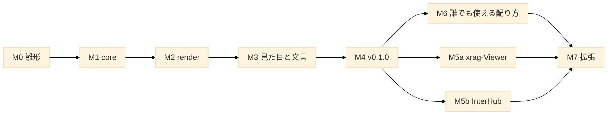

# 04. ロードマップ — マイルストーンと Issue の切り方

| 項目 | 値 |
| --- | --- |
| 文書 | XSheet 立ち上げ資料 04 |
| 更新日 | 2026-11-12 |
| 関連 | [03_source-map.md](03_source-map.md)・[05_quality.md](05_quality.md) |

## TL;DR
- M0 雛形 → M1 core → M2 render → M3 見た目と文言 → M4 ビルドと配布（v0.1.0）→ M5 利用者の切り替え（xrag-Viewer・InterHub）→ M7 拡張。M6 誰でも使える配り方（v0.2.0・[ADR-0003](adr/0003-universal-distribution.md)）は M5 の保留中に先に進める。
- 1 Issue＝1 回の指示で終わる大きさ。各 Issue の完了条件はテスト・型検査・ビルドが通ること。目視が要る Issue（M3・M5）は実機の確認を条件に足す。
- M1・M2 は機械的な移動が中心。判断が要るのは M2-3（`renderSheet` の切り出し）と M4（配布の形）と M5（利用者の切り替え）。

---

## M0 雛形

| Issue | 内容 | 完了の条件 |
| --- | --- | --- |
| M0-1 | リポジトリ・`package.json`（`type: module`・`exports` の枠）・`tsconfig`（strict・`verbatimModuleSyntax`・core は `lib` に DOM を入れない設定を分ける）・vitest＋jsdom・ESLint＋Prettier（`printWidth: 100`） | 空のテストが通る |
| M0-2 | `CLAUDE.md`（InterHub の立ち上げ資料の `CLAUDE.template.md` から）・`docs/` に本資料・ADR-0001（ライブラリ化の決定と D1〜D8） | 文書がそろう |
| M0-3 | 依存の固定：jszip 3.10.2・ssf 0.11.2 を完全一致で（2 週間以上前の版） | `npm ci` が通る |

## M1 core

| Issue | 内容 | 完了の条件 |
| --- | --- | --- |
| M1-1 | geom を写す（評価器・JSON・変換器・NOTICE）。`npm run geom:build` を作る | geom のテストが通る。JSON を作り直して差分 0 |
| M1-2 | core を写す（[03](03_source-map.md) §1）。import を geom へ付け替え、`import type` へ直す | core のテスト（32 ファイル。当初の見積もりは 36）が通る |
| M1-3 | 公開の範囲を決める（`index.ts`・`internal`）。DOM 非依存の確認（core だけを Node で import するテスト） | 公開 API のテスト（型の import を含む）が通る |

## M2 render

| Issue | 内容 | 完了の条件 |
| --- | --- | --- |
| M2-1 | 描画の部品を写す（`xlsx-grid`〜`xlsx-shapes`）。`ih-` → `xs-`（D6） | 部品のテスト（17 ファイル。perf の 1 は M2-3、CSS の 3 は M3-1）が通る。`ih-` が 0 件 |
| M2-2 | 文言を `messages` に（23 キー・ja/en の既定値。`data.noData` を足した） | `t(` が 0 件 |
| M2-3 | `spreadsheet.ts` から `renderSheet` を切り出す。状態をインスタンスへ。geom を動的 import に | 描画のテスト（`spreadsheet.*.render` を書き直したもの）が通る。2 つの表示を同時に作って壊し、blob URL・リスナの漏れが 0 |
| M2-4 | `renderWorkbook`（タブ・非表示シートの印・シートの切り替え・エラー表示） | テストが通る |

## M3 見た目と文言

| Issue | 内容 | 完了の条件 |
| --- | --- | --- |
| M3-1 | `style.css` を作り変数にまとめる（[02](02_architecture.md) §6）。CSS の静的テストを合わせる | テストが通る |
| M3-2 | `examples/`：素の HTML でファイルを選んで表示するページ（明暗の切り替え・CSP の meta 付き） | 実機で明るい表示・ダーク表示を目視 OK |
| M3-3 | `nonce` オプション。CSP の要件を文書に（`style-src`・`img-src blob:`） | `style-src 'nonce-…'` だけの CSP で examples が動く |

## M4 ビルドと配布（v0.1.0）

| Issue | 内容 | 完了の条件 |
| --- | --- | --- |
| M4-1 | Vite のライブラリモードで ESM（core・render・geom を別チャンク）＋`tsc --emitDeclarationOnly` で d.ts。`exports` に `types` を付ける | 別のプロジェクトから `import` して型検査とビルドが通る |
| M4-2 | 大きさの計測と上限（N6）・依存のライセンスの一覧・`NOTICE` が `dist` に入ることの確認 | 計測値を README に記録 |
| M4-3 | `CHANGELOG.md`・利用者向け README（使い方・CSP・CSS 変数・上限）・タグ `v0.1.0`（`dist/` を含める） | タグから git 依存で入れて動く |

## M5 利用者の切り替え

| Issue | 内容 | 完了の条件 |
| --- | --- | --- |
| M5a | xrag-Viewer：依存に追加し、自前の .xlsx の表示を `renderSheet` に置き換える（細かい手順は xrag-Viewer 側で決める） | xrag-Viewer のテスト・e2e が通る。実機の目視 OK |
| M5b | InterHub：.xlsx の読み取りと表示をライブラリへ置き換える。`.xls`（SheetJS）・タブ・バナーは InterHub に残す | InterHub のテスト・ビルドが通る。実機の回帰 TV-36〜TV-44 が OK |

## M6 誰でも使える配り方（v0.2.0）

[ADR-0003](adr/0003-universal-distribution.md)。2026-10-30 に ADR を accepted にした（Q1〜Q4 は提案のとおり。まず社内向けで、公開は別に決める）。

| Issue | 内容 | 完了の条件 |
| --- | --- | --- |
| M6-1 | 同期の道具：`tools/sync/interhub.json`（対応表・変換の規則・取り込み済みのコミット `943e4f0`）・`npm run sync:status`・`sync:patch`。写しの規約を 03 に書く | `sync:status` が 943e4f0 以降のグラフのコミットと行き先を一覧にする。InterHub に書き込まないことをテストで確かめる |
| M6-2 | 入口の層 `src/facade/`：`view`・`read`・`Viewer`。`source` の形（Blob・ArrayBuffer・型付き配列・Response・Promise）・`lang`・`theme`（ダークの値を style.css へ）・`css` の自動挿入・`height` の既定。`MESSAGES_KO`。`xsheet` の入口を全部に、`xsheet/core` を足す | テスト（jsdom）が通る。Node で `xsheet` を import して DOM に触れない |
| M6-3 | 単独版のビルド：`xsheet.min.js`（IIFE・大域 `XSheet`）・`xsheet.mjs`＋`xsheet-geom.mjs`・`xsheet.css`・`xsheet.d.ts`。遅れて読む部品の一覧からビルドの設定を作る。`npm run size` に上限を足す | 裸の import と `eval`・`new Function` が無い。jsdom で `XSheet.view` が合成の xlsx を描く。大きさが上限の内 |
| M6-4 | README の先頭を「3 行で始める」に。`docs/guide/`（React・Vue・Worker・CSP・ダーク）。`examples/standalone.html`（ビルド不要・`file://`）・`examples/esm.html` | 実機で standalone と esm の例を目視 OK（`file://` を含む） |
| M6-5 | 版を出す手順に単独版の zip（GitHub Release の添付）を足す。CHANGELOG 0.2.0。タグ `v0.2.0` | タグと zip から入れて動く（タグ・Release はユーザーの指示があるとき） |

## M7 拡張（候補・優先は利用者と決める）

| 候補 | 内容 |
| --- | --- |
| グラフ | **取り込み済み（2026-10-30・InterHub f035f68・v0.3.0）**。InterHub のグラフ（ADR-0031・ISSUE-101〜111。G1）を M6-1 の同期の道具で取り込み、描画を遅れて読む部品（`chart-draw`・`xsheet-chart.mjs`）にした。残りは InterHub の後続（G2 など）を同じ道具で取り込む |
| Web Components・埋め込み | `<x-sheet>` 要素、iframe と `postMessage` で置けるビューア（ADR-0003 の却下した案・§5） |
| 生の値 | `cellValue(r, c)`、`sheetToJson`・`sheetToCsv`（SheetJS の `sheet_to_json` に当たる） |
| Worker | 解析を Worker で動かす補助（core は DOM 非依存なのでそのまま動く。転送の型を用意する） |
| Excel との照合 | 罫線 E1〜E5・書式 F1〜F10 の暫定項目を Excel 16 で確かめる（[05_quality.md](05_quality.md) §3） |
| 表示の追加 | 揃えと折り返し・条件付き書式・テーブルのスタイル・フォント名・リッチテキストの部分書式・グラフの G2（面・散布図・データラベル・第 2 軸・組み合わせ） |
| 操作 | 検索・ハイライト・移動（`scrollToCell`）・位置の判定・拡大縮小・見出しを隠す：**API は決定**（2026-11-12・[ADR-0007](adr/0007-moobius-viewer-api.md)。Moobius の依頼 R1〜R7）。作業は下の「M7 Moobius の依頼」。残りはセルの選択とコピー |
| 公開 | npm 公開：**名前・入口は決定**（2026-11-05・[ADR-0006](adr/0006-npm-publish.md)。`@taekangkwon/xsheet`・`xsheet/internal` を外す）。残りは ADR-0006 §4（アカウントと Trusted Publisher の用意・名前の付け替え・`publish.yml`・0.5.0） |

### M7 Moobius の依頼（v0.4.1・v0.5.0・[ADR-0007](adr/0007-moobius-viewer-api.md)）

順は M7-1 → M7-3（v0.4.1）、M7-2 は実装より先、M7-4 → M7-5 → M7-6 → M7-7 → M7-9 の順に積み上げ、M7-8 は M7-1 の後ならいつでもよい。最後に M7-10（v0.5.0）。GitHub のマイルストーン `v0.4.1`・`v0.5.0` に入れた。

| Issue | GitHub | 内容 | 依存 | 完了の条件 |
| --- | --- | --- | --- | --- |
| M7-1 | [#25](https://github.com/TaekangKwon/XSheet/issues/25) | 曜日の書式（`aaa`・`aaaa`）。書式の字句の分解（`format-ja.ts`）・通し番号からの曜日 | — | テストが通る。Excel の `WEEKDAY` と同じ |
| M7-2 | [#26](https://github.com/TaekangKwon/XSheet/issues/26) | ADR-0007 の公開 API の型定義（`.d.ts`）を先に作る（Moobius に渡す） | — | `.d.ts` が型検査を通る |
| M7-3 | [#27](https://github.com/TaekangKwon/XSheet/issues/27) | v0.4.1 を出す（曜日・#23 の見た目） | M7-1 | タグと Release（ユーザーの指示で） |
| M7-4 | [#28](https://github.com/TaekangKwon/XSheet/issues/28) | 検索 `findText`（非同期・中断・上限） | — | テストが通る。実機で検索中もスクロールが止まらない |
| M7-5 | [#29](https://github.com/TaekangKwon/XSheet/issues/29) | ハイライト `setHighlights`（`span.xs-hits`・色の変数） | M7-4 | テストが通る。描き直しで残ることを目視 |
| M7-6 | [#30](https://github.com/TaekangKwon/XSheet/issues/30) | 今のヒットと移動・位置の判定（`focusHighlight`・`scrollToCell`・`cellAt`・`highlightAt`） | M7-5 | テストが通る。実機で遠い行・列への移動と判定 |
| M7-7 | [#31](https://github.com/TaekangKwon/XSheet/issues/31) | 拡大縮小 `setZoom`（寸法に倍率・見出しは掛けない・fit） | M7-6 | テストが通る。実機で 50%・75%・150% の罫線と判定 |
| M7-8 | [#32](https://github.com/TaekangKwon/XSheet/issues/32) | 和暦の書式と組み込みの書式の指定 `builtinDates`（先に日本語版 Excel で 27〜36・50〜58 の見え方を確かめる） | M7-1 | テストが通る。Excel で作ったファイルと同じ表示 |
| M7-9 | [#33](https://github.com/TaekangKwon/XSheet/issues/33) | 見出しを隠す `headers`・`SheetView.showSheet` | M7-7 | テストが通る。examples で目視 |
| M7-10 | [#34](https://github.com/TaekangKwon/XSheet/issues/34) | v0.5.0 を出す（examples・README・受け入れの確認） | M7-2・M7-4〜M7-9 | タグと Release（ユーザーの指示で） |
