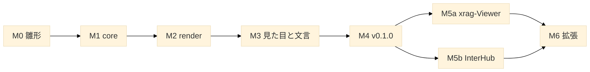

# 04. ロードマップ — マイルストーンと Issue の切り方

| 項目 | 値 |
| --- | --- |
| 文書 | XSheet 立ち上げ資料 04 |
| 更新日 | 2026-10-28 |
| 関連 | [03_source-map.md](03_source-map.md)・[05_quality.md](05_quality.md) |

## TL;DR
- M0 雛形 → M1 core → M2 render → M3 見た目と文言 → M4 ビルドと配布（v0.1.0）→ M5 利用者の切り替え（xrag-Viewer・InterHub）→ M6 拡張。
- 1 Issue＝1 回の指示で終わる大きさ。各 Issue の完了条件はテスト・型検査・ビルドが通ること。目視が要る Issue（M3・M5）は実機の確認を条件に足す。
- M1・M2 は機械的な移動が中心。判断が要るのは M2-3（`renderSheet` の切り出し）と M4（配布の形）と M5（利用者の切り替え）。

---

## M0 雛形

| Issue | 内容 | 完了の条件 |
| --- | --- | --- |
| M0-1 | リポジトリ・`package.json`（`type: module`・`exports` の枠）・`tsconfig`（strict・`verbatimModuleSyntax`・core は `lib` に DOM を入れない設定を分ける）・vitest＋jsdom・ESLint＋Prettier（`printWidth: 100`） | 空のテストが通る |
| M0-2 | `CLAUDE.md`（InterHub の立ち上げ資料の `CLAUDE.template.md` から）・`docs/` に本資料・ADR-0001（ライブラリ化の決定と D1〜D8） | 文書がそろう |
| M0-3 | 依存の固定：jszip 3.10.2・ssf 0.11.2 を完全一致で（2 週間以上前の版） | `npm ci` が通る |

## M1 core

| Issue | 内容 | 完了の条件 |
| --- | --- | --- |
| M1-1 | geom を写す（評価器・JSON・変換器・NOTICE）。`npm run geom:build` を作る | geom のテストが通る。JSON を作り直して差分 0 |
| M1-2 | core を写す（[03](03_source-map.md) §1）。import を geom へ付け替え、`import type` へ直す | core のテスト（36 ファイル）が通る |
| M1-3 | 公開の範囲を決める（`index.ts`・`internal`）。DOM 非依存の確認（core だけを Node で import するテスト） | 公開 API のテスト（型の import を含む）が通る |

## M2 render

| Issue | 内容 | 完了の条件 |
| --- | --- | --- |
| M2-1 | 描画の部品を写す（`xlsx-grid`〜`xlsx-shapes`）。`ih-` → `xv-` | 部品のテストが通る。`ih-` が 0 件 |
| M2-2 | 文言を `messages` に（22 キー・ja/en の既定値） | `t(` が 0 件 |
| M2-3 | `spreadsheet.ts` から `renderSheet` を切り出す。状態をインスタンスへ。geom を動的 import に | 描画のテスト（`spreadsheet.*.render` を書き直したもの）が通る。2 つの表示を同時に作って壊し、blob URL・リスナの漏れが 0 |
| M2-4 | `renderWorkbook`（タブ・非表示シートの印・シートの切り替え・エラー表示） | テストが通る |

## M3 見た目と文言

| Issue | 内容 | 完了の条件 |
| --- | --- | --- |
| M3-1 | `style.css` を作り変数にまとめる（[02](02_architecture.md) §6）。CSS の静的テストを合わせる | テストが通る |
| M3-2 | `examples/`：素の HTML でファイルを選んで表示するページ（明暗の切り替え・CSP の meta 付き） | 実機で明るい表示・ダーク表示を目視 OK |
| M3-3 | `nonce` オプション。CSP の要件を文書に（`style-src`・`img-src blob:`） | `style-src 'nonce-…'` だけの CSP で examples が動く |

## M4 ビルドと配布（v0.1.0）

| Issue | 内容 | 完了の条件 |
| --- | --- | --- |
| M4-1 | Vite のライブラリモードで ESM（core・render・geom を別チャンク）＋`tsc --emitDeclarationOnly` で d.ts。`exports` に `types` を付ける | 別のプロジェクトから `import` して型検査とビルドが通る |
| M4-2 | 大きさの計測と上限（N6）・依存のライセンスの一覧・`NOTICE` が `dist` に入ることの確認 | 計測値を README に記録 |
| M4-3 | `CHANGELOG.md`・利用者向け README（使い方・CSP・CSS 変数・上限）・タグ `v0.1.0`（`dist/` を含める） | タグから git 依存で入れて動く |

## M5 利用者の切り替え

| Issue | 内容 | 完了の条件 |
| --- | --- | --- |
| M5a | xrag-Viewer：依存に追加し、`src/viewers/xlsx.ts` の表の部分を `renderSheet` に置き換える。`src/lib/xlsx/` と `tests/lib/xlsx/` を消す。`source.css` で変数を対応づける（手順は InterHub `docs/guides/xlsx-library-plan.md` の L5・L6） | xrag のテスト・e2e（`network-csp`・`perf`）が通る。実機の目視 OK |
| M5b | InterHub：`spreadsheet.ts` の .xlsx 部分と `lib/xlsx/`・`viewers/xlsx-*` をライブラリへ置き換える。`.xls`（SheetJS）・タブ・バナーは InterHub に残す | InterHub のテスト・ビルドが通る。実機の回帰 TV-36〜TV-44 が OK |

## M6 拡張（候補・優先は利用者と決める）

| 候補 | 内容 |
| --- | --- |
| 生の値 | `cellValue(r, c)`、`sheetToJson`・`sheetToCsv`（SheetJS の `sheet_to_json` に当たる） |
| Worker | 解析を Worker で動かす補助（core は DOM 非依存なのでそのまま動く。転送の型を用意する） |
| Excel との照合 | 罫線 E1〜E5・書式 F1〜F10 の暫定項目を Excel 16 で確かめる（[05_quality.md](05_quality.md) §3） |
| 表示の追加 | 揃えと折り返し・条件付き書式・テーブルのスタイル・フォント名・リッチテキストの部分書式・グラフ |
| 操作 | `scrollToCell`・セルの選択とコピー・検索 |
| 公開 | npm 公開（ライセンスの決定・名前の確認・`provenance`） |
